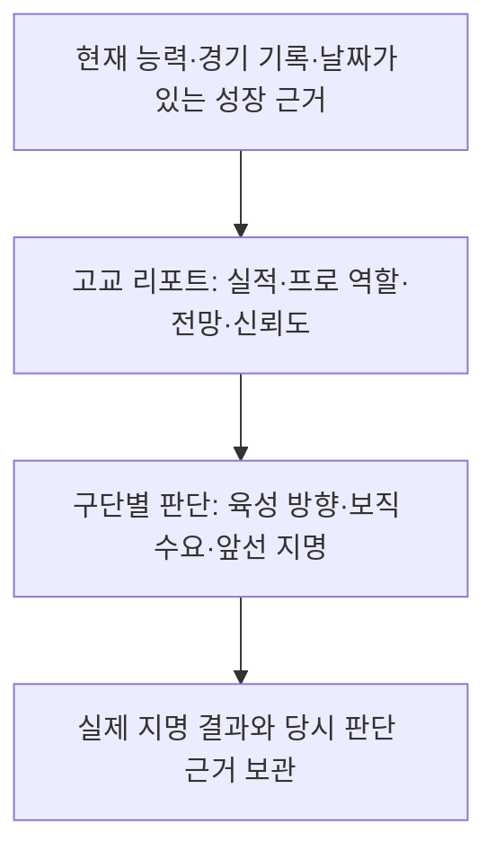

# 고교 선수 스카우팅·평가 체계 리서치와 적용안

작성·조사 기준일: 2026-11-06  
상태: **현재 데이터 기반 평가 엔진·리포트 1차 적용 완료 (`scouting-v1`). 역할 기량·보정 성과를 실제 평판에 연결했다. 등록·계약의 독립 모델 교체는 비교·검증 단계다.**  
연결 문서: [프로 평가 리서치](pro-scouting-evaluation.md), [드래프트·로스터](draft-and-roster.md), [프로 라이프](pro-life.md), [훈련](training.md), [야구 이벤트](baseball-events.md)


## 2026-11-06 구현 상태 · scouting-v1

문서의 단계적 적용 지침에 따라 **평가 자료층·계산·리포트·비교 경로**를 연결했고, 후속 사용자 합의로 실제 평판도 평가 기준으로 교체했다. [평판 계산과 영향 범위](reputation-evaluation.md)를 참고한다. 아래 리서치의 후속 단계 전체가 완료되었다는 뜻은 아니다.

**같은 날 드래프트 순서 후속 변경:** 고교 구단 순번은 커리어 시드·연도 기반 Fisher–Yates 추첨으로 결정하며 같은 해 모든 라운드에서 유지한다. 순서 조회는 실제 RNG를 소비하지 않는다. 선수 평가 80:10:10·인원 규칙은 유지하며, 구단 순번의 고정과 성장·성적에 따른 선수 예상 순위 변화는 구분한다. 저장된 결과는 당시 `club`·`slot`으로 표시하고 프로 신인의 전년도 성적 역순도 유지한다. [현행 드래프트 규칙](draft-and-roster.md)

| 항목 | 현재 적용 |
| --- | --- |
| 조회 | 고교·프로 대시보드의 선수 프로필 ‘선수 평가’, 고교 선수 카드·프로 개인 기록에서 열람 |
| 현재 능력 | 기본 능력과 1군 기준 툴 분리. 피로·부상 페널티는 기량 등급에 중복 적용하지 않음 |
| 실제 성적 | PA·BF·정수 아웃 기반 지표. 1/2군·포스트시즌 분리. 표본 0은 미측정 |
| 표본 보정 | 사건별 분모로 보정. 고교 사전 표본: 사건 60·안타 90·추가루타 150, 프로: 50·90·150 |
| 리그 기준 | 같은 시즌·레벨 합산 기록. 빈 시즌 초에는 전년도 동일 레벨 자료를 쓰고 기준 연도를 표시. 자료가 없으면 비교값을 만들지 않음 |
| 장기 성적 | 최근 3년의 사건 수·분모를 6:3:1로 합산. 빈 해는 제외하며 1군 100PA/30IP에서 2군 근거를 버리지 않음 |
| 현재/과거 | 월간·시즌 결산·소속/역할 변경·계약 검토·큰 능력 변화의 입력 자료를 보관. 구버전은 도입 시점부터 관찰 |
| 불변성 | 평가 조회는 난수·기록·평판·능력을 바꾸지 않음. 기준 계수·리그 환경·역할 가중치와 지명 당시 근거 보존 |
| 평판과 비교 모드 | 역할 기량·표본 신뢰도·레벨별 보정 성과는 실제 평판에 적용. 출전·계약의 새 독립 모델은 비교 단계 |

현재 관찰 입력은 선수마다 정기 평가 두 건과 입단·연간 결산·드래프트·소속/역할 변경·계약 검토의 보존 평가를 남긴다. 공통 기준표와 리그 환경은 공유하고 기록은 숫자 배열로 저장한다. 모든 선수에게 같은 기본 관찰을 적용하며 훈련 노출량을 스카우터 시찰 횟수로 표시하지 않는다.

**리포트 1차 검증(평판 연동 전):** 전체 258개 테스트, 이후 표시·전망·진로 경계 수정 영역 81개 재검증, 타입 검사·lint·빌드·실제 프로덕션 Worker 검증 통과. Worker에서 전 선수 월간 평가 생성, 지명 확장 평가와 프로 평가 상태가 순차 계산과 같음을 확인했다. 순수 계산 실험은 48개 능력 시드(개발 32/별도 16), 10/30/100/300PA, 다음 1,000PA를 비교했다. 선택한 프로 사전 표본은 별도 시드 OPS MSE 0.00549로 원시 성적 0.03904보다 작았다. 20만 타석의 조건부 BB·K·HR 분기도 확인했다. 이는 고정 상대 합성 실험이며 실제 승격·장기 계약·프로 성공을 검증한 결과가 아니다. [검증 자료](../validation/player-evaluation-v1.json), [실험 스크립트](../scripts/validate-player-evaluation.mjs).

**아직 전환하지 않은 부분:** 고교 지명식·신고선수 2점/TOP5·국가대표 TOP23, 프로의 등록·연봉 산식은 유지하되 평판 입력은 새 평가 기준으로 바뀌었다. 평판 80%의 현행 지명식과 평판 5%의 현행 계약식에도 간접 반영된다. 별도의 새 지명·승격·계약 모델 적용은 후속 단계다. 구종·타구 질·수비 기회·의학적 재발률처럼 엔진이 생성하지 않는 자료는 만들지 않는다.

공통 구현: [평가 계산](../lib/sim/player-evaluation.ts), [표본 보정](../lib/sim/evaluation-metrics.ts), [고정 기준·상대 전망](../lib/sim/evaluation-reference.ts), [성장 시나리오](../lib/sim/evaluation-projection.ts), [게임 연결·보관](../lib/sim/evaluation-lifecycle.ts), [화면](../app/components/player-evaluation.tsx).

고교에 적용한 내용은 같은 학년·졸업 연도·주력/겸업 분야의 순위, 대회별 완료 경기·상대 수·PA/BF, 보직 강점과 과제, 졸업 시점/프로 입단 후 3년차의 조건부 전망이다. 주력으로 활동하지 않는 보조 분야를 해당 선수 집단에 끼워 순위를 만들지 않는다. 기존 지명 리포트에는 당시 고교 평가를 추가로 보관한다. 드래프트 80:10:10 합산·신고·대표팀의 자격 규칙은 유지하지만 새 평판에 따라 예상/실제 순서와 평판 순위는 바뀔 수 있다.

프로 신인 생성의 입단 연도와 실제 평가 날짜의 연도를 구분한다. 평가 날짜가 졸업 이후라면 지난 졸업 시점의 능력치를 현재 능력으로 소급해 만들지 않는다.

## 1. 결론과 권장 방향

고교 선수는 **“고교에서 지금 얼마나 잘하는가”와 “프로에서 어떤 선수로 성장할 수 있는가”를 함께, 그러나 구분해서 평가**하는 편이 좋다. 같은 타율과 OVR이라도 학년, 강점의 구성, 출전량, 예상 포지션, 앞으로 필요한 훈련에 따라 지명 이유가 달라져야 한다.

프로 평가의 중심이 현재의 기여와 앞으로의 활용이라면, 고교 평가는 그 선수에게 프로 입단 후 육성 기회를 줄 이유를 설명하는 데 더 큰 비중을 둔다. 그렇다고 고교 성적을 없애거나 숨겨진 재능만으로 미래를 확정해서도 안 된다.

권장 구조는 다음과 같다.

| 평가 항목 | 답할 질문 | 게임에서의 의미 |
| --- | --- | --- |
| 현재 능력 | 지금 무엇을 잘하는가? | 기존 11개 능력치·OVR, 역할별 강점 |
| 고교에서의 실적 | 어느 경기에서 얼마나 보여줬는가? | 시즌 성적, 타석·상대한 타자 수, 대회별 근거 |
| 동급생 내 위치 | 같은 졸업 예정 연도의 선수와 비교하면 어떤가? | 학년별 성장 피드백과 유망주 목록 |
| 프로 역할 전망 | 입단 후 어떤 보직을 맡길 수 있는가? | 주 포지션 전망, 대안 보직, 육성 과제 |
| 성장 전망 | 어떤 조건에서 얼마나 좋아질 여지가 있는가? | 졸업 시점·프로 3년차의 조건부 전망 |
| 판단의 신뢰도 | 무엇을 확인했고 무엇이 아직 불명확한가? | 적은 표본, 관찰 부족, 역할 전환의 불확실성 |
| 구단의 선택 | 왜 우리 구단이 이 선수를 지명하는가? | 선수 가치와 구단별 지명 순서의 구분 |

**첫 단계는 기존 지명식을 유지하면서 고교 리포트를 확장하는 것이다.** 이후 성장·관찰 데이터를 축적하고, 새 평가 방식이 실제 프로 경력을 더 잘 설명하는지 검증한 뒤 드래프트에 연결한다. 신고선수와 청소년 국가대표의 기존 자격 조건은 별도로 보존한다.

## 2. 조사 범위와 근거의 성격

- **대상:** 한국·일본·미국의 고교 선수 및 고교 졸업 예정자의 프로 지명 평가. 미국의 쇼케이스는 측정과 관찰 방식의 참고 자료로 사용한다.
- **우선 자료:** 구단 공식 스카우팅 리포트·지명 발표·스카우트 인터뷰, 평가기관 자체 설명, USA Baseball의 행사 보고, 스카우트 출신 필자의 평가 척도 설명.
- **자료의 한계:** 지명 발표는 선수를 소개하는 자료라 긍정적 표현이 많다. 미지명 선수의 평가나 내부 감점표까지 공개한 자료로 해석하지 않는다. 쇼케이스 평가도 프로 구단의 내부 지명표와 같지 않다.
- **국가별 비교의 한계:** 한국은 삼성, 일본은 DeNA·소프트뱅크의 공개 사례를 중심으로 확인했다. 모든 구단이 같은 항목·가중치·등급을 쓴다는 뜻이 아니다.
- **시점:** 2026년 사례와 과거 방법론 자료를 구별한다. 2027년 신인에 관한 2026년 발표도 게시일 기준으로 표시한다. 과거 선수가 실제로 성공했는지를 당시 전망의 근거로 소급하지 않는다.
- **게임 범위:** 야구 능력, 훈련, 경기, 포지션, 야구 관련 인물과 진로만 다룬다. 학교 성적·가정환경·야구 밖 인간관계를 새 평가 능력치로 도입하지 않는다.
- **표기:** 3절은 외부 자료와 그 해석, 4~5절은 현재 저장소 분석, 6절 이후는 게임 설계 제안이다. 제안 수치나 화면 예시는 실제 구단의 공통 규정이 아니다.

## 3. 한국·일본·미국의 고교 선수 평가

### 3.1 한국: 현재 장점과 프로에서 필요한 육성을 연결한다

삼성의 「2021 삼성 신인선수 스카우팅 리포트」는 체격·장점·종합 평가·특이 사항을 나눠 제시한다. 고교 투수 이승현은 투구 동작과 제구, 변화구를 설명한 뒤 초기 불펜 활용과 체력 보완 후 선발 가능성을 연결한다. 고교 야수 김현준은 수비 판단을 강점으로 보고 파워와 순발력 보완을 주전 성장의 과제로 제시한다. 단순한 고교 성적 순위보다 **현재 도구 → 보완 과제 → 프로 역할**이라는 구조가 드러난다. [삼성 공식 리포트, 2020-09-24](https://www.samsunglions.com/fan/fan15.asp?act=view&idx=846867)

이재현 지명 발표는 고교 타격 기록과 함께 컨택·파워·송구·수비를 설명하고, 미래의 주전 유격수 확보를 지명 이유로 제시한다. 고교에서 투수로 던진 강한 공은 이 발표에서 유격수의 어깨를 설명하는 근거로도 쓰인다. 고교에서 여러 역할을 했다는 사실과 프로에서 맡길 역할은 구별할 수 있다. [삼성 이재현 지명 발표, 2021-08-27](https://www.samsunglions.com/intro/intro02.asp?act=view&idx=890057)

최근 사례인 2027년 신인 계약 발표에서도 고교 투수 김민훈에 대해 빠른 공의 구위와 제구를 언급한다. 다만 이 발표는 계약 선수 소개이므로, 구단의 전체 평가 항목이나 비중을 알아낼 수 있는 자료는 아니다. [삼성 2027년 신인 계약 발표, 2026-10-08](https://www.samsunglions.com/m/intro/intro02.asp?act=mview&idx=1017364)

**게임 적용 해석:** 고교 타격 순위·투수 성적과 별도로 “프로 유격수로 남을 수 있는가”, “선발을 소화할 체력이 있는가”를 설명하는 역할별 리포트가 필요하다. 공개 자료만으로 평판·성적·재능에 대한 한국 구단 공통 가중치를 정할 수는 없다.

### 3.2 일본: 육성 경로와 역할 전환을 구체적으로 설명한다

DeNA의 2023년 지명 자료는 고교 선수 다케다 리쿠를 외야수로 표기하면서 투타 양쪽의 장점을 설명한다. 육성 지명된 고교 선수 시미즈 마사나리는 투구 동작과 신체적 성장 여지를, 오가사와라 소는 장타력과 몸 만들기를 중심으로 소개한다. 같은 고교 지명자 안에서도 당장 확인한 강점과 입단 후 육성 과제가 다르다. [DeNA 2023 드래프트 공식 자료](https://www.baystars.co.jp/team/draft/2023/)

2026년 자료의 고교 내야수 호니시 마사노리 역시 장타력과 송구 능력을 미래 타자 전망에 연결한다. 해당 페이지의 대학·사회인 선수 평가는 고교 선수의 평가 근거로 섞지 않았다. [DeNA 2026 드래프트 공식 자료](https://sp.baystars.co.jp/team/draft/2026/)

소프트뱅크 스카우트 좌담회는 관찰이 제한됐던 시기의 영상 공유, 여름까지 달라지는 고교 선수 평가, 선수의 평가 순서와 실제 지명 순서가 달라질 수 있음을 설명한다. 한 번의 관찰로 결론을 고정하기보다 시점과 의사결정을 구분하는 사례다. [소프트뱅크 2021 스카우트 좌담회](https://www.softbankhawks.co.jp/team/draft/2021/zadankai.html)

**게임 적용 해석:** “고교에서는 중심타자, 프로에서는 다른 역할 검토”, “강점은 충분하지만 준비 기간 필요” 같은 판단을 표현할 수 있어야 한다. 다만 NPB의 육성선수 제도를 우리 게임 신고선수의 자격·성장·전환 규칙과 동일시하지 않는다.

### 3.3 미국: 측정, 실전 확인, 현재·미래 등급을 구별한다

Perfect Game은 쇼케이스 평가에서 달리기·수비·타격·실전 관찰을 함께 다룬다. 투수는 구속뿐 아니라 동작의 반복성, 제구, 변화구 감각을 살피고, 야수의 강한 송구도 정확성과 함께 판단한다. 훈련 상황의 좋은 수치가 경기에서 같은 가치로 이어지는지 확인하는 접근이다. [Perfect Game 평가 FAQ 2부, 2021-12-15](https://www.perfectgame.org/articles/View.aspx?article=18167)

같은 기관은 자체 등급과 졸업 연도별 순위를 운영하며, 측정치 중심 명단과 전망을 포함한 유망주 명단을 구분한다. 이 자체 등급을 MLB의 20–80 척도나 우리 게임의 재능 1–10에 곧바로 대응시키면 안 된다. 본문에 포함된 2024년 측정 표본도 미국 전체 고교 선수의 무작위 표본으로 볼 수 없다. [Perfect Game 평가 FAQ 3부, 2021-12-17; 본문에 2024년 자료 포함](https://www.perfectgame.org/Articles/View.aspx?article=18181)

USA Baseball의 2026 Breakthrough Series 보고에는 운동능력 검사와 Rapsodo 타격 측정, 구단·대학 관계자의 관찰, 평가 자료 제공이 함께 등장한다. 장비 데이터는 관찰을 보완하는 근거로 활용된다. [USA Baseball 2026 행사 보고](https://www.usabaseball.com/news/2026-breakthrough-series-by-the-numbers)

오리올스는 고교 선수를 일찍 추적하고 대학 기록과 다른 신뢰도로 판단한다고 설명했다. [오리올스 구단 인터뷰, 2020-06-09](https://www.mlb.com/orioles/news/featured/birdland-insider-drafting-the-future)

스카우트 출신 Kiley McDaniel의 설명에서 20–80은 메이저리그 평균 50을 기준으로 하며 현재와 미래 등급을 구분한다. 고교 선수의 현재 툴에 20이 붙어도 고교에서 최하위라는 뜻은 아니다. 같은 선수의 현재 20·미래 50은 프로 기준의 현재 기량과 전망을 따로 적은 것이다. 원문의 2014년 구속 등급표를 오늘의 기준으로 옮기지는 않는다. [FanGraphs, Scouting Explained: The 20-80 Scouting Scale, 2014-09-04](https://blogs.fangraphs.com/scouting-explained-the-20-80-scouting-scale/)

**게임 적용 해석:** 기존 능력치는 훈련 성과를 보여주는 수치로 유지하고, 고교 동급생 내 위치와 프로 기준의 역할 전망을 별도로 보여주는 구성이 적합하다. 실제 측정값이 없는 상태에서 구속·타구속도·송구 시간 등을 만들어 내는 방식은 필요하지 않다.

### 3.4 국가별 자료를 종합하면

아래는 위 공개 사례의 비교이며, 국가별 성향을 단정한 표가 아니다.

| 관점 | 한국 자료에서 확인 | 일본 자료에서 확인 | 미국 자료에서 확인 | 적용 방향 |
| --- | --- | --- | --- | --- |
| 현재 능력 | 컨택·파워·제구·수비 등 장점 | 투타 도구·동작·송구 등 장점 | 측정과 툴 관찰 | 11개 능력치를 역할에 맞게 해석 |
| 미래 역할 | 불펜 후 선발, 미래 주전 등 | 육성 과제와 역할 전망 | 현재·미래 등급 구분 | 현재 보직과 프로 예상 보직 분리 |
| 평가 근거 | 기록과 스카우팅 설명 | 여러 시점의 관찰과 영상 | 실전·쇼케이스·측정 | 근거와 평가 시점을 남김 |
| 의사결정 | 미래 보직 확보라는 지명 이유 | 평가 순서와 지명 순서 구별 | 기관의 순위와 구단 판단을 구별할 필요 | 선수 리포트와 구단 지명 이유 분리 |

세 나라에 통용되는 비공개 점수식은 확인하지 못했다. 따라서 “실제 한국식 60:40”, “일본식 기본기 보너스”, “미국식 데이터 보너스” 같은 국가별 가중치를 만들어 붙이지 않는다.

## 4. 현재 게임은 고교 선수를 어떻게 평가하는가

이 절은 조사일의 작업 트리를 읽은 결과다. 현재 개발 중인 변경도 포함될 수 있으므로 특정 커밋만의 상태를 재현한다고 주장하지 않는다. 주요 근거는 [엔진](../lib/sim/engine.ts), [밸런스](../baseball_balance_v0_4.json), [드래프트](../lib/sim/draft.ts), [기존 리포트](../lib/sim/scouting-report.ts), [자료형](../lib/sim/types.ts)이다.

### 4.1 OVR과 역할 점수는 이미 다르다

- 일반 야수 OVR은 컨택·파워·스피드·수비의 평균이다.
- 일반 투수 OVR은 구속·제구·변화구의 평균이다.
- 겸업 OVR은 타자 OVR과 투수 OVR의 평균이다.
- `roleScore`는 별도의 역할별 가중치를 사용한다. 스태미나·송구 등은 역할 해석에 필요하지만 일반 OVR과 같은 구성은 아니다.

따라서 OVR 하나로 유격수·포수·선발의 장래성을 모두 설명하기 어렵다. 고교 OVR을 없앨 필요는 없고, 역할 판단에 맞는 정보를 추가하면 된다.

### 4.2 평판과 드래프트의 실제 연결

고교의 기본 평판은 다음 구조다. 전문 선수용 추가 보너스는 이 고교 설명에서 제외한다.

```text
평판 R = clamp(0.60 × OVR + 0.40 × 성적 평가 P + 평판 보너스 B, 0, 100)
B에는 이벤트 등에 따른 reputationBonus와 해당 시 겸업 평판 보너스가 포함된다.
새 성적 평가가 없고 과거 평가도 없으면 P = 50을 사용한다.

재능 환산 T = (주 분야 재능 - 1) / 9 × 100
구단 적합도 F = 0.50 × 역할 점수 S + 0.50 × 구단 수요 N
실제 지명 점수 D = 0.80 × R + 0.10 × T + 0.10 × F
```

평판이 상한·하한에 걸리지 않고 현재 평판이 이 식으로 갱신된 상태라면 다음처럼 풀어 쓸 수 있다.

```text
D = 0.48 × OVR + 0.32 × P + 0.10 × T
  + 0.05 × S + 0.05 × N + 0.80 × B
```

즉 **평판 80%라는 표기 안에 현재 능력과 경기 성적이 이미 들어 있다.** 새 평가를 만들 때 OVR·성적·평판을 각각 독립적인 근거로 더하면 중복 반영이 커진다. 평판 보너스 +10도 상한에 걸리지 않는 구간에서는 지명 점수에 +8의 영향을 줄 수 있다. 이벤트 평판은 현재 단순한 인지도 장식이 아니다.

현재 구단 수요는 실제 프로 로스터의 결원을 읽는 방식이 아니라 드래프트 RNG로 생성한다. 같은 보직을 지명하면 수요를 낮춘다. 따라서 리포트의 “구단 수요”를 실제 프로팀의 특정 선수가 은퇴해서 생긴 필요라고 설명할 근거는 없다.

### 4.3 경기 성적은 표본 보정을 거치지만 맥락 보정은 제한적이다

`updateReputation`의 주요 흐름은 다음과 같다.

1. 타자는 OPS, 투수는 `(3 × SO − 3 × BB − 12 × HR) / BF`를 사용한다.
2. 기록이 적으면 전체 집계 기록에서 구한 기준값 쪽으로 줄인다. 타자는 PA, 투수는 **아웃 수**를 표본량으로 사용하며 사전 표본 크기는 각각 60이다. 투수의 60은 60타자가 아니라 20이닝이다.
3. 타격·투구 평가군 안에서 각각 표준화하고, 주 역할에 해당하는 값을 선수에게 배정한다.
4. 두 분야의 표준화 값을 합쳐 상대 순위를 0–100 성적 평가로 바꾼다. 동률에는 중간 순위를 적용한다.
5. 새 출전 기록이 없으면 종전 성적 평가를 보존한다. 진급 직후의 값도 새 학년에서 이미 검증한 성적이라는 뜻은 아니다.

이미 작은 표본의 과대평가를 줄이려는 장치가 있다. 다만 상대 학교·상대 선수의 수준, 대회 종류, 학년별 기준을 별도로 조정하지 않는다. 겸업도 성적 평가의 중심은 `primaryRole` 쪽이다. 투수 공식은 게임 내부 성적 점수이며 실제 FIP라고 표시할 수 없다.

### 4.4 재능은 정확한 내부 성장 계수다

현재 타격·투구 재능은 1–10이고 훈련 성장에 관여한다. `talentExposure`가 누적되면 재능을 미상 → 낮음·보통·높음 → 정확한 수치로 보여준다. 이 노출량은 해당 분야의 훈련 경험으로 늘며 **스카우터의 시찰 횟수가 아니다.**

현재 드래프트는 이 내부 재능값을 직접 사용한다. 플레이어에게 아직 재능이 공개되지 않았어도 지명식은 정확한 값을 안다. 이는 게임의 현재 단순화이며, 공개 리포트의 현실성을 높인다고 이미 관찰 기반 평가가 구현되어 있다고 설명하면 안 된다.

또한 재능은 성장 속도에 관한 값이지 “미래 OVR의 상한”, “프로 성공 확률”, “스카우팅 미래 등급” 자체가 아니다. 세 값을 같은 숫자로 복사하지 않는 것이 좋다.

### 4.5 기존 리포트는 지명 당시의 설명을 보관하는 좋은 출발점이다

`createScoutingReport`는 지명 보직에 맞는 능력 중 상위 두 개를 장점으로 설명하고, 평판·구단 적합도·일부 재능 및 출전 경험을 지명 이유로 덧붙인다. 낮은 능력 하나를 중심으로 육성 과제도 제시한다. 능력치와 기록의 스냅샷을 보관하는 구조가 이미 있다.

다만 현재 장점의 순위는 전달받은 고3 후보 중 해당 투타 분야 및 겸업 선수 기준이다. 신고선수의 전 학년 TOP5와 모집단이 다르다. 성장 전망 구간, 관찰 근거, 평가 신뢰도, 복수의 프로 역할 전망도 아직 별도 평가로 저장하지 않는다.

### 4.6 지명·예상·진로에서 보존해야 할 현재 동작

| 구분 | 현재 확인한 동작 | 새 리포트에서 지킬 점 |
| --- | --- | --- |
| 지명 후보 | 고3 선수 | 고1·고2 유망주 순위를 올해 지명 순위로 표시하지 않음 |
| 지명 보직 | 출전 자격 중 주 역할과 같은 투타 분야에서 검토 | 겸업의 반대 분야까지 이미 비교한다고 설명하지 않음 |
| 고교 구단 순번 | 커리어 시드·연도 기반 추첨, 연도 내 전 라운드 동일 | 조회·훈련으로 순번을 다시 뽑지 않고 선수 평가 순위와 구별 |
| 예상 드래프트 | 실제 선택 모델에 현재 상태를 넣고 RNG를 복제 | 조회로 실제 RNG나 결과를 바꾸지 않음 |
| 예상의 의미 | 지금 지명한다면 나오는 순서 | 시즌 말 지명 확률이나 확정 예약으로 설명하지 않음 |
| 결과 공개 | 이미 계산된 결과를 공개 | 결과 확인·리포트 열기로 재추첨하지 않음 |
| 과거 결과표 | 저장된 지명 결과의 구단·순번에서 머릿글 복원 | 현재 추첨 순서로 과거 결과를 재배열하지 않음 |
| 정상 고교 종료 UI | 지명자는 프로 입단, 대상 미지명자는 신고 입단·은퇴, 나머지는 은퇴 | 대학 진학 버튼이 이미 일반 종료 화면에 있다고 쓰지 않음 |

대학·입단 테스트에 관한 엔진 경로와 대학 커리어 화면은 존재한다. 그러나 그 존재와 정상 고교 종료 화면에서의 선택 가능 여부는 다르다. 진학 경로의 재노출은 별도 기획 사항이다. [지명 계산](../lib/sim/draft.ts), [종료 처리](../lib/sim/draft-outcome.ts), [진로 UI](../app/components/career-continuation.tsx)

## 5. 가진 데이터와 부족한 데이터

### 5.1 지금 활용할 수 있는 근거

| 현재 데이터 | 활용 가능한 평가 | 제한 |
| --- | --- | --- |
| 컨택·파워·스피드·수비 | 타격·주루·수비의 현재 강점 | 능력치가 실제 측정값이나 성적 그 자체는 아님 |
| 구속·제구·변화구 | 투수의 현재 강점과 보완점 | `velocity`도 점수이며 km/h가 아님; 구종별 능력은 없음 |
| 스태미나·회복력·송구·BQ | 역할 적합성·몸 관리·야구 판단의 게임 내 근거 | BQ로 실제 성격·인성·학업을 추정하지 않음 |
| 타격 PA·AB·H·2B·3B·HR·BB·SO 등 | 타율·OPS·삼진율·볼넷율, 장타 구성 | 타구속도·발사각·스윙 판단은 직접 관찰 불가 |
| 투구 BF·아웃·H·BB·SO·HR·R·ER | 탈삼진·볼넷·피홈런 비율, 이닝과 실점 | 구종별 결과·투구 위치·헛스윙률은 없음 |
| 현재 시즌 경기 날짜·상대·대회·라운드·박스스코어 | 대회별 기록, 출전 기회, 평가 시점 | 실제 스카우터가 현장에 왔는지는 저장하지 않음 |
| 학년·소속·포지션·출전 자격·겸업 상태 | 동급생 비교와 보직 검토 | 고교 선수에게 정확한 생년월일·성숙도가 있는 것은 아님 |
| 피로·부상 상태와 기간 | 현재 출전 가능 여부, 복귀 맥락 | 몸 상태만으로 장기 의학적 위험을 확정하지 않음 |
| `initialStats`, 연도별 `career` | 시작 대비 변화, 연간 능력·성적 비교 | 모든 선수의 주간별 능력·훈련·이벤트 원인이 남는 것은 아님 |
| 지명 리포트 스냅샷 | 당시 평가와 입단 이후의 비교 | 구버전 세이브에 없는 당시 근거를 현재 값으로 채우지 않음 |

### 5.2 현실 리포트의 항목을 그대로 복사하면 생기는 문제

- **체격·좌우 유형:** 현재 고교 선수 자료형에 키·체중·생년월일·투타 손잡이 정보가 충분히 모델링되어 있지 않다. 화면의 고정 문구는 선수별 데이터의 근거가 아니다.
- **구속·타구속도·회전수:** 구속 능력 70을 150km/h로 바꾸거나 파워 80을 특정 타구속도로 바꾸는 변환 근거가 없다.
- **실전 파워와 원천 파워:** 현재 `power`와 HR 결과를 나란히 설명할 수는 있지만 독립적으로 측정한 두 개의 파워 등급이라고 표시할 수 없다.
- **수비·주루 세부 성과:** 송구 시간, 수비 범위 좌표, 도루 기회·성공률 등은 현재 기록만으로 충분히 산출할 수 없다. 능력치 기반 설명과 실전 성과를 구분한다.
- **땅볼 성향:** 현재 GB·FB는 타구 전체를 빠짐없이 분류한 데이터가 아니다. 이를 전체 타구의 GB%·FB%로 표시하지 않는다.
- **상대 수준:** 완료 경기의 상대 팀은 알지만 모든 타석의 투타 맞대결과 당시 상대 능력 스냅샷이 보존되는 것은 아니다. 현재 성장한 로스터로 지난봄 상대 수준을 소급 계산하면 미래 정보가 섞인다.
- **누적 관찰:** 연도가 넘어가면 시즌 합계는 보관되지만 모든 과거 경기·타석·시찰 내역이 그대로 남는 구조는 아니다.
- **성장 원인:** 훈련 티켓, 출전, 전학 적응, 부상, 이벤트가 성장에 영향을 준다. 연간 능력 상승만으로 타고난 재능을 정확히 역산할 수 없다. 초기 고2·고3 NPC에는 생성 시 사전 훈련도 적용된다.

### 5.3 데이터 추가 우선순위

| 우선순위 | 제안 데이터 | 필요한 이유 |
| --- | --- | --- |
| 1 | 평가 날짜·대상 졸업 연도·비교 집단·모델 버전 | 순위와 전망의 의미를 고정 |
| 1 | 리포트 생성 당시의 능력·성적·건강·보직 스냅샷 | 이후 성장으로 과거 평가가 바뀌는 문제 방지 |
| 2 | 전 선수의 정기 능력 스냅샷과 기간별 훈련·부상·이벤트 변화 요약 | 플레이어와 NPC에 같은 성장 관찰 기준 적용 |
| 2 | 경기 시점 상대 수준과 경기별 역할·출전량 | 상대·포지션 맥락을 시간에 맞게 평가 |
| 3 | 관찰 날짜·분야·근거 유형을 가진 시찰 기록 | 훈련 노출량과 스카우터 지식을 분리 |
| 3 | 구단별 육성 방향·보직 전망 | 임의 수요를 장기 구단 판단으로 발전 |
| 후순위 | 구종·실측·좌우·세부 수비 자료 | 그 데이터가 실제 경기·육성에 쓰일 때 추가 |

## 6. 권장 평가 모델

### 6.1 세 가지 숫자의 의미를 분명히 한다

| 표시 | 기준 | 권장 용도 |
| --- | --- | --- |
| 능력치·OVR | 기존 게임의 1–100 능력 척도 | 훈련으로 무엇이 달라졌는지 표시 |
| 고교 내 순위·백분위 | 해당 시즌·학년·분야의 선수 집단 | 같은 단계의 경쟁자와 비교 |
| 프로 기준 현재·미래 평가 | 게임 속 목표 프로 리그의 고정된 기준 집단 | 입단 후 역할의 수준과 전망 설명 |

고교 상대평가의 평균을 50으로 만든 숫자를 MLB식 50과 같은 의미로 쓰지 않는다. 프로 리서치에서 제안한 20–80 표시를 채택한다면 **게임 내 프로 1군 기준**임을 명시하고, 고교와 프로에서 같은 기준표·버전을 공유한다. 한국 게임 선수의 숫자를 실제 MLB 평균과 직접 비교한 등급이라고 부르지 않는다.

현재는 고교 OVR과 같은 학년 내 위치를 기본 화면에 두고, 프로 역할 전망은 상세 리포트에 배치하는 편이 좋다. 프로 기준 환산표는 프로 월드의 충분한 표본으로 보정하기 전에는 정밀한 수치 대신 역할 설명으로 시작한다.

### 6.2 능력치에서 역할별 질문을 만든다

아래는 새 능력치를 추가하는 표가 아니라 기존 능력치를 읽는 방법이다. 실제 포지션 변경은 별도 선택과 출전 자격 규칙을 따른다.

| 검토 역할 | 우선 확인할 근거 | 리포트가 설명할 질문 |
| --- | --- | --- |
| 선발 | 구속·제구·변화구·스태미나·회복력, BF·이닝·BB% | 긴 이닝의 기반이 있는가, 무엇을 먼저 보완해야 하는가? |
| 불펜 | 주력 투구 능력·제구·회복력, 투구 성과 | 짧은 이닝에서 강점을 살릴 수 있는가? |
| 포수 | 수비·송구·BQ와 타격 능력 | 포수 자격과 수비 기반이 있는가, 타격이 어느 정도 필요한가? |
| 유격수·중견수 등 | 출전 자격, 수비·스피드·송구와 타격 | 현재 포지션을 프로에서도 유지할 근거가 있는가? |
| 코너 야수 | 컨택·파워, 해당 수비·송구, 실전 타격 | 타격이 주된 가치가 될 때 필요한 보완점은 무엇인가? |
| 겸업 | 투타 각각의 현재 능력·기록·성장 전망 | 두 역할 유지와 한 분야 집중 중 어느 경로를 검토할 수 있는가? |

현재 `primaryRole`은 게임의 분류 기준이다. 고교에서 마무리라는 이유만으로 프로 마무리가 확정되는 것은 아니며, 고교 유격수라는 이유만으로 미래 유격수 등급을 보장하지 않는다. 반대로 출전 자격도 없는 포지션을 리포트 한 줄로 자동 부여하지 않는다.

### 6.3 동급생 비교와 지명 후보 비교를 분리한다

- 고1·고2의 성장 피드백은 같은 졸업 예정 연도와 같은 분야를 우선 비교한다.
- 그해 실제 드래프트 보드는 고3 후보 집단을 유지한다.
- 전 학년 능력 TOP5와 전 학년 평판 TOP23은 기존 자격 판정용 집단을 유지한다.
- “전국 12위”처럼 대상이 없는 표현 대신 “2029년 졸업 예정 타자 중 컨택 12위 / 420명”처럼 모집단을 함께 적는다. 인원은 예시이며 실제 데이터에서 계산한다.
- 고교 자료에 없는 생년월일을 학년에서 지어내어 월령 보너스를 주지 않는다. 첫 단계에서는 학년을 육성 단계의 대리 변수로만 사용한다.

기준 집단이 바뀌면 순위도 달라질 수 있다. 선수 능력이 그대로인데 학년 진급이나 후보 구성 변화로 순위가 달라진 경우를 능력 하락으로 설명하지 않는다.

### 6.4 성적에는 출전량과 평가 근거를 함께 붙인다

새 리포트는 타격의 PA, 투구의 BF와 아웃 수를 기본으로 기록한다. 투수의 비율 통계는 주로 BF를 분모로, 이닝 소화량은 아웃 수를 기준으로 구분한다. 삼진율이 좋다는 것과 긴 이닝을 던졌다는 것은 다른 근거다.

작은 표본의 보정은 현재 방식에서 출발할 수 있다. 다만 지표별로 분모를 맞추고, 보정값은 공식 기록을 바꾸지 않는 내부 평가값으로 사용한다. 다음은 원리 설명용 제안 예시다.

```text
예: 20타석에서 볼넷 4개 → 공식 BB% = 20.0%
비교 집단 BB% = 8.0%, 사전 표본 = 60타석이라고 가정
평가용 보정 BB% = (4 + 60 × 0.08) / (20 + 60) = 11.0%

화면: 20 PA · BB 4 · 공식 BB% 20.0% · 아직 확인할 타석이 적음
내부 평가: 보정된 11.0%를 다른 근거와 함께 검토
```

이는 현재 OPS 보정식을 BB% 방식으로 이미 교체했다는 뜻이 아니다. 지표별 사전 표본은 향후 시뮬레이션으로 조정한다. 0타석·0BF는 성적 0점 대신 **평가할 경기 근거 없음**으로 표시한다.

학교의 탈락으로 출전량이 적어진 선수에게 학교 성적을 개인 실력 감점으로 다시 적용하지 않는다. 대회 우승, 결승 진출, 국가대표 경력은 기록의 맥락이 될 수 있지만 그것만으로 컨택·제구가 입증되었다고 판단하지 않는다.

### 6.5 대회·상대 수준은 과장 없이 단계적으로 반영한다

**현재 데이터만 사용하는 단계:** 완료 경기의 박스스코어로 대회별 PA·BF·성적을 집계하고 “어느 대회에서 보여줬는가”를 설명한다. 몰수 경기처럼 실제 출전 근거가 없는 결과는 개인 실적에 넣지 않는다. 대회 이름만으로 성적에 고정 배수를 곱하지 않는다.

**데이터를 추가한 단계:** 경기 당시 상대 수준을 저장한 뒤 상대의 투타 강도와 선수의 성과를 함께 검증한다. 박스스코어만 있으면 팀 단위 근사임을 명시하고, 정확한 투타 맞대결 보정은 타석별 상대 기록이 있을 때 검토한다.

이 게임의 고교 정규리그는 팀별 전·후반기 각 9경기이며 토너먼트 출전은 추가로 달라진다. 따라서 프로의 수백 타석 기준을 그대로 가져오면 고교 선수 대부분이 끝까지 평가 불가로 남을 수 있다. 표본 기준은 [게임 일정](season-calendar.md)에 맞춰 정해야 한다.

### 6.6 성장 전망은 조건과 불확실성을 함께 쓴다

전망의 공통 시점은 **고교 졸업 시점**과 **프로 입단 후 3년차**를 권장한다. 서로 다른 학년에게 모두 “오늘부터 3년 뒤”만 제시하면 고1의 졸업 시점과 고3의 프로 경력을 비교하게 된다. 프로 입단 후에는 프로 리포트의 다음 시즌·3년 전망으로 이어간다.

전망에는 현재 능력, 관찰된 성장 변화, 훈련 조건, 건강·출전 상태, 보완해야 할 역할 능력을 사용한다. “성장이 순조로운 경우”, “현재와 비슷한 훈련을 이어가는 경우”, “보완이 늦어지는 경우”를 나누되 이를 검증되지 않은 성공 확률로 표시하지 않는다.

정확한 재능값을 미래 등급으로 치환하면 현재의 비공개 값이 다시 노출된다. 관찰 기반 전망을 도입하는 단계에서는 시뮬레이션이 가진 실제 재능과 스카우팅 평가가 가진 추정치를 별도로 관리해야 한다. 플레이어가 훈련으로 알아낸 자기 재능이 모든 구단에 자동 공유되는지도 별도 규칙으로 정한다.

처음에는 “선발 육성 검토, 제구·체력 보완 필요”처럼 역할과 조건을 제시한다. 1년 뒤 1군, 3년 뒤 주전 같은 소요 기간은 실제 성장·프로 경쟁 시뮬레이션으로 검증한 뒤 붙인다. 능력 상승 이벤트도 성장의 일부이며, 관찰된 급상승을 모두 타고난 재능 상승으로 잘못 해석하지 않는다.

### 6.7 신뢰도는 능력과 별도의 정보다

| 상태 | 리포트 표현 | 지명 판단에서의 취급 |
| --- | --- | --- |
| 경기에 거의 나오지 않음 | 현재 능력의 장점은 있으나 실전 근거 부족 | 0점 확정 대신 검토 필요 |
| 한 경기에서 큰 활약 | 좋은 출발, 반복 확인 필요 | 즉시 최고 전망으로 고정하지 않음 |
| 여러 상대에게 반복 확인 | 강점이 여러 경기에서 나타남 | 같은 수준의 평가에 대한 확신 증가 |
| 부상 복귀 직후 | 복귀 후 표본이 적음 | 이전 기록과 복귀 후 근거 구분 |
| 보직 전환 직후 | 새 역할에서 확인할 부분이 남음 | 기존 포지션 실적을 전부 새 역할 실적으로 간주하지 않음 |

관찰 횟수 증가 자체는 능력 상승도, 평판 상승도 아니다. 관찰 결과 기존의 좋은 평가가 강화될 수도 있고 수정될 수도 있다. 신뢰도 낮음도 무조건 점수 감점으로 구현하지 않는다. 그러면 출전 기회가 적은 유망주를 이중으로 불리하게 만들기 쉽다.

실제 시찰 로그를 도입하기 전에는 “스카우터 3회 관찰” 대신 “평가에 사용한 완료 경기 3경기”라고 표시한다. 구단별 관심을 표시하더라도 근거 없이 실제 영입 확률을 붙이지 않는다.

## 7. 드래프트·신고선수·국가대표에 연결하는 방법

### 7.1 선수 평가와 구단의 지명 결정을 두 단계로 나눈다

**선수 평가:** 현재 강점, 고교 성적, 성장 전망, 프로 예상 보직, 불확실성을 정리한다. 이 단계에서는 어느 구단이 뽑을지와 무관한 공통 리포트를 만든다.

**구단의 결정:** 공통 평가에 해당 구단의 육성 방향과 보직 수요를 붙여 지명 후보를 비교한다. 단기 활용을 원하는 구단과 육성 기간을 감수할 구단이 같은 선수를 다르게 선택할 수 있게 한다.



처음에는 현재 `D`를 그대로 사용하고 이 구조로 이유만 정리한다. 이후 새 선택 모델을 만들 때에는 OVR·성적이 섞인 평판을 다시 독립 항목으로 더하지 않는다. 현재 평판을 계속 사용할지, 새 평가의 요약값으로 바꿀지는 이벤트·대표팀·신고선수 영향까지 함께 검증한 뒤 결정한다.

기존과 다른 가중치가 필요하더라도 실제 구단의 공식 비율이라고 이름 붙이지 않는다. 미래 전망 비중을 높인 여러 후보 모델을 같은 월드에서 비교하고, 성적 좋은 완성형과 덜 완성된 유망주가 모두 선택될 수 있는지 확인해 결정한다.

고교 단계에서는 프로 월드의 구체적 선수 구성이 아직 연결되어 있지 않을 수 있다. 실제 로스터 기반 수요를 쓰려면 고교 때부터 지속되는 구단 전략·로스터 자료가 먼저 필요하다. 그전에는 현재 수요를 게임상의 보직 선호로 설명한다.

### 7.2 겸업의 평가 개선은 별도 변경으로 다룬다

향후에는 투수 전망과 타자 전망을 따로 비교하고, 두 분야 유지와 한 분야 집중의 장단점을 제시하는 편이 좋다. 그러나 현재 지명식은 주 역할과 같은 분야만 검토하므로 리포트만 확장하면서 실제로 반대 분야로 지명된 것처럼 쓰면 안 된다.

새 모델을 도입한다면 두 분야의 OVR·가치를 단순 합산하지 않는다. 같은 선수의 한정된 훈련·출전 시간을 두 번 사용한 것처럼 평가하기 때문이다. 가장 적합한 주 역할을 먼저 정하고, 겸업으로 실제 확보할 수 있는 추가 기회를 따로 검토한다. 단순히 주 역할 표시를 바꿔 평가를 반복해서 유리한 결과를 뽑는 문제도 확인해야 한다.

### 7.3 신고선수 자격과 전환은 기존 기조를 유지한다

사용자가 정한 정책은 유지한다.

> 지명권과 평가 2점 이내 또는 개별 능력 전국 TOP5이면 신고선수 제안을 받을 수 있다. 성장 90%·출전 불이익으로 시작하고, 2군 성과를 달성한 정식 전환 이벤트로 제한을 해제한다.

현재 판정의 구체적인 의미는 다음과 같다. [판정 코드](../lib/sim/draft-outcome.ts), [프로 라이프 정책](pro-life.md)

- 정상 고교 드래프트가 끝난 고3 미지명 선수에게 판정한다.
- 실제 지명된 선수들을 **구단 수요 50의 중립 평가**로 다시 비교하고, 그중 가장 낮은 평가와의 차이를 본다. 실제 마지막 순번 선수의 당시 구단별 점수와 비교하는 방식은 아니다.
- 점수 차이는 `max(0, 지명자 중 최저 중립 평가 − 내 중립 평가)`로 계산한다. 이 값이 2 이내면 해당 경로의 자격을 충족한다.
- 개별 능력은 11개 능력 중 하나라도 해당하면 된다. 주 역할과 관계없는 능력을 임의로 제외하지 않는다.
- 전국 TOP5는 고3만이 아니라 프로·대학 모드가 아닌 전 학년 선수 집단이다. 순위는 자신보다 높은 선수 수에 1을 더하므로 동률이면 5명보다 많은 선수가 조건을 충족할 수 있다.
- 90%는 성장 배율이다. 입단 순간 모든 능력을 90%로 깎는 뜻이 아니다. 좋은 리포트가 나왔다고 출전 불이익을 미리 없애거나 정식 전환을 자동 처리하지 않는다.

새 리포트의 프로 등급이나 동급생 백분위를 이 판정에 대입하지 않는다. 특히 지명 점수의 척도를 바꾸면 같은 ‘2점’도 의미가 달라진다. 향후 지명 모델을 교체할 때는 기존 중립 점수와 새 점수의 경계 부근 분포를 비교하고, 자격 정책을 유지하는 변환을 별도 설계해야 한다. 첫 단계의 문서·리포트 개선에는 점수식 변경을 포함하지 않는다.

### 7.4 청소년 국가대표 TOP23도 별도의 정책이다

현재 [국가대표 이벤트 판정](../lib/sim/event-system.ts)의 `tryNationalEvent`는 고교 모드 고2·고3, 평판 존재, 진행 상태 등을 확인한 뒤 전 학년 선수의 평판 상위 23명 안에 있는지 검사한다. 고3은 드래프트 이전이며 같은 학년의 소집 이벤트 반복도 제한한다.

신고선수 TOP5와 달리 여기서는 평판 내림차순·ID 순으로 정렬한 **정확히 앞 23명**을 사용한다. 동률을 모두 포함하는 순위 규칙으로 무심코 바꾸지 않는다.

이는 사용자가 정한 게임 자격 규칙이며 실제 국가대표 선발 방식이라고 설명하지 않는다. 새 유망주 순위나 프로 미래 평가 TOP23으로 교체하지 않는다. 대표팀 이벤트에서 받은 능력·평판 보상은 선택 결과가 확정된 뒤 기존 방식으로 반영하고, 실제로 시뮬레이션하지 않은 국제대회 타석·이닝을 리포트에 만들어 넣지 않는다.

### 7.5 훈련·선택 이벤트와 충돌하지 않게 한다

- 선택 전에는 효과를 숨기고 선택 후 결과를 보여주는 기존 방식과 확률을 유지한다.
- 일반 능력 상승을 티켓 5개 기준 3~4주 훈련량에 맞추려는 이벤트 밸런스 기조와, 특별한 대폭 상승·각성 효과는 별도 영역이다. 평가 리포트 개편을 이유로 보상을 축소하지 않는다.
- 이미 확정된 능력 상승은 실제 능력에 반영한다. 이후 리포트가 갱신되면 변화한 능력을 설명하되, 미결정 선택지의 결과나 각성 여부를 미리 노출하지 않는다.
- 실제 능력 상승과 “스카우터가 새로 알게 된 장점”을 같은 효과로 취급하지 않는다. 스카우트 등장만으로 능력치가 자동 증가하지 않는다.
- 평가 열람이나 스카우트 대사 반복으로 평판·관찰량·지명 확률을 무한히 얻을 수 없게 한다.

### 7.6 진학 평가를 확장한다면 야구 경로에 한정한다

추후 대학 진학 경로를 정상 종료 선택에 다시 연결할 경우, 야구 측면의 출전 기회·보완할 능력·추가 육성 시간을 설명할 수 있다. 학교 성적이나 야구 밖 인간관계를 요구하는 새 시스템을 붙일 필요는 없다.

다만 리포트에 “대학에서 출전을 쌓는 경로 검토”라고 쓰는 것과 실제로 선택 가능한 진로를 제공하는 것은 구분한다. 해당 경로가 열려 있지 않은 화면에서는 선택할 수 없는 제안을 행동 버튼처럼 보여주지 않는다.

## 8. 권장 리포트 구성과 예시

### 8.1 한 화면에서 읽는 순서

| 순서 | 내용 | 예시 표현 |
| --- | --- | --- |
| 1 | 평가 시점과 대상 | 고2 · 2029년 졸업 예정 · 2028-08-01 평가 |
| 2 | 현재 능력과 동급생 위치 | 컨택이 강점, 같은 학년 타자 중 상위권 |
| 3 | 실제 경기 근거 | 이번 시즌 72 PA, 대회별 출전 기록 |
| 4 | 프로 역할 전망 | 센터라인 자원 검토, 현재 포지션 유지 가능성 점검 |
| 5 | 보완 과제 | 송구·수비 기반을 더 확인할 필요 |
| 6 | 전망의 조건과 신뢰도 | 타격 근거는 쌓였으나 새 수비 역할의 근거는 부족 |
| 7 | 구단별 이유·지명 예상 | 그 시점의 실제 예측 모델이 산출한 내용 |

예시의 연도·타석 수는 설명용이다. 실제 화면에서는 저장된 값을 사용하며, 데이터가 없는 항목은 억지로 채우지 않는다. 기본 화면은 핵심 장점과 다음 과제를 먼저 보여주고 세부 비교 집단·산식·근거 기록은 펼쳐 볼 수 있게 한다.

### 8.2 상황별 설명 예시

아래 문구는 새 구조의 작성 예시이며 실제 선수·시뮬레이션 결과가 아니다. 사용한 근거가 있을 때만 해당 문장을 생성한다.

**A. 고교에서 잘하지만 프로 역할의 과제가 남은 야수**

> 고교 경기에서 컨택과 출루를 꾸준히 보여줬다. 현재 타격은 지명 검토의 강점이다. 코너 야수로 육성한다면 장타력을 더 키울 필요가 있고, 다른 수비 역할을 맡길 수 있는지도 확인해야 한다.

성적이 좋다는 이유로 미래 역할까지 완성됐다고 하지 않는다. 반대로 미래의 장타 과제 때문에 이미 남긴 좋은 고교 성적을 지우지 않는다.

**B. 현재 성적은 평범하지만 발전이 확인되는 투수**

> 아직 고교 성적이 최상위는 아니다. 여러 시점의 평가에서 구속 능력과 제구가 함께 좋아졌고, 선발 육성에 필요한 기반을 검토할 만하다. 현재 수준을 경기에서 반복해서 보여주는 것이 다음 과제다.

이 문구에는 날짜가 다른 능력·성적 근거가 필요하다. 단지 내부 재능이 9라는 이유만으로 “관찰에서 발전이 확인됐다”고 쓰지 않는다.

**C. 후보 선수의 작은 표본**

> 컨택은 동급생과 비교해 강점이다. 다만 이번 시즌 12타석으로 실전 판단 근거가 적다. 현재의 좋은 결과를 유지하는지 더 확인할 필요가 있다.

적은 출전을 능력 부족으로 확정하거나, 소수 타석의 높은 타율을 완성된 타격 능력으로 확정하지 않는다.

**D. 고교에서 투타를 모두 하는 선수**

> 고교에서는 투타 양쪽에 기여했다. 프로 육성 방향을 정할 때에는 투수의 제구·변화구 발전과 타자의 컨택·파워를 각각 비교해야 한다. 양쪽의 출전과 훈련을 계속 확보할 수 있는지도 함께 검토한다.

현재 지명식이 한 분야만 검토한 결과라면 그 지명 이유는 해당 분야에 맞게 쓰고, 반대 분야는 추가 검토 의견으로 구분한다.

**E. 일찍 탈락한 팀의 좋은 선수**

> 대회 출전 기회는 적었지만 확인한 경기에서 자신의 강점을 보여줬다. 팀의 탈락만으로 개인 평가를 낮추지는 않는다. 더 많은 상대에게 같은 강점이 나타나는지는 추가 확인이 필요하다.

대회 진출 라운드와 개인 실력을 같은 점수로 취급하지 않는다.

**F. 신고선수로 제안받은 특화형 선수**

> 종합 지명 평가는 지명권에 들지 못했지만, 송구 능력은 전 학년 전국 TOP5 조건을 충족했다. 이 장점을 살릴 역할을 찾는 것이 육성 과제다. 입단 후 정식 전환은 기존 2군 성과 조건으로 판단한다.

이 예시는 실제 TOP5 판정이 송구일 때만 사용한다. 역할의 적합성 설명은 할 수 있지만 원래 자격인 11개 능력 중 하나라는 규칙을 임의로 좁히지 않는다.

## 9. 저장 구조와 갱신 원칙

### 9.1 리포트에 필요한 정보

이 표는 신규 저장 구조의 제안이며 현재 `ScoutingReport`에 이미 존재하는 필드 목록이 아니다.

| 정보 묶음 | 보관할 내용 |
| --- | --- |
| 식별 | 선수 ID, 평가 날짜, 학년·졸업 예정 연도, 리포트·밸런스 버전 |
| 비교 기준 | 학년·역할·시즌·프로 기준표의 식별자와 집단 크기 |
| 현재 근거 | 11개 능력, 출전 자격, 기록, 건강 상태의 당시 스냅샷 |
| 근거 기간 | 경기 날짜 범위, 경기 수·상대 수, PA·BF·아웃 수, 원본 경기 참조 |
| 역할 평가 | 현재 역할, 검토할 프로 역할, 강점과 보완점 |
| 전망 | 목표 시점, 가정한 훈련·출전 조건, 전망 범위와 미확인 사항 |
| 관찰 정보 | 도입 이후의 실제 관찰 로그 및 평가자가 알 수 있는 정보 |
| 구단 결정 | 지명 당시 점수 구성, 구단 수요, 선택한 보직과 이유 |

이전 세이브에 없는 관찰 정보를 현재 기록으로 소급 생성하지 않는다. 불러올 수 없는 항목은 근거 없음으로 표시한다. 기존의 지명 당시 리포트가 있으면 그대로 보관하고, 새 평가는 새 날짜·새 버전으로 추가한다.

### 9.2 갱신 시점

- 현재 능력 화면은 훈련·경기·이벤트 처리 결과를 따른다.
- 정기 스카우팅 리포트는 월말 등 정해진 날짜나 대회 종료 후 갱신하는 방식을 권장한다. 매번 탭을 열 때 평가 문구나 신뢰도가 달라지지 않게 한다.
- 드래프트 당일에는 실제 지명 판단에 사용한 평가를 고정한다. 뒤에 성장한 능력으로 지명 이유를 다시 쓰지 않는다.
- 부상 복귀·포지션 전환처럼 근거가 달라지는 경우에는 변경 사실을 남기되 기존 기록을 덮어쓰지 않는다.
- 모든 선수에게 적용할 기본 평가를 먼저 만들고, 추가 스카우트 이벤트는 그 위에 쌓는다. 플레이어만 상세 관찰을 받고 NPC는 영원히 관찰 부족으로 남는 구조를 피한다.
- 현재 예상 드래프트의 재현성을 유지한다. 향후 전망 시나리오를 따로 돌리더라도 실제 경기·이벤트·지명 RNG 스트림을 소비하지 않게 분리한다.

### 9.3 정보 공개와 내부 계산의 경계

현재 모델을 그대로 설명하는 단계에서는 실제 지명 점수와 저장된 근거를 사용한다. 이때 재능 수치를 공개하는 기존 화면과 새 전망의 공개 수준이 서로 모순되지 않는지 확인한다.

관찰 기반 모델로 전환하는 단계에서는 내부 실제 재능, 플레이어가 아는 재능, 구단이 추정한 성장 가능성을 별도 정보로 관리한다. 이름만 바꾼 미래 등급이나 정밀한 전망 수치로 숨긴 재능을 그대로 역산할 수 있게 만들지 않는다.

## 10. 적용 순서

| 단계 | 작업 | 완료 기준 |
| --- | --- | --- |
| 1. 현재 리포트 개선 | 능력·성적·모집단·보완 과제를 나눠 표시 | 현재 데이터로 설명 가능하고 실제 지명 결과가 기존과 같음 |
| 2. 근거 보관 | 정기 능력 변화, 평가 날짜, 상대·역할 맥락 저장 | 같은 날짜의 평가를 나중에도 재현 가능 |
| 3. 성장 전망 실험 | 조건부 역할 전망, 관찰 정보와 실제 재능 구분 | 미래 정보를 보지 않고 전망 생성, 미확인 부분 표시 |
| 4. 지명 모델 비교 | 기존 선택과 새 선택을 같은 조건에서 비교 | 기대한 선수 유형 다양성·프로 성과 개선 여부 확인 |
| 5. 실제 판단 연결 | 검증된 평가를 구단 결정에 적용 | 신고·대표팀·이벤트·예상·구버전 저장 호환 확인 |

1단계에서 드래프트 순위까지 바꾸는 것을 권장하지 않는다. 설명을 개선하는 작업과 게임의 입단 난이도를 바꾸는 작업을 구분해야 변화의 이유를 확인하기 쉽다.

고교와 프로가 공유할 부분은 능력 해석, 역할 설명, 기록 표본 처리, 평가 스냅샷이다. 고교의 졸업 연도·지명 전망과 프로의 1·2군·계약 판단은 각 단계에 맞게 유지한다. 기존 프로 리서치와 별도의 모순된 능력 척도를 만들지 않는다.

## 11. 검증 계획과 판단 기준

아래는 리서치 당시의 검증 계획이다. 현재 수행한 검증과 남은 범위는 문서 상단의 구현 상태에 기록했다.

### 11.1 규칙 보존

| 상황 | 기대 결과 |
| --- | --- |
| 고1·고2가 전국 OVR 최상위 | 유망주로 표시할 수 있으나 올해 실제 고3 드래프트 후보에는 없음 |
| 같은 선수의 리포트를 여러 번 열기 | 능력·평판·관찰량·실제 RNG·지명 결과 불변 |
| 동일 상태의 예상과 실제 지명 | 현재 모델의 동일 순서 보존 |
| 표본 0, 극소 표본, 충분한 표본 | 없음·낮은 신뢰·축적된 근거를 구분, 0으로 나누지 않음 |
| 타자·투수·겸업 | PA·BF·아웃 수와 각 분야 근거를 혼동하지 않음 |
| 진급 직후 성적 없음 | 보존한 이전 평가를 새 학년 실적으로 표시하지 않음 |
| 부상·전학·포지션 변경 | 당시 학교·역할·상태와 현재 상태를 구분 |
| 신고 평가 차이 2점 경계 | 현재 중립 평가 기준과 동률 처리 유지 |
| 전 학년 개별 능력 TOP5 동률 | 현재 순위 방식 유지, 주 역할 밖 능력도 자격 검사 |
| 국가대표 평판 경계 동률 | ID 순서까지 포함한 정확히 23명 판정 유지 |
| 신고선수 좋은 평가 획득 | 성장 90%·출전 불이익이 정식 전환 전 임의 해제되지 않음 |
| 구버전 기록·리포트 | 없는 과거 측정·시찰·상대 수준을 현재 값으로 조작하지 않음 |

### 11.2 평가가 나아졌는지 검증하는 방법

같은 초기 월드·같은 훈련 및 경기 조건에서 기존 평가와 후보 평가를 나란히 기록한다. 여러 시드·졸업 연도를 사용하고, 모델 조정에 사용하지 않은 월드에서도 확인한다. 단일 선수가 잘 뽑혔다는 사례만으로 전체 개선을 판단하지 않는다.

| 확인할 것 | 비교 지표·방법 |
| --- | --- |
| 미래 역할을 설명하는가 | 프로 입단 후 일정 기간의 역할 유지·출전·성적과 당시 전망 비교 |
| 능력만 높게 예측하는가 | 미래 OVR뿐 아니라 프로에서의 실제 기여·기회도 함께 확인 |
| 표본이 적은 선수를 과대·과소평가하는가 | 출전량 구간별 전망 오차, 적은 표본에서의 순위 급변 빈도 |
| 완성형과 성장형을 모두 발견하는가 | 현재 성적·능력·성장 여지별 지명 분포와 이후 경력 |
| 학교·대회 기회가 과도한 영향을 주는가 | 비슷한 능력·성적에서 팀의 진출 라운드·출전 기회에 따른 차이 |
| 투타·포지션에 편향되는가 | 분야·역할별 후보 대비 지명률과 이후 역할 성과 |
| 전망 범위가 의미 있는가 | 실제 결과가 범위에 들어오는 빈도와 범위 폭; 검증 전에는 확률 명칭 사용 금지 |
| 기존 자격 정책을 훼손하는가 | 신고 제안 인원·경계 선수, 대표팀 선정, 이벤트 보상의 영향 비교 |

지명된 선수만 프로에서 추적하면 미지명 선수의 잠재력을 확인할 수 없고, 지명 구단의 육성·출전 기회 차이가 결과에 섞인다. 오프라인 검증에서는 모든 후보에게 같은 육성 조건을 준 비교와 실제 지명·출전 조건의 비교를 나눠야 한다. 미지명 선수를 자동으로 실패 사례로 처리하지 않는다.

훈련 성장식이 이미 재능을 직접 사용하므로 숨겨진 재능을 입력한 평가가 미래 OVR을 잘 맞히는 것은 당연한 결과일 수 있다. 실제 재능을 모르는 관찰 기반 모델을 검증하려면 당시 알 수 있는 데이터만 사용해야 한다. 미래의 이벤트 결과·부상·성적·프로 경력은 입력에서 제외한다.

## 12. 출처와 내부 참조

외부 자료는 모두 2026-11-06에 확인했다. 아래 게시일·행사 연도는 확인일과 구별한다. 링크 본문의 선수 설명은 출처가 내린 당시 판단이며 객관적으로 확정된 미래 성과라는 뜻은 아니다.

| 자료 | 시점 | 이 문서에서 사용한 범위 |
| --- | --- | --- |
| [삼성 신인선수 스카우팅 리포트](https://www.samsunglions.com/fan/fan15.asp?act=view&idx=846867) | 2020-09-24 게시, 2021 신인 | 리포트 항목, 고교 선수의 장점·육성 과제·프로 역할 |
| [삼성 이재현 지명 발표](https://www.samsunglions.com/intro/intro02.asp?act=view&idx=890057) | 2021-08-27 | 고교 능력과 미래 유격수 확보의 연결 |
| [삼성 2027 신인 계약 발표](https://www.samsunglions.com/m/intro/intro02.asp?act=mview&idx=1017364) | 2026-10-08 | 최근 고교 투수 소개 사례 |
| [DeNA 2023 드래프트](https://www.baystars.co.jp/team/draft/2023/) | 2023년 지명 자료 | 고교 투타 유망주·육성 지명자의 과제 |
| [DeNA 2026 드래프트](https://sp.baystars.co.jp/team/draft/2026/) | 2026년 지명 자료 | 고교 내야수의 도구와 타자 전망 |
| [소프트뱅크 스카우트 좌담회](https://www.softbankhawks.co.jp/team/draft/2021/zadankai.html) | 2021년 | 관찰 시점·영상·평가와 지명의 구분 |
| [Perfect Game FAQ 2부](https://www.perfectgame.org/articles/View.aspx?article=18167) | 2021-12-15 | 실전과 측정, 여러 능력을 함께 보는 방법 |
| [Perfect Game FAQ 3부](https://www.perfectgame.org/Articles/View.aspx?article=18181) | 2021-12-17; 본문 2024년 표 포함 | 자체 등급·졸업 연도별 비교·표본의 범위 |
| [USA Baseball Breakthrough Series](https://www.usabaseball.com/news/2026-breakthrough-series-by-the-numbers) | 2026년 행사 보고 | 운동능력·타격 측정과 평가 자료 활용 |
| [오리올스 인터뷰](https://www.mlb.com/orioles/news/featured/birdland-insider-drafting-the-future) | 2020-06-09 | 장기 관찰 |
| [FanGraphs 20–80 척도 설명](https://blogs.fangraphs.com/scouting-explained-the-20-80-scouting-scale/) | 2014-09-04 | 프로 기준 현재·미래 등급의 구분 |

내부 분석의 주요 근거:

- [능력·선수·경기 자료형](../lib/sim/types.ts): 저장 가능한 데이터와 결측 항목.
- [고교 엔진](../lib/sim/engine.ts): `overall`, `roleScore`, `reputationScore`, `updateReputation`, `train`, `talentLabel`, `promote`.
- [밸런스 파라미터](../baseball_balance_v0_4.json): 평판·드래프트 가중치와 표본 보정값.
- [드래프트](../lib/sim/draft.ts): `draftAssessment`, 실제 지명, 예상, 구단 수요와 후보 보직.
- [신고선수·결과 공개](../lib/sim/draft-outcome.ts): 중립 점수 차이·전 학년 TOP5·공개 시 재추첨 방지.
- [기존 스카우팅 리포트](../lib/sim/scouting-report.ts): 현재 장점·순위·지명 이유와 스냅샷.
- [이벤트 처리](../lib/sim/event-system.ts): 국가대표 자격과 선택 결과 처리.
- [진로 화면](../app/components/career-continuation.tsx), [진로 엔진](../lib/sim/pro-career.ts): 화면에 열린 진로와 엔진 경로의 구분.
- [경기 엔진](../lib/sim/match-engine.ts), [고교 일정](../lib/sim/calendar.ts): 경기 기록과 상대·대회 맥락의 범위.

리서치에서 제안한 평가 항목 중 구현한 범위와 후속 계획은 상단의 구현 상태로 구분한다. 평가 자료와 리포트는 연결했으며 실제 능력 성장, 드래프트 합산 비중, 신고선수·대표팀 자격과 이벤트 결과의 기존 규칙은 유지한다. 평판은 후속 합의로 새 평가 기준에 연결했다.
