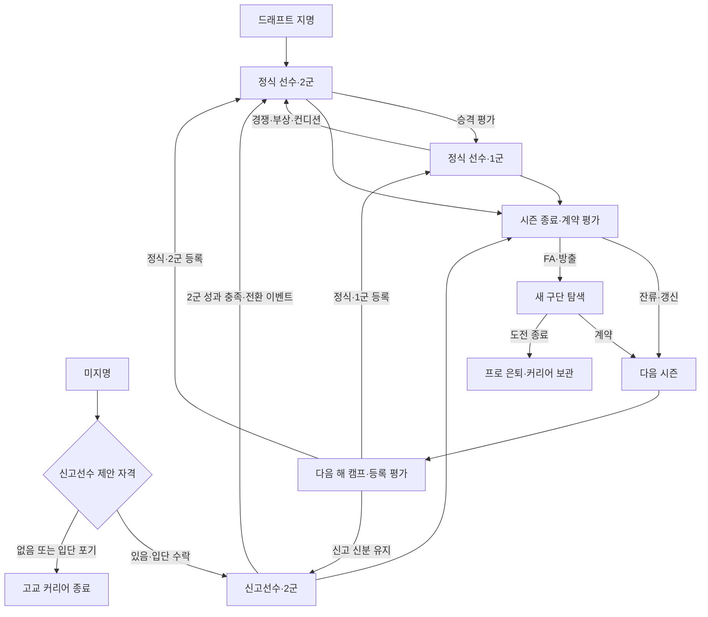

# 프로 라이프 · 신인부터 은퇴까지

작성·갱신: 2026-11-05

**문서 상태:** v0.6.1 신인 시즌을 기준으로 작성한 기획을 사용자 요청에 따라 **v0.7.0 다년 커리어로 구현했다**. 아래 v0.6.1 절은 확장 전 기준선이고, 확장 기획은 구현의 요구사항을 보존한 것이다. 실제 적용과 검증 상태는 다음 표와 문서 끝의 구현 기록을 기준으로 본다.

## v0.7.0 적용 상태

**v0.7.4 후속 적용:** 지명 순위 옆 스카우팅 리포트 모달을 추가했다. 실제 지명 시점의 강점·능력·기록·구단 보직 수요를 보관하므로 성장 후에도 내용이 유지된다. 프로의 커리어 화면과 지명 선수 상세에서 다시 확인한다. 구버전은 당시 보관 기록을 우선하며 원본이 없으면 지명 평가만 표시한다. 리포트 생성은 드래프트 점수·난수·성장에 영향을 주지 않는다. 훈련은 타격 피로 0.75배·투구/피지컬 1배를 적용하며 [현행 훈련 규칙](training.md)을 따른다.

**v0.7.2 훈련 변경:** 고교·프로 모두 강도 선택과 총 티켓 예산을 제거하고, 8항목 각각 0~5를 자유롭게 투자한다. 회복력과 총 배분량으로 주간 회복/유지/쌓임을 계산하며 경기 피로는 별도다. 앞의 과거 강도·회복 설명보다 [현행 훈련 규칙](training.md)을 우선한다.

**v0.7.1 후속 적용:** 대표 OVR을 일반 선수의 주력 분야·겸업 선수의 투타 평균(100점)으로 변경했다. 신규 프로 기본 선수는 1군 주력 65·2군 55 중심이다. 고교 겸업 55/2주를 유지하되 프로 겸업 자격은 별도로 평가한다. 아래에서 고교 겸업 자격을 그대로 이어받는다는 확장 전 설명은 문서 끝 v0.7.1 규칙으로 교체한다.

| 단계 | 적용한 내용 |
| --- | --- |
| A · 다년 기반 | 동일 선수·리그의 다음 시즌, 연도별 보관, 나이 갱신, IndexedDB 자동 저장·수동 보관·JSON 내보내기/불러오기 |
| B · 성장·출전 | 표의 나이 효율·고정 노화 보정, 전 구단 등록 경쟁, 2군 평가 출전, 시즌 마지막 경기 정식 전환, 신분·부상 유지 |
| C · 리그 순환 | 기존 NPC 유지, 매년 90~110명 신인과 적격 신고선수, 은퇴·방출·1년 갱신, 30/45/75 정원 및 포지션 확보 |
| D · 시즌 성과 | 가까운/장기 목표, 정규 개인상, 상위 4팀 준결승·결승, 무승부 재경기, 포스트시즌 별도 명단·기록 |
| E · 선수 시장 | 연봉 평가·공개 제안·1회 재협상·장기 계약, FA 900일, 1대1 트레이드, 방출 보장액, 최대 3회 구직·무소속 월간 훈련 |
| F · 커리어 완성 | 캠프·분석실·취재·복귀·베테랑 선택 이벤트, 자발적/무소속/45세 은퇴, 기록·이적·계약·수상·능력 변화 요약과 보관 |

실행은 기존 [기본 앱](http://localhost:3000)과 [프로 체험](http://localhost:3000/pro)을 사용한다. 구현 변경은 아직 커밋·푸시하지 않았다. 기획의 실제 제도 재현 제외 범위는 그대로 유지한다.

**사용자 확정 기조:** 신고선수 제안은 지명권과 평가 2점 이내 또는 개별 능력 전국 TOP5다. 신고선수는 성장 90%·출전 불이익으로 시작하고, 2군 경기 성과를 달성하면 정식 전환 이벤트로 제한이 해제된다. 이 기조를 바꾸지 않는다.

**기획 방향:** 야구 안에서의 성장·경쟁·성적·계약·구단 이동·은퇴를 다룬다. 학교생활, 가족·연애, 야구 밖 인간관계, 생활비 소비는 포함하지 않는다. 리그·계약·FA·선수 등록 규칙은 게임용 규칙이며 실제 KBO 제도의 재현이나 설명이 아니다.

## 확장 전 구현 기준선 · v0.6.1

### 실행과 드래프트 결과

기본 저장소의 [앱](http://localhost:3000)에 프로 라이프를 통합했다. `/`에서 직접 키운 선수로 고교부터 시작하며, [/pro](http://localhost:3000/pro)는 별도의 상위 유망주 샘플 체험이다. v0.6.0의 별도 복제본·새 창 연결은 현행 기본 경로에서 교체했다. 저장 기능은 없어 새로고침하면 해당 창의 플레이가 초기화된다.

고3 드래프트 당일에 실제 지명을 한 번 계산하고 진행을 멈춘다. 드래프트 페이지의 **결과 확인**을 눌러야 지명표·OVR TOP10·고교 커리어·다음 진로가 나타난다. 공개는 결과와 RNG를 재추첨하지 않으며 다른 탭으로 이동해도 유지된다. 공개 전 전국 목록의 실제 지명 배지도 숨긴다.

드래프트 결과의 요약 영역 안에 THE NEXT CHAPTER와 다음 버튼을 합쳤다. 데스크톱은 오른쪽, 모바일은 설명 아래 오른쪽에 배치한다.

| 결과 | 다음 선택 |
| --- | --- |
| 지명 | 프로 입단 |
| 미지명·신고선수 제안 | 신고선수 입단 / 은퇴 |
| 미지명·제안 없음 | 은퇴 |

은퇴는 첫 선수 생성 화면으로 돌아간다. 입단은 같은 창에서 지명·제안 구단의 다음 해 2군으로 이어진다. 이름·ID·능력의 소수점 원본·재능·평판·훈련·겸업 자격·고교 기록을 보존한다. 입단 자체로 능력을 올리지 않는다. 고교 마지막 시즌을 한 번만 보관하고 새 시즌 기록을 시작하며 비시즌에는 피로·기간이 지난 부상이 회복된다.

### 신고선수 제안

고교 미지명 선수 중 다음 하나를 만족하면 제안한다. 조회는 RNG를 소비하지 않는다.

- 같은 구단 수요 50을 적용한 평판 80%·재능 10%·적합도 10% 평가로, 지명된 선수들의 최저 평가와 차이가 2점 이내다. 구단 수요를 동일하게 놓아 서로 다른 구단·라운드 점수 차이의 영향을 줄인다.
- 컨택·파워·주루·수비·구속·제구·변화구·스태미나·회복력·어깨·야구 지능 중 하나가 전국 고교 선수 전체 TOP5다. 학년 제한 없이 비교하며 동점은 자신보다 높은 선수 수 + 1로 순위를 계산한다.

제안 구단은 위 최저 평가 지명 선수의 구단이다. 지명된 선수에게 중복 제안하지 않는다. 실제 프로의 신고선수 제도를 그대로 재현한 규정이 아닌 게임용 진로다.

### 성장·출전 제한과 정식 선수 전환

- 신고선수는 일반 선수 대비 **성장 90%**다. 일상 기본·티켓·피지컬·BQ 성장과 훈련량 기반 이벤트 보상, 양수 능력 효과에 적용한다. 능력 하락·피로·재능 공개 경험은 줄이지 않는다. 기존 성장 둔화와 상한도 유지한다.
- 출전 평가에서 **6점 불이익**을 받고, 정식 전환 전에는 1군 등록을 하지 않는다. 부상·피로·최근 성적 등 원래 출전 조건은 함께 적용한다.
- 완료된 2군 경기에서 아래 성과를 쌓으면 다음 진행 시 정식 선수 전환 모달이 뜬다. 전환은 한 번만 발생하며 자동 진행을 멈추고, 확인 후 직접 재개한다.

| 분야 | 정식 전환 조건 |
| --- | --- |
| 타자 | 80타석 이상, OPS .750 이상 |
| 투수 | 20이닝 이상, ERA 4.00 이하, SO/BF 18% 이상 |
| 겸업 | 타자 또는 투수 조건 중 하나 달성 |

전환 시 성장 100%와 일반 출전 평가로 돌아가고 1군 경쟁이 열린다. 능력치나 평판을 덤으로 올리지 않는다. 전환 날짜와 원래 신고선수 입단 경로는 유지된다. 프로 대시보드와 커리어에서 현재 상태·진행량·조건을 확인한다.

### 시즌과 엔트리

- 가상 10개 구단의 1군·2군에 기본 선수 600명과 실제 드래프트 신인들을 합류시킨다. 신인 ID와 고교 기록을 보존하며 신고선수도 본인 ID로 합류한다.
- 고교와 같은 절대 능력 척도를 사용한다. 기존 1군 선수의 주 분야는 대체로 66~81, 2군은 49~64 범위다.
- 3월 1일부터 훈련하고 3월 22일 이후 1군 팀당 144경기·2군 팀당 72경기, 총 1,080경기를 편성한다. 실제 공식 일정이 아닌 게임용 일정이다.
- 3월 15일부터 14일마다 같은 수비 위치의 경쟁을 검토한다. 역할 능력·최근 성적·피로·부상으로 1군 승격이나 2군 조정을 결정하고 NPC와 교환한다. 고정 날짜에 무조건 승격하지 않는다.
- 입단·승격·강등·정식 전환·종료는 모달로 알리고 자동 진행을 멈춘다.
- 1·2군 기록을 따로 집계하고 합산·연도별 기록, 일정·순위·박스스코어, 이동 이력을 제공한다. 고교 훈련·피로·부상·집중 이벤트를 공유하며 프로 전용 선택 이벤트 4종이 있다.

이전 입단 테스트·최대 네 번의 대학 육성 시즌과 재도전 드래프트는 엔진 호환 경로로 남아 있다. **현행 고교 종료 화면에는 노출하지 않는다.**

### 범위와 검증

프로의 범위는 신인 정규 시즌 종료까지다. 다년 프로·포스트시즌·FA·트레이드·계약·프로 은퇴 시뮬레이션은 포함하지 않는다. 고교 종료 화면의 은퇴·초기 화면 복귀는 지원한다.

- `lib/sim/draft-outcome.ts`: 미지명 제안과 결과 공개.
- `lib/sim/pro-career.ts`: 입단·정식 전환·엔트리·보관·종료.
- `lib/sim/pro-calendar.ts`, `pro-events.ts`: 일정·순위·이벤트.
- `app/components/draft-result-gate.tsx`, `career-continuation.tsx`, `pro-life.tsx`: 공개·다음 진로·프로 화면.
- `tests/draft-transition.test.mjs`: 공개·근접 2점 경계·전국 TOP5·세 진로·성장 90%·출전 제한·정식 전환과 중단/재개 10개 시나리오.
- `tests/pro-career.test.mjs`: 기록 보존·1,080경기 시즌 완주 등 기존 프로 12개 시나리오.

브라우저에서 공개 전 결과 숨김, 공개 후 통합 영역과 세 진로, 현재 창 입단, 정식 전환 모달, 은퇴 후 생성 화면 복귀, 390px 모바일 배치를 확인했다. 전체 테스트와 실제 Worker의 공개 대기·신고선수 성장·전환·재개 검증은 `history.md`의 v0.6.1 기록을 참고한다.

---

## 확장 기획 1. 플레이 목표와 커리어의 구조

### 핵심 경험

선수의 능력치와 기록을 누적하면서, 현재 자신의 위치에 맞는 목표를 좇는다. 모든 선수가 같은 나이에 같은 단계를 통과하거나 스타가 되는 구조는 아니다.

| 현재 위치 | 가까운 목표 | 주된 판단 |
| --- | --- | --- |
| 신고선수 | 2군 출전 표본을 확보하고 정식 전환 | 약점 보완, 평가 기회 준비, 피로 관리 |
| 정식 2군 선수 | 같은 역할의 경쟁자를 넘어 1군 진입 | 장점 집중, 포지션 전환, 승격 시점 준비 |
| 1군 후보 | 출전 기회를 늘리고 엔트리에 정착 | 유틸리티·보직 수용, 특정 역할 특화 |
| 1군 주전 | 시즌을 완주하고 개인·팀 성과 달성 | 기록과 몸 관리, 강점 유지, 팀의 요구 |
| 핵심 선수 | 우승·타이틀·좋은 계약 | 잔류와 이적, 역할과 연봉, 장기 계약 |
| 베테랑 | 떨어지는 능력을 보완하고 커리어 마무리 | 역할 축소, 다른 구단 도전, 은퇴 시점 |

위 항목은 화면에서 설명하는 커리어 단계다. 단계마다 숨겨진 능력 보너스를 주거나 앞 단계로 돌아가지 못하게 하는 레벨 시스템으로 쓰지 않는다.

### 최종적으로 가능한 커리어

- 신고선수로 시작해 정식 전환과 1군 데뷔를 이루는 선수.
- 오랜 2군 생활 끝에 늦게 주전이 되는 선수.
- 빠르게 주전이 되어 여러 차례 우승과 개인상을 얻는 선수.
- 특정 역할에 강점을 가진 대타·수비 자원·불펜 선수.
- 주전 경쟁에서 밀린 뒤 다른 구단에서 다시 자리 잡는 선수.
- 한 구단에서 오래 뛰다가 역할을 줄여가며 은퇴하는 선수.
- 끝내 정착하지 못했지만 자신의 기록과 도전 이력을 남기는 선수.

은퇴 결과를 성공·실패 두 종류로만 표시하지 않는다. 출발점, 최고 도달 단계, 시즌·통산 기록, 역할, 구단 이동, 우승·수상으로 서로 다른 커리어를 요약한다.

## 확장 기획 2. 서로 구분해야 할 상태

| 상태 축 | 값·예시 | 다른 상태와의 관계 |
| --- | --- | --- |
| 입단 경로 | 드래프트 / 신고선수 | 최초 경력으로 영구 보존 |
| 현재 신분 | 신고 / 정식 | 정식 전환 후 신고로 되돌리지 않음 |
| 소속 | 구단 / 자유계약 상태 / 은퇴 | 자유계약 선수에게 1·2군 소속을 부여하지 않음 |
| 등록 단계 | 1군 / 2군 | 정식 선수도 2군에서 뛸 수 있음 |
| 경기 역할 | 선발·구원·마무리 / 주전·후보·지명타자 등 | 등록 단계와 별도로 평가 |
| 몸 상태 | 정상 / 부상 결장 / 복귀 후 회복 / 강제 휴식 | 계약이나 선수 신분을 자동으로 바꾸지 않음 |
| 계약 상태 | 계약 중 / 갱신 협상 / FA / 방출 후 구직 | 능력치·통산 기록과 분리 |
| 시즌 단계 | 비시즌 / 캠프 / 정규 시즌 / 포스트시즌 / 결산 | 가능한 행동과 이벤트를 제한 |

중요한 전이:

이적해도 최초 입단 경로와 정식 전환 이력은 보존한다. 신고선수 출신이라는 이유로 전환 후 성장·출전 평가에 계속 불이익을 주지 않는다.

## 확장 기획 3. 고교에서 프로로 이어지는 진입

### 그대로 유지할 부분

- 현재 고교 종료 화면의 지명 선수 입단, 미지명 유망주의 신고선수 제안, 제안 없는 선수의 은퇴 경로를 유지한다.
- 대학·입단 테스트 호환 경로를 이번 확장만으로 다시 화면에 노출하지 않는다.
- 최초 소속 구단은 실제 지명·신고선수 제안 결과를 따른다. 입단 단계에서 원하는 구단을 다시 추첨하지 않는다.
- 이름·선수 ID·능력치 소수점·재능·고교 기록·평판·겸업 경험을 이어받는다. 프로 겸업 출전 자격은 v0.7.1의 별도 기준으로 평가한다.
- 입단만으로 능력치를 올리거나 고교 기록을 프로 기록에 합산하지 않는다.
- 실제 같은 해 지명된 동기들의 ID·기록도 프로 세계에 함께 보존한다.

### 새로 보여줄 내용

입단 화면에는 소속 구단, 입단 경로, 현재 신분, 나이, 2군 소속, 계약 기간·연봉, 같은 역할의 경쟁자, 이번 시즌 가까운 목표를 보여준다.

신고선수에게는 성장 90%·출전 불이익·정식 전환 조건을 명시한다. 이 정보는 시스템 규칙이므로 이벤트의 숨겨진 결과처럼 감추지 않는다.

현재 고교 종료의 은퇴는 첫 화면으로 돌아가지만, 장기 커리어의 은퇴는 **기록을 먼저 보관하고 결과를 보여준 뒤** 새 선수를 만들게 한다. 은퇴 버튼이 기존 커리어를 삭제하는 동작이 되지 않게 한다.

## 확장 기획 4. 신고선수의 생존과 정식 전환

### 고정 기조

| 항목 | 유지할 규칙 |
| --- | --- |
| 제안 기준 | 지명권 평가와 2점 이내 **또는** 개별 능력 전국 TOP5 |
| 비교 방식 | 지명 최저 평가와 비교할 때 구단 수요를 중립 50으로 맞춤 |
| TOP5 대상 | 학년 제한 없는 전국 고교 선수, 현재와 같은 동점 순위 방식 |
| 성장 | 기본·티켓·피지컬·야구 지능·양수 이벤트 성장에 0.9배 |
| 출전 | 일반 출전 평가에서 -6, 정식 전환 전 1군 등록 불가 |
| 전환 조건·타자 | 해당 시즌 2군 80타석 이상, OPS .750 이상 |
| 전환 조건·투수 | 해당 시즌 2군 20이닝 이상, ERA 4.00 이하, SO/BF 18% 이상 |
| 전환 조건·겸업 | 위 타자 또는 투수 조건 하나 충족 |
| 전환 결과 | 성장 100%, 출전 -6 해제, 1군 승격 경쟁 허용 |

2군 성과는 완료된 경기의 실제 기록으로만 판단한다. 경기 중 일부 기록, 이벤트 문구, 1군 기록, 캠프 기록으로 정식 전환 조건을 채우지 않는다. 이적 전후 같은 시즌의 2군 기록은 합산한다.

### 정식 전환 이벤트

상황 문구 예시:

> 2군에서 보여준 경기력을 인정받았다. 구단이 정식 선수 전환을 결정했다.

이것은 확률 이벤트나 수락 시험이 아니라 **조건을 달성한 선수에게 주는 확정 통보**다. 재추첨·추가 성공 확률·별도 능력 보너스를 붙이지 않는다. 통보가 발생하는 시점에 신분과 제한 해제를 한 번 적용하고, 확인 버튼은 결과 확인만 담당한다.

자동 진행을 멈추고 현재 신분·달성 기록·해제된 제한을 보여준다. 확인 후 바로 1군으로 옮기지 않고 정식 선수의 엔트리 평가를 받는다. 같은 날 승격 조건도 충족하면 전환 통보를 먼저 보여주고 승격 통보를 이어서 보여준다.

전환 시 적용 중이던 90%는 **그 이후의 성장부터** 해제한다. 이미 90%로 받은 성장의 부족분을 소급 지급하지 않는다. 능력 하락·피로 변화·노화에는 90%를 곱하지 않는다.

### 평가 기회가 아예 사라지지 않게 하는 장치 — 신규 제안

출전 -6은 유지하되, 2군 감독의 육성 운용을 추가한다.

- 활동 가능한 2군 선수 중 25세 이하 또는 프로 입단 3시즌 이내이며, 최근 14일 동안 타석·등판이 없었던 선수는 평가 출전 후보가 된다.
- 경기당 야수 최대 2자리, 투수 최대 1명의 평가 기회를 별도로 배정할 수 있다. 포수·선발 등 실제 수비·투구 자격과 피로 제한을 지킨다.
- 후보 중에는 오랫동안 기회를 받지 못한 순서, 해당 역할 적성 순서로 정한다. 신고·정식·플레이어·NPC에 같은 원칙을 적용한다.
- 일반 주전 경쟁에서는 신고선수의 -6을 그대로 적용한다. 평가 출전은 제한 해제가 아니라 육성 목적으로 주는 별도 기회다.
- 평가 경기 결과가 나쁘면 그대로 기록한다. 전환 조건을 맞추기 위해 결과를 보정하지 않는다.
- 캠프·평가 출전 자체는 정식 전환을 보장하지 않는다.

### 시즌을 넘겼을 때

- 정식 전환을 못했다고 자동 은퇴시키지 않는다. 구단은 성장, 2군 실적, 나이, 경쟁자, 정원을 보고 다음 해 계약을 평가한다.
- 신고선수 잔류라면 다음 시즌에도 90%·출전 불이익을 유지한다.
- 전환 조건은 해당 시즌 기록으로 평가하므로 새 시즌에는 진행 수치가 초기화된다. 이전 시즌 기록은 커리어에 남는다.
- 큰 부상 때문에 평가 표본이 부족한 경우에는 성적 미달과 구분해 잔류 검토에 반영한다.
- 전환 자격을 시즌 마지막 경기에서 달성하면 전환 처리를 결산·계약 평가보다 먼저 실행한다.
- 다른 구단에 신고 신분으로 옮겼어도 같은 시즌 기록과 전환 자격을 보존한다.

## 확장 기획 5. 한 시즌의 진행

월은 기본 구간이며 실제 경기 종료일에 따라 결산 시점을 조정한다. 정규 시즌의 기존 1군 144경기·2군 72경기는 유지한다.

| 단계 | 시점 제안 | 진행 내용 | 주요 선택 |
| --- | --- | --- | --- |
| 비시즌 | 전년도 결산 후~2월 | 계약, FA, 트레이드, 신인 합류, 몸 관리 | 소속·계약 선택, 강화할 분야 |
| 캠프 | 3월 1일~개막 전 | 기존 훈련으로 준비, 역할 평가, 개막 등록 | 장점 집중 / 약점 보완 / 몸 관리 |
| 정규 시즌 전반 | 개막~여름 중간 | 1·2군 경기, 승격·강등, 주전 경쟁 | 훈련·컨디션·경기 선택 |
| 중간 점검 | 정규 일정 약 절반 | 시즌 목표와 역할 평가 | 현 역할 유지 / 변경 요청 / 이적 희망 전달 |
| 정규 시즌 후반 | 여름~정규 일정 종료 | 기록 경쟁, 포스트시즌 진출 경쟁 | 성과 도전과 몸 관리 |
| 포스트시즌 | 정규 시즌 이후 | 1군 상위 구단의 시리즈 | 경기 준비와 보직 선택 |
| 결산 | 마지막 공식 경기 이후 | 수상, 기록 보관, 연봉·계약 평가 준비 | 다음 시즌 계속 / 은퇴 검토 |

### 시즌 전환의 고정 순서

1. 그 시즌의 모든 진행 중 경기와 선택 결과를 확정한다.
2. 신고선수 전환 자격 등 경기 결과에 따른 확정 처리를 마친다.
3. 1군·2군 정규 시즌과 포스트시즌의 기록·수상·우승을 보관한다.
4. 구단·선수 시즌 평가를 확정하고 계약 만료·FA 자격을 계산한다.
5. 비시즌의 날짜를 진행하며 회복·계약 협상·이적·신인 합류를 처리한다.
6. 새 시즌 시작 때 나이를 한 번 올리고 해당 나이의 노화 변화를 한 번 적용한다.
7. 확정 로스터로 새 일정과 당해 시즌 기록을 만든다. 이전 기록과 선수 ID는 유지한다.
8. 캠프 시작 화면에서 지난 시즌 대비 변화와 현재 경쟁 구도를 보여준다.

새 시즌은 '새 게임 생성'이 아니다. 이전 선수·계약·부상·소속·리그 기록을 유지한 상태에서 계속한다. 기간이 지난 부상은 회복하지만 장기 부상을 개막 시점에 임의로 제거하지 않는다.

기존 1군 선수를 새 시즌마다 일괄 2군으로 내리지 않는다. 캠프의 역할·컨디션 평가로 개막 명단을 정하며 신인 입단의 2군 시작 규칙과 구분한다.

## 확장 기획 6. 성장·전성기·노화

### 유지하는 성장 원칙

- 고교와 프로의 능력치는 같은 절대 척도를 사용한다. 개별 능력·투수 OVR·타자 OVR·대표 OVR은 모두 100이 상한이다. 일반 선수의 대표 OVR은 주력 분야, 겸업 선수는 두 분야의 평균이다.
- 입단·승격·계약·수상만으로 능력을 올리지 않는다.
- 현행 [훈련 규칙](training.md)의 기술 7종 기본 성장, 티켓 집중 성장, 재능, 능력별 성장 둔화를 유지한다.
- 훈련 강도는 티켓 총량과 피로에 영향을 준다. 같은 항목에 같은 티켓을 쓴 경우 추가 성장 배율을 따로 붙이지 않는다.
- 프로 훈련에도 스태미나·회복력·어깨의 피지컬 3분할, 야구 지능 자연 성장 규칙을 유지한다.
- 신고선수 성장 계수는 별도의 0.9배다. 나이 계수를 추가해도 같은 선수의 정식 신분 대비 90% 관계를 유지한다.

### 나이별 훈련 효율 — 초기 수치 제안

| 시즌 나이 | 훈련 효율 | 의도 |
| --- | ---: | --- |
| 19~22 | 1.20 | 신체·기술을 적극적으로 키우는 시기 |
| 23~26 | 1.10 | 주전 경쟁에 필요한 성장 지속 |
| 27~29 | 1.00 | 현재 능력의 완성·유지 |
| 30~32 | 0.80 | 약점을 선별해서 보완 |
| 33~35 | 0.60 | 유지·보직 전환의 가치 증가 |
| 36~38 | 0.40 | 남은 강점과 관리에 집중 |
| 39 이상 | 0.25 | 훈련은 가능하나 큰 회복은 어려움 |

`실제 일별 성장 = 현행 일별 성장 × 나이별 효율 × 신고선수 여부 계수`

다른 기존 계수가 필요한 상황에서는 그대로 곱하되 같은 계수를 두 번 적용하지 않는다. 나이는 시즌 시작 시 한 번 변하며, 시즌 중 생일 이벤트는 추가하지 않는다.

### 노화는 성장 효율과 별도로 처리한다

훈련이 느려지는 것만으로는 베테랑의 능력이 떨어지지 않는다. 시즌 시작마다 아래 기본 감소량을 적용하는 안을 제안한다.

| 능력 묶음 | 29세 이하 | 30~32세 | 33~35세 | 36~38세 | 39세 이상 |
| --- | ---: | ---: | ---: | ---: | ---: |
| 스피드·구속 | 0 | -0.30 | -0.70 | -1.20 | -1.80 |
| 파워·어깨·스태미나·회복력 | 0 | -0.15 | -0.45 | -0.90 | -1.40 |
| 컨택·수비·제구·변화구 | 0 | 0 | -0.10 | -0.35 | -0.70 |
| 야구 지능 | 0 | 0 | 0 | 0 | -0.10 |

- 표는 각 대상 능력의 연간 감소량이며 한 번에 적용한다. 피로·부상에 따른 일시 저하와 구분해 표시한다.
- 선수 생성 때 노화 시작 보정값을 -2~+2세 범위로 한 번 정해 조기 하락형·늦게 유지하는 선수가 생기게 한다. 감소 표에 쓰는 나이만 보정하고 실제 나이·계약·은퇴 나이를 바꾸지 않는다.
- 이 값은 시즌마다 다시 뽑지 않는다. NPC도 같은 규칙을 따른다.
- 감소 후에도 훈련으로 보완할 수 있다. 나이가 많다는 이유만으로 성장량을 음수로 바꾸지는 않는다.
- 최소 능력치는 1이다. 감소량이 큰 선수는 보직 변경·몸 관리·은퇴 판단에 영향을 받는다.
- 위 값은 실제 선수의 생리 통계가 아니라 게임 밸런스 시작값이다. 다년 시뮬레이션으로 조정한다.

### 성장형과 전성기

재능은 기존 훈련 효율 차이를 담당하고, 노화 시작 보정은 유지 기간의 차이를 담당한다. 초기에는 별도의 '숨겨진 최대 OVR'을 추가하지 않는다. 같은 재능이어도 출전·부상·훈련·이벤트·노화 시점에 따라 커리어가 달라지게 한다.

전성기 진입으로 매년 일괄 +N을 주거나 시즌이 끝날 때 훈련 성장을 다시 지급하지 않는다. 한 해의 실제 성장과 노화 차감이 최종 변화를 만든다.

### 이벤트 성장과 일치시키기

프로의 일반 이벤트는 기존처럼 해당 항목 티켓 5개 기준 3~4주분을 사용한다. 큰 보상은 6~8주분, 각성은 현행의 최대 12주분 규칙을 따른다. [야구 이벤트 문서](baseball-events.md)의 현행 규칙을 참조하며 과거 고정 +12·+24 방식으로 되돌리지 않는다.

기준량 계산에도 현재 나이·재능·능력 둔화·신고선수 90%를 한 번씩 적용한다. 몇 주분을 계산한다고 달력이 흐르거나 해당 기간의 노화·피로·재능 공개 경험까지 추가되지 않는다.

## 확장 기획 7. 피로·부상·복귀

- 프로 경기 수가 많아지므로 기존 피로 누적과 강도 조절이 출전 경쟁에 실제 영향을 주게 한다.
- 현행 약한·보통·강한 훈련 3종을 유지한다. 과거의 사용자용 회복 훈련 타입을 이번 기획에서 다시 추가하지 않는다.
- 약한 훈련은 회복에 유리하지만 경기 출전이 많으면 피로가 쌓일 수 있다. 부상·강제 휴식은 기존 활동 불가 처리를 따른다.
- 부상 결장 중에는 실제 경기 기록과 성장량을 정상 출전한 것처럼 주지 않는다.
- 장기 부상으로 2군에 내려간 것은 성적 부진에 따른 강등과 다른 사유로 표시한다.
- 복귀 예정일을 지났어도 잔여 능력 저하가 남아 있으면 그 상태로 경쟁한다. 1군 복귀를 자동 보장하지 않는다.
- 초기 다년 버전은 기존의 회복 가능한 부상 페널티를 유지한다. 누적 중상으로 영구 능력 손실을 만드는 기능은 별도 확장으로 둔다.
- 단일 랜덤 부상만으로 강제 은퇴시키지 않는다.

재활 관련 선택은 추가 훈련, 영상 분석, 복귀 준비 등 야구 안의 행동으로 제한한다. 부상을 숨긴다는 선택으로 출전 제한을 무조건 우회하는 기능은 넣지 않는다.

## 확장 기획 8. 엔트리와 주전 경쟁

### 선수 정원 — 신규 제안

| 단위 | 기본 정원 |
| --- | ---: |
| 구단 | 10개 |
| 구단별 1군 등록 | 최대 30명 |
| 구단별 2군 등록 | 최대 45명 |
| 구단별 계약 선수 합계 | 최대 75명 |

현행 1·2군 기본 600명과 실제 지명 신인을 보존하되, 이후 시즌부터 계약·방출·신인 합류로 정원을 관리한다. 2군 전원이 정식일 필요는 없다. 신고선수는 2군 정원에 포함한다.

상한은 목표 인원이나 최저 인원이 아니다. 구단은 포지션별 경기 성립과 대체 인력을 확보해야 하며, 정원만 채우기 위해 무의미한 선수를 매년 생성하지 않는다.

### 승격·강등

- 현행 14일 평가 간격과 능력·최근 성적·컨디션 기반 경쟁을 출발점으로 유지한다.
- 1군 부상 공백이 생기면 다음 정기 평가일까지 무조건 기다리지 않고 추가 등록 검토를 할 수 있다.
- 신고선수는 정식 전환 전 승격 후보에서 제외한다.
- 플레이어만 평가하지 않고 전체 구단의 NPC도 같은 방식으로 이동한다.
- 능력이 비슷한 선수의 잦은 왕복을 줄이기 위해 기본 최소 유지 기간 14일을 둔다. 장기 부상·활동 불가로 명단 보충이 필요한 경우만 예외다.
- 같은 위치의 선수 수, 포수 확보, 선발·불펜 수를 유지한다. 종합 점수만 높은 선수를 모아 출전 명단이 성립하지 않는 구성을 만들지 않는다.
- 승격 시에는 누가 내려가고 어떤 이유로 기회를 얻었는지, 강등 시에는 무엇을 보완해야 하는지 보여준다.

### 출전 평가

기본 역할 능력, 최근 경기 성적, 피로·부상, 수비 자격으로 판단한다. 평판이나 연봉만 높아서 능력·컨디션과 무관하게 영구 주전이 되지는 않는다.

같은 1군에서도 후보·주전·선발 로테이션·불펜·마무리 역할을 따로 표시한다. 1군 등록은 출전 보장이 아니다. 겸업은 현재 방식의 경기별 투타 배정을 유지하며 같은 선수에게 두 개의 엔트리 자리를 쓰지 않는다.

### 사용자가 할 수 있는 요청

| 요청 | 구단의 판단 | 결과 |
| --- | --- | --- |
| 현재 보직에서 기회를 요청 | 최근 훈련·성적, 경쟁자, 일정 | 평가 출전 또는 현 보직 유지 |
| 다른 포지션·보직에 도전 | 해당 역할 적성, 팀 부족 자리 | 적응·평가 과정 시작 |
| 출전보다 몸 관리를 우선 | 피로·부상·현재 대체 인력 | 일정 기간 출전 감소·관리 |
| 다른 구단에서 기회를 찾고 싶다고 전달 | 선수 가치, 계약, 구단 수요 | 트레이드 후보 검토 |

요청은 결과를 보장하지 않는다. 같은 요청을 매주 반복해 효과를 쌓지 못하도록 4주 간격을 제안한다. 거절되었다는 이유만으로 무조건 평판을 깎지는 않는다.

대타·대수비·대주자 같은 경기 중 교체 역할은 현재 경기 엔진의 확장과 묶어 후속 단계에서 도입한다. 그 전에는 해당 역할을 약속하는 계약·이벤트를 노출하지 않는다.

## 확장 기획 9. 1군·2군 평가와 평판

### 기록과 평가를 분리한다

- 고교·2군·1군·포스트시즌 기록을 따로 보관한다. 통산 프로 1군 기록에 2군 기록을 더하지 않는다.
- 시즌 도중 구단을 옮겼다면 구단별 기록과 해당 시즌 합산을 모두 제공한다.
- OPS·ERA 등 비율 기록은 원시 기록을 합친 뒤 다시 계산한다. 시즌별 비율을 단순 평균하지 않는다.
- 2군에서 좋은 성적은 정식 전환·승격 판단에 중요하지만 같은 수치를 1군에서 기록한 것과 계약·개인상에서 동일 취급하지 않는다.

### 평판의 용도

평판은 현재 선수에 대한 대외 평가다. 통산 업적은 기록·수상 이력으로 별도 보관한다. 평판은 계약과 일부 이벤트에 영향을 주지만 출전·FA·정식 전환의 필수 기록을 대신하지 않는다.

기본 `대표 OVR 60% + 성과 평가 40% + 이벤트 보정` 구조를 사용한다. v0.7.1부터 겸업 선수의 능력 기여는 두 분야의 평균이며, 성과 부분은 리그별로 구분한다.

- 1군·2군 각각에서 충분한 표본과 기존 보정 원칙을 사용해 성과 평가를 계산한다.
- 1군 표본이 충분하면 1군 평가를 중심으로 한다. 기준 제안은 타자 100타석 또는 투수 30이닝이다.
- 1군 표본이 적으면 이전에 확정된 평가·중립값과 혼합해 한 경기로 극단적인 평판이 나오지 않게 한다.
- 2군 성과만 있는 선수의 성과 점수 상한은 70을 초기안으로 둔다. 2군 상위권이라는 이유로 자동으로 프로 전체 최고 평판을 받지 않게 한다.
- 입단 때 고교 평판을 유지하되, 프로 경기 표본이 쌓일수록 프로 평가로 갱신한다.

장기 누적 이벤트 보정에는 프로 내 한도 ±10과 시즌 종료 때 20% 완화를 제안한다. 과거 이벤트는 이력에 남기고 현재 평가에 미치는 보정만 줄인다. 이는 **신규 제안**이며 고교 이벤트 효과를 소급 취소한다는 뜻은 아니다. 프로 전환 시 기존 보정과의 연결 규칙은 별도 마이그레이션에서 명시해야 한다.

## 확장 기획 10. 시즌 목표·타이틀·포스트시즌

### 목표

가까운 목표 하나와 장기 목표 하나를 대시보드에 제시한다. 기본은 상태에 따라 자동 제안하고 사용자가 관심 목표를 바꿀 수 있게 한다.

| 선수 상태 | 가까운 목표 예시 | 장기 목표 예시 |
| --- | --- | --- |
| 신고선수 | 정식 전환에 필요한 표본·성적 | 1군 데뷔 |
| 2군 정식 선수 | 1군 승격 | 1군 시즌 100타석·30이닝 |
| 1군 후보 | 첫 선발 출전·꾸준한 출전 | 주전 정착 |
| 1군 주전 | 규정 출장·개인 기록 | 타이틀·우승·FA |
| 베테랑 | 몸 관리·통산 기록 | 우승 후 은퇴·한 구단 커리어 |

목표 달성 보상은 우선 기록·칭호·평가에 둔다. 목표를 바꿀 때마다 능력을 반복 지급하는 시스템으로 만들지 않는다.

### 정규 시즌 개인상

| 구분 | 첫 도입 범위 | 판정 원칙 |
| --- | --- | --- |
| 타격 | 타율·홈런·타점·안타 | 1군 정규 시즌 실제 기록 |
| 투구 | 평균자책점·탈삼진 | 1군 정규 시즌 실제 기록 |
| 종합 | 신인상·시즌 MVP | 출전량을 포함한 분야별 성과 비교 |
| 2군 | 구단 육성 우수 선수 | 정식 전환·승격과 연결되는 2군 평가 |

타율은 팀 정규 경기 수 ×3.1을 올림한 타석, ERA는 팀 정규 경기 수만큼의 이닝을 자격 기준으로 하는 게임 규칙을 제안한다. 144경기라면 각각 447타석·144이닝이다. 누적 기록 타이틀은 별도 최소 표본을 두지 않는다. 같은 기록의 타이틀은 공동 수상을 허용한다.

신인상 자격 초안은 프로 입단 3년 이내이며 **전년도까지의 1군 통산 기록이 50타석 미만이고 20이닝 미만**인 선수다. 신고선수 출신도 동일하게 평가한다. 당해 시즌의 기록으로 수상자를 결정하며, 나이만으로 신인상을 판정하지 않는다.

MVP·신인상은 타자와 투수를 각 분야에서 리그 대비 성과와 출전량으로 평가한 후 비교한다. 구현 전 별도 수식표를 확정하고, 이름만 WAR로 붙인 임의 수치를 만들지 않는다. 같은 점수라면 출전량·팀 기여·고정 ID 순서로 판정해 조회할 때마다 수상자가 바뀌지 않게 한다.

투수 승·패·세이브·홀드와 수비 개인상을 추가하려면 해당 기록의 정확한 집계부터 구현한다. 현재 집계하지 않는 기록으로 타이틀을 주지 않는다.

### 포스트시즌 — 단순한 게임용 첫 안

- 1군 정규 시즌 상위 4개 구단이 진출한다.
- 1위 대 4위, 2위 대 3위가 각각 5전 3선승 준결승을 치른다.
- 승자가 7전 4선승 결승을 치러 우승을 정한다.
- 높은 정규 순위 팀이 준결승 1·2·5차전, 결승 1·2·6·7차전의 홈을 갖는다.
- 시리즈 간 이동·휴식일을 일정에 배치한다. 모든 경기를 연속 날짜로 몰아 기존 투수 휴식 규칙을 깨지 않는다.
- 정규 시즌처럼 12이닝까지 무승부라면 시리즈 승수에 넣지 않고 다음 가능한 날짜에 재경기한다. 이미 치른 경기의 기록·피로는 유지한다. 추첨으로 승자를 정하지 않는다.
- 포스트시즌 기록은 정규 개인상·정식 전환·정규 통산 기록에서 분리한다.
- 포스트시즌 개막 전에 정식 선수 30명 이하의 등록 명단을 확정한다. 2군 정식 선수도 등록 후보이며 신고선수는 제외한다.
- 첫 안에서는 시리즈 도중 자유로운 명단 교체를 허용하지 않는다. 부상 선수 교체는 부상자 제외·대체자 등록을 같은 시점에 처리하고 이전 선수를 그 시리즈에 다시 등록하지 않는다.

포스트시즌 미진출 선수에게는 정규 시즌 결산과 비시즌 개인 관리가 이어진다. 사용자가 탈락해도 다른 구단의 우승 결과는 세계 기록에 남는다.

## 확장 기획 11. 계약·연봉

### 연봉의 의미

첫 버전에서 연봉은 선수 가치와 커리어 성취를 보여주는 지표다. 생활비·재테크·주택·차량 구매나 돈으로 능력치를 사는 시스템은 넣지 않는다. 따라서 낮은 연봉이 직접 추가 성장 페널티가 되지 않는다.

연봉·계약 기간·보장 조건은 선택 전에 반드시 보여준다. 사용자가 실제로 선택할 계약 내용을 이벤트 효과 숨김 규칙 때문에 감추지 않는다.

### 계약 구분

| 구분 | 기간 초안 | 협상·이동 |
| --- | --- | --- |
| 신고선수 | 1시즌 | 시즌 후 잔류·방출 평가. 전환 시 정식 기본 조건으로 변경 |
| 정식 신인·FA 전 | 기본 1시즌 갱신 | 원소속 구단과 연봉 평가·재협상. 계약 만료만으로 즉시 FA는 아님 |
| FA 자격 이후 | 1~4시즌 | 여러 구단의 조건 비교·선택 |
| 38세 이상 FA | 기본 1~2시즌 제안 | 현재 능력과 예상 유지 기간을 중시 |

신고선수 정식 전환 시에는 전환일부터 정식 기본 연봉 기준으로 일할 계산한다. 지난 기간의 신고선수 급여를 소급해서 바꾸지 않는다. 전환 자체가 다음 시즌 계약을 보장하지도 않는다.

### 연봉 규모의 초기 기준

정식 신인 기본 연봉을 `B`로 두고 모든 금액을 동일한 기준으로 관리한다. 예시 `B=5,000만 원`은 게임용 수치이며 실제 최저연봉 규칙이 아니다.

| 가치 구간 | 제안 범위 |
| --- | ---: |
| 신고선수 기본 | 0.6B |
| 정식 신인 기본 | 1B |
| 2군·1군 경계 선수 | 1~3B |
| 1군 후보·로테이션 자원 | 2~6B |
| 안정적인 주전 | 5~12B |
| 구단 핵심·리그 스타 | 12~30B |
| 드문 최상위 선수 | 30~50B |

범위는 시장 평가의 출발점이다. 등급만으로 자동 고정하지 않고 실제 실적·능력·나이·가용성·수요를 함께 본다. 최초 계약금·성과 옵션·계약 거부권은 후속 확장으로 분리한다.

### 구단의 가치 평가

초기 가중치 제안:

- 최근 1군 성과와 출전 기여: 45%.
- 현재 구단이 필요로 하는 역할 능력: 30%.
- 나이와 앞으로의 성장·유지 가능성: 10%.
- 부상·피로를 포함한 가용성: 10%.
- 현재 평판: 5%.

성과는 최근 3시즌을 최신 60%·직전 30%·그 이전 10%로 반영한다. 기록이 없으면 0점으로 단정하지 않고 선수 단계에 맞는 중립·잠재 평가를 사용한다. 2군 성과는 1군과 분리해 환산하며 정식 전환·승격 평가에도 원시 기록을 남긴다.

신고선수 출신이라는 이력은 정식 전환 이후 가치 평가의 감점 항목으로 사용하지 않는다. 높은 고교 지명 순위도 여러 해 뒤 실적보다 우선하지 않는다.

### 협상 흐름

1. 구단이 연봉·기간·예상 역할을 제안한다.
2. 사용자는 수락, 재협상, 다른 진로 검토 중 상황에 맞는 행동을 고른다.
3. 재협상은 제안당 한 번으로 제한한다. 같은 버튼을 반복해 금액을 무한히 올리지 못하게 한다.
4. 최종 조건을 다시 확인하고 계약한다. 계약 체결만으로 성장이 발생하지 않는다.

FA 전 선수는 재협상이 결렬되었다고 곧바로 전 구단 자유계약 권한을 얻지 않는다. 최종안 수락, 구단에 트레이드·계약 해제 요청, 은퇴 검토의 경로를 보여준다. 구단 동의 없이 계약을 일방적으로 없애는 선택은 제공하지 않는다.

예상 역할은 구단의 계획이며 부상·부진에도 무조건 출전시키겠다는 보장이 아니다. 제안 화면에 이 성격을 설명한다.

## 확장 기획 12. FA·트레이드·방출·재도전

### FA 자격 — 게임용 제안

- 첫 FA는 1군 정규 시즌 등록 공헌일 900일에 도달한 시즌의 계약 종료 때 취득한다.
- 한 시즌 공헌일은 최대 150일까지 인정한다. 따라서 가장 빠른 경우에도 6시즌이 필요하다.
- 정규 시즌 기간 중 그날 1군으로 등록된 정식 선수만 하루를 인정한다. 실제 출전 여부는 묻지 않는다.
- 2군·신고선수·비시즌·포스트시즌 기간은 쌓이지 않는다. 부상 중에도 1군 등록을 유지했다면 인정하며, 2군으로 이동했다면 인정하지 않는다.
- 이적 당일은 이전·새 구단에서 중복 인정하지 않는다.
- 이미 FA 권리를 취득한 선수는 이후 계약 만료 때 자유계약 시장으로 나갈 수 있다. 900일을 매번 다시 채우지 않는다.

이는 실제 FA 규정이 아니라 누적 1군 정착을 장기 목표로 만드는 간소화 규칙이다.

### FA의 선택 기준

최대 3개 구단의 구체적인 제안을 한 번에 비교한다. 실제로 관심이 있는 구단이 적으면 제안 수를 억지로 채우지 않는다.

| 비교 항목 | 화면에 보여줄 내용 |
| --- | --- |
| 돈·안정성 | 연봉, 계약 기간, 총 보장액 |
| 출전 | 예상 역할, 같은 위치 경쟁자 |
| 팀 상황 | 지난 순위, 주요 선수, 우승 경쟁·재건 방향 |
| 익숙함 | 잔류 여부, 기존 구단에서의 기록 |

첫 버전에서는 타 구단 선택에 보상선수·보상금 제도를 붙이지 않는다. 재계약·FA 협상은 같은 시장 일정과 구단 예산을 공유한다.

### 트레이드

- AI 구단은 부족한 자리와 남는 자원, 계약 기간·금액, 나이·성장 가능성을 보고 협상한다.
- 선수 한 명만 다른 구단으로 복사하지 않고 양쪽 구단의 소속 변경을 하나의 거래로 확정한다.
- 플레이어가 이적을 요청해도 거래가 성사된다는 보장은 없다.
- 초기에는 1대1 선수 교환으로 시작하고, 현금·지명권·다수 선수 거래는 후속으로 둔다.
- 거래 가능 기간은 비시즌과 정규 시즌 전반까지로 제한하는 안을 제안한다. 중간 점검 시점 이후에는 구단을 옮겨 후반 대회를 반복 이용하지 못하게 한다.
- 트레이드는 계약·선수 신분·누적 기록을 유지한 소속 변화다. 정식 선수를 신고선수로 되돌리지 않는다.
- 플레이어가 포함된 거래는 통보와 기록 보관 후 자동 진행을 멈춘다. 첫 버전에는 계약상 트레이드 거부권이 없으므로 확인 버튼을 거절 버튼처럼 표현하지 않는다.

### 방출

- 시즌 중 무작위 이벤트로 방출하지 않는다. 기본은 시즌 종료 후의 계약·정원 평가다.
- 실력·성적·성장·나이·계약 비용·포지션 수요를 함께 본다. 단 한 경기 부진으로 방출하지 않는다.
- 신고선수에게는 평가 기회가 있었는지와 부상으로 표본이 부족했는지를 함께 본다.
- 방출되면 소속이 없는 상태가 되고, 구단 경기에 출전하지 않는다. 기록·능력·원래 입단 경로는 유지한다.
- 정식 전환 이력은 방출로 취소하지 않는다. 이후 계약은 정식 신분 기준으로 협상한다.
- 보장 계약이 남은 선수를 방출하면 남은 보장액을 구단의 잔여 계약 비용에 반영한다. 정원에서 제외했다고 비용까지 지우지 않는다.

### 새 구단을 찾는 기간

비시즌 계약 시장에서 최대 3회의 제안 갱신 시점을 둔다. 첫 제안을 거절할 수 있지만 마지막 시점 이후에는 제안이 보장되지 않는다.

제안이 없으면 다음 중 선택한다.

- 개인 훈련으로 한 시즌 더 준비하고 다음 계약 시장에 도전한다.
- 은퇴하고 커리어를 마무리한다.

무소속 훈련은 시설 지원을 받지 못하는 상태를 표현하기 위해 일반 성장의 60%를 초기안으로 제안한다. 신고 신분을 유지한 무소속 선수라면 90% 계수도 함께 적용한다. 공식 경기 기록이나 1군 공헌일은 쌓이지 않는다.

무소속 1년을 보내는 화면은 장기간의 빈 주간 진행을 강요하지 않고 월 단위 요약과 중요한 선택만 보여준다. 자동 은퇴는 무소속 2시즌 연속 종료 또는 커리어 나이 상한에 도달했을 때로 제안하며, 그 조건을 사전에 안내한다.

## 확장 기획 13. 구단과 NPC가 함께 변하는 리그

### 매년 유지할 것

- 프로 선수의 ID·이름·나이·능력·재능·계약·기록·부상·노화 특성을 유지한다.
- 시즌이 바뀌었다고 구단을 새 선수 60명으로 다시 만들지 않는다.
- 플레이어와 같은 해 입단한 동기가 성장·이적·은퇴하는 것을 추적할 수 있게 한다.
- 은퇴·방출한 선수를 활성 로스터에서 제거하더라도 기록 보관소에는 남긴다.

### 신인 유입

- 첫 프로 해에는 고교에서 실제 계산한 지명 동기들을 그대로 사용한다.
- 이후에는 매년 새로운 고교 졸업 후보 집단을 생성해 현행 90~110명 지명·구단별 9~13명 규칙으로 신인을 공급한다.
- 프로 플레이 중에 전국 고교의 모든 경기를 추가로 시뮬레이션하는 것은 첫 범위에 넣지 않는다. 졸업 후보의 능력·재능 분포는 고교 졸업 표본에 맞춰 생성한다.
- 이후 연도의 지명 순서는 직전 프로 정규 시즌 하위 팀 우선으로 정하는 게임용 변경을 제안한다. 플레이어가 이미 경험한 최초 고교 지명 결과는 바꾸지 않는다.
- 신고선수 제안도 매년 같은 자격 규칙으로 평가하되, NPC의 실제 계약 여부는 구단 정원·예산·수요를 본다.
- 생성 연도와 ID를 고정해 같은 시장을 다시 열어도 후보가 바뀌지 않는다.

### 팀 방향

구단은 매년 우승 경쟁·중위권 보강·재건 중 하나의 방향을 가진다. 이는 선수 능력 배율이 아니라 영입·방출·기용 우선순위에 영향을 준다.

| 방향 | 선호 |
| --- | --- |
| 우승 경쟁 | 현재 전력, 부족 포지션의 즉시 전력, 짧은 기간의 베테랑 |
| 중위권 보강 | 현재 실력과 성장의 균형, 비용 대비 역할 |
| 재건 | 젊은 선수, 성장 가능성, 충분한 평가 출전 |

구단별 연간 선수 비용 예산은 220~300B 범위를 초기안으로 두고, 매년 성적만으로 크게 늘거나 줄지 않게 한다. 기존 계약과 방출 선수 잔여 보장액을 먼저 반영한 뒤 새 제안을 낸다. 미래 시즌 보장액도 함께 검토해 장기 계약을 무제한 쌓지 않는다.

매년 들어오는 신인 수와 은퇴·방출 수가 맞지 않으면 정원이 폭증한다. 계약 시장이 닫힐 때 구단당 최대 75명과 포지션별 경기 성립을 검증한다. 이미 계약한 선수를 아무 설명 없이 삭제해서 인원을 맞추지 않는다.

## 확장 기획 14. 프로 전용 이벤트

### 기존 규칙의 유지

- 야구 관련 상황만 사용한다.
- 확률형 사건은 선택지 2~3개, 선택 전 효과 비공개, 선택 후 결과 문구와 실제 변화 공개를 유지한다.
- 프로 일상 성장 보상에는 3~4주분과 공통 각성 5%를 적용한다. 같은 결과의 상승 능력마다 각성 확률을 따로 굴리지 않는다.
- 프로에서는 고교 전용 국가대표·전학·학년 조건 이벤트를 후보에서 제외한다.
- 현행 프로 4종 D01~D04는 사용 가능한 공통 훈련 사건으로 유지하고 아래 사건을 상황별로 확장한다.

### 사건을 세 종류로 구분한다

| 유형 | 예시 | 처리 |
| --- | --- | --- |
| 확률형 경험 | 선배 레슨, 장비 적응, 추가 훈련 | 숨겨진 결과 중 하나 추첨 |
| 조건 달성 통보 | 정식 전환, 1군 데뷔, 수상 | 조건을 만족하면 확정. 재추첨 없음 |
| 명시적 커리어 결정 | 계약, FA 구단 선택, 은퇴 | 선택할 조건·대상을 먼저 공개. 몰래 다른 계약으로 변경하지 않음 |

### 주요 이벤트 목록

| ID | 사건·등장 조건 | 선택 또는 처리 | 연결되는 시스템 |
| --- | --- | --- | --- |
| PRO01 | 신고선수 정식 전환·성과 달성 | 결과 확인 | 90%·출전 불이익 해제 |
| PRO02 | 캠프에서 새 보직 제안·역할 적성 존재 | 도전 / 현재 역할 유지 | 보직 평가, 성장, 출전 경쟁 |
| PRO03 | 2군 평가 출전 통보·장기 무출전 | 결과 확인 | 평가 기회 배정 |
| PRO04 | 평가 출전 전 준비·출전 기회 예정 | 기본기 점검 / 몸 관리 | 3주분 성장 또는 피로 관리 |
| PRO05 | 첫 1군 승격 | 결과 확인 | 등록 이동, 경쟁자 안내 |
| PRO06 | 첫 1군 출전 전 취재 | 목표를 말함 / 팀 준비를 이야기함 / 짧게 마침 | 평판·경험 |
| PRO07 | 1군 부진 뒤 분석실 방문 | 약점 교정 / 기존 루틴 / 피로 관리 | 성장·회복, 다음 경기 |
| PRO08 | 선배의 보직 전환 조언·베테랑 또는 경쟁 열세 | 전환 검토 / 현재 역할 집중 | 적성·보직·계약 수요 |
| PRO09 | 복귀 전 준비·부상 결장 종료 임박 | 영상 분석 / 허용 범위의 몸 관리 | 야구 지능·회복, 부상 경계 |
| PRO10 | 포스트시즌 등록·팀 진출 | 결과 확인 | 시리즈 출전 자격 |
| PRO11 | 중요한 시리즈 전 동료의 제안 | 상대 분석 / 개인 루틴 / 몸 관리 | 경험·컨디션 |
| PRO12 | 구단의 재계약 제안 | 수락 / 재협상 / 진로 검토 | 공개된 계약 조건 |
| PRO13 | FA 제안 도착 | 구단 제안 선택 / 기다림 | 계약·소속 |
| PRO14 | 트레이드 통보 | 결과 확인 | 계약과 기록을 유지한 구단 이동 |
| PRO15 | 베테랑 역할 조정 면담 | 역할 수용 / 다른 기회 요청 | 출전 계획·시장 수요 |
| PRO16 | 시즌 종료 후 은퇴 고민 | 다음 시즌 / 은퇴 | 커리어 보관·종료 |

### 확률형 예시 A: 평가 출전 전 준비

상황: “오랜만에 출전 기회가 잡혔다. 경기 전 준비 시간을 어떻게 쓸까?”

| 선택 | 확률 | 결과 문구 | 효과 |
| --- | ---: | --- | --- |
| 기본기를 다시 점검한다 | 75% | 반복하던 동작이 자연스럽게 이어졌다. | 타자 컨택·투수 제구 3주분, 피로 +1 |
| 기본기를 다시 점검한다 | 25% | 기회를 의식한 탓에 준비가 길어졌다. | 피로 +2 |
| 몸을 가볍게 풀고 마친다 | 100% | 몸의 긴장을 풀고 경기를 기다렸다. | 피로 -4 |

이 선택은 이미 잡힌 출전을 자동 취소하지 않는다. 이후 부상·강제 휴식 같은 실제 출전 불가 사유가 생기면 정상적으로 제외한다.

### 확률형 예시 B: 1군 부진 뒤 분석실

상황: “최근 경기에서 같은 약점이 반복됐다. 분석 담당자가 함께 장면을 보자고 한다.”

| 선택 | 확률 | 결과 문구 | 효과 |
| --- | ---: | --- | --- |
| 약점을 고치는 훈련을 해본다 | 70% | 흔들리던 동작을 고칠 실마리를 찾았다. | 역할 핵심 최저 능력 4주분, 피로 +3 |
| 약점을 고치는 훈련을 해본다 | 30% | 당장 고치기는 어려웠지만 이유를 이해했다. | 야구 지능 3주분, 피로 +1 |
| 익숙한 루틴을 유지한다 | 100% | 기본 동작을 차분히 확인했다. | 정교함 3주분, 피로 +1 |
| 오늘은 몸 관리에 집중한다 | 100% | 경기로 쌓인 피로를 풀었다. | 피로 -6 |

훈련 이벤트 성공이 다음 경기의 안타·승리를 보장하지 않는다. 실제 경기 결과는 갱신된 능력·컨디션으로 계산한다.

### 빈도 제안

일반 선택 이벤트는 한 주 최대 1개, 최소 2주 간격을 기본으로 한다. 현행 집중 훈련 이벤트와 같은 기회 예산을 공유해 서로 중복으로 뜨지 않게 한다. 통보·계약·정식 전환은 별도로 발생할 수 있지만 한 번에 하나씩 표시한다.

일반 사건을 많이 넣어 한 시즌의 자동 진행이 계속 끊기지 않도록 시즌당 선택 이벤트 약 8~14회를 첫 목표로 삼는다. 이는 강제 할당이 아니라 플레이 시간 검증 목표다. 최근 동일 사건은 피하고 선수 신분·나이·보직·대회 상황에 맞는 후보만 뽑는다.

## 확장 기획 15. 은퇴와 커리어 평가

### 은퇴 경로

- 시즌 결산에서 사용자가 은퇴를 선택한다.
- 방출·FA 뒤 새 계약을 얻지 못하고 도전을 마무리한다.
- 무소속 2시즌 연속 종료 시 계약 가능성을 다시 안내하고 커리어를 종료한다.
- 게임의 장기 진행 상한으로 45세 시즌 종료를 제안한다. 실제 야구의 은퇴 제한이 아니며 사전에 표시한다.

계약이 남아 있는 상태의 자발적 은퇴는 남은 미래 급여를 포기하는 선택으로 두고, 확인 화면에 이를 명시한다. 방출로 인해 받는 보장액과 혼동하지 않는다. 시즌 중 임의 은퇴 버튼은 첫 버전에서 제공하지 않는다.

### 은퇴 화면

| 영역 | 내용 |
| --- | --- |
| 출발 | 고교, 지명 라운드 또는 신고선수 입단, 최초 구단 |
| 전환점 | 정식 전환, 첫 1군, 첫 선발·첫 안타·첫 홈런·첫 탈삼진, 이적 |
| 기록 | 고교 / 2군 / 1군 / 포스트시즌의 연도별·통산 기록 |
| 성과 | 우승, 개인상, 팀의 핵심 역할, 통산 주요 기록 |
| 성장 | 입학·입단·최고점·은퇴 시점의 능력 비교 |
| 계약 | 총 계약 기간, 누적 수령액, 최고 연봉, 구단별 재직 기간 |
| 이야기 | 커리어 특징을 반영한 요약문 |

요약문 예: “신고선수로 입단해 두 번째 시즌 정식 전환에 성공했다. 네 구단을 거치며 오랜 시간 불펜을 지켰고, 마지막 시즌 처음으로 우승을 경험했다.” 실제 발생한 이력만 사용한다.

별도의 종합 커리어 점수를 만든다면 산식을 공개하고, 기록·업적을 대체하는 유일한 평가로 쓰지 않는다. 첫 버전은 억지로 등급을 붙이기보다 커리어를 비교·보관하는 데 집중한다.

## 확장 기획 16. 화면·진행 속도·저장

### 프로 대시보드

- 현재 구단·나이·프로 연차·입단 경로·현재 신분·1군/2군·보직.
- 대표 OVR과 투타 OVR, 피로·부상, 평판.
- 이번 시즌 가까운 목표, 현재 진행량, 다음 평가일.
- 1군·2군 구분 기록과 구단 순위.
- 다음 경기·현재 일정 단계.

신고선수 대시보드의 첫 목표는 정식 전환이다. 정식 전환 후에는 해당 진행 카드를 1군 경쟁 카드로 바꾼다. 이미 끝난 제약을 계속 경고하지 않는다.

### 주요 화면

| 화면 | 필요한 기능 |
| --- | --- |
| 훈련 | 현행 티켓·강도·피로 예측, 나이에 따른 성장 기준 |
| 경쟁 현황 | 같은 역할 선수, 현재 등록·보직, 평가 사유 |
| 시즌 | 일정·순위·개인 기록·포스트시즌 |
| 계약 | 현재 계약, 만료, FA 진행량, 제안 비교 |
| 리그 | 구단 로스터, 선수 검색, 이적·신인·은퇴 소식 |
| 커리어 | 연도별·구단별·리그별 기록, 주요 사건 |

### 진행 속도

기본 주간 진행과 자동 진행을 유지한다. 모든 경기에 수동 타석 선택을 강제하지 않는다. 월말 요약은 지난달 성적·몸 상태·경쟁 변화만 압축해서 보여준다.

자동 진행은 새로운 부상, 정식 전환, 승격·강등, 선택 이벤트, 계약·이적, 시즌 종료에서 멈춘다. 중요한 통보가 여러 개면 순서대로 확인하고 사용자가 재개한다.

게임이 안정된 뒤에는 '다음 주요 결정까지' 진행을 추가할 수 있다. 이때도 선택을 자동으로 대신 고르지 않는다.

### 저장·불러오기 — 다년 커리어와 함께 필수 도입

- 현재는 메모리에만 유지되므로 다년 플레이를 도입할 때 로컬 저장을 함께 넣는다.
- 완료된 주간, 선택 처리 직후, 경기 중 선택 대기, 계약 확정, 시즌 전환 직후에 일관된 상태를 저장한다.
- 현재 날짜·시즌·진행 단계, 선수·구단·계약·리그 기록, 난수 상태, 중단된 주간·경기 위치, 미해결 선택과 확정 결과를 함께 보존한다.
- 다시 불러오기가 이벤트·드래프트·FA 제안을 재추첨하지 않게 한다.
- 자동 저장 슬롯과 수동 보관·내보내기를 구분한다. 새 커리어 생성·은퇴 때문에 다른 보관 커리어를 덮어쓰지 않는다.
- 버전 변경 시 지원 가능한 저장 형식인지 확인하고, 변환 실패 시 원본 저장을 보존한다.
- 과거 전체 리그의 상세 경기 로그가 저장 용량을 무한히 키우지 않도록 시즌 합산·개인 이력과 상세 박스스코어의 보관 범위를 구분한다. 플레이어의 연도별·통산 기록은 항상 보존한다.

## 확장 기획 17. 데이터와 처리 원칙

필드명 확정이나 코드 변경은 이 문서의 작업 범위가 아니다. 이후 구현에서는 최소한 다음을 별도로 보관해야 한다.

| 데이터 | 이유 |
| --- | --- |
| 영구 선수 ID·입단 경로·정식 전환일 | 이적·전환·은퇴 이후에도 같은 선수로 추적 |
| 구단 ID와 1·2군 등록 | 구단 소속과 리그 단계를 혼동하지 않음 |
| 연도·리그·구단별 원시 기록 | 이적·포스트시즌·통산 비율 재계산 |
| 계약·보장액·권리 상태 | 만료·FA·트레이드·방출 정산 |
| 시즌 등록일·누적 FA 공헌일 | 이적 당일 중복 및 무소속 적립 방지 |
| 나이·노화 시작 보정·적용 연도 | 불러오기·새 시즌 진입 시 중복 하락 방지 |
| 구단 예산·미래 보장액·정원 | 무제한 영입과 선수 증식 방지 |
| 리그 연혁·수상·이적·은퇴 | 세계가 여러 해 동안 유지되는 근거 |
| 중단 위치·처리 완료 ID·난수 상태 | 결과 중복 적용·재추첨 방지 |

새 시즌, 계약 체결, 이적, 정식 전환은 한 번의 완결된 상태 변경으로 저장한다. 일부만 적용된 상태가 다음 계산이나 저장에 노출되지 않게 한다.

## 확장 기획 18. 구현 순서와 범위

현재 신인 시즌 기반을 이용해 아래 순서로 확장한다. 모든 기능을 한 번에 만들기보다 각 단계가 실제로 플레이 가능한 상태로 끝나게 한다.

| 단계 | 범위 | 완료 기준 |
| --- | --- | --- |
| A. 다년 진행의 기반 | 시즌 결산·기록 보관·다음 해·나이·저장 | 같은 선수·리그로 3시즌을 이어가고 저장 후 동일하게 재개 |
| B. 성장과 출전 경쟁 | 나이별 성장·노화·전 구단 등록 평가·2군 평가 기회·다년 신고선수 | 신분·부상·정원·경쟁이 여러 시즌에도 일관됨 |
| C. 리그 순환·기본 계약 | NPC 은퇴·매년 신인·정원·1년 계약·방출·기본 재계약 | 10년 진행해도 선수 수·구단 구성·기록이 유지됨 |
| D. 시즌 성과 | 타이틀·목표·포스트시즌·우승 | 정규·포스트시즌 기록을 분리해 완결된 한 시즌 제공 |
| E. 선수 시장 | 연봉 평가·장기 계약·FA·트레이드·구직 | 구단 예산·계약 권리·선수 이동이 모순 없이 연결됨 |
| F. 커리어 완성 | 베테랑 역할·은퇴·커리어 요약·상황별 이벤트 확대 | 신인부터 은퇴까지 서로 다른 경로로 완주 가능 |

전체 은퇴까지 완주하려면 A~F가 필요하다. 초기 중간 산출물은 A~C까지의 '여러 시즌을 뛰는 프로 생활'로 잡는다. 저장은 마지막 장식 기능으로 미루지 않는다.

초기 범위에서 제외하는 기능:

- 실제 KBO 규정·구단·선수·현실 계약의 완전 재현.
- 해외 리그·포스팅·외국인 선수 제도·군 복무·국가 간 이적.
- 대학 진학 화면 재도입.
- 연애·가족·학교생활·생활비·투자·광고 수익 관리.
- 명예의 전당 투표, 지도자·감독으로의 은퇴 후 커리어.
- 같은 경기의 동시 투타 출전, 정밀 수비 시프트, 개별 구종 레퍼토리.

위 항목은 확장 가능성을 막는 것이 아니라 첫 다년 프로 커리어의 범위를 정한 것이다.

## 확장 기획 19. 밸런스·검증 계획

이 절은 앞으로 검증할 기준이며 이미 구현·검증했다는 의미가 아니다.

### 필수 경계 검증

- 신고선수 제안의 평가 차이 2점 경계와 개별 능력 5위·6위, 동점 처리가 현재 기조와 같다.
- 신고 성장은 같은 상태의 정식 선수 대비 90%이며, 노화·능력 하락·피로에는 잘못 적용되지 않는다.
- 정식 전환은 타석·이닝·OPS·ERA·SO/BF 조건을 모두 정확히 판정하고 한 번만 발생한다.
- 전환 전 1군 등록은 불가능하며 전환 후에는 출신에 따른 출전 불이익이 남지 않는다.
- 시즌 마지막 경기의 전환 자격, 이적 전후 2군 기록, 겸업의 두 경로를 처리한다.
- 시즌이 바뀔 때 나이·노화·기록 초기화·수상·새 신인 생성이 중복되지 않는다.
- 1군·2군·포스트시즌·이적 구단별 원시 기록의 합과 통산 표시가 일치한다.
- 한 선수는 같은 시점에 한 구단·한 등록 단계에만 속하고, 겸업이라도 정원을 두 번 차지하지 않는다.
- 구단 정원과 최소 포지션 구성이 시즌 전환·부상·트레이드 뒤에도 성립한다.
- 계약 종료·FA 자격·재계약·방출 보장액을 서로 중복 적용하지 않는다.
- FA 공헌일은 하루 한 번, 시즌 최대 150일이며 899일·900일 경계를 확인한다.
- 경기 중 선택·계약 직전·시즌 전환 직후 저장을 불러와도 난수와 결과가 같고 지난 계산이 반복되지 않는다.
- 은퇴·새 커리어 생성 후에도 보관한 커리어를 확인할 수 있다.

### 장기 밸런스 표본

다음 유형을 여러 시드로 최소 10시즌, 별도 표본은 은퇴까지 진행한다.

| 유형 | 확인할 경험 |
| --- | --- |
| 상위 지명 타자·투수 | 빠른 승격과 이후 경쟁, 무조건 스타가 되지는 않는지 |
| 하위 지명 | 2군에서 성장해 기회를 얻을 수 있는지 |
| 평가 근접 신고선수 | 출전 표본과 전환 가능성이 막혀 있지 않은지 |
| 단일 능력 TOP5 신고선수 | 낮은 종합 능력에서도 장점을 활용할 기회가 있는지 |
| 겸업 | 양쪽 출전·피로·평가·정원이 중복 보상되지 않는지 |
| 잦은 부상 선수 | 회복·보직 변경·다음 계약의 재도전 경로 |
| 늦게 성장한 선수 | 일정 나이를 넘었다는 이유만으로 기회가 사라지지 않는지 |
| 베테랑 | 일부 강점을 유지하며 역할을 바꿀 수 있는지 |

수집 지표:

- 입단 경로별 정식 전환율·전환까지의 시즌·평가 출전량.
- 첫 1군까지의 기간, 연간 등록일·출전량, 승격·강등 횟수.
- 나이별 능력 분포·전성기·하락 시작·은퇴 나이.
- 연도별 1·2군 전력 분포, 90 이상 능력의 희소성, 평균 선수 나이.
- 매년 신인·은퇴·방출·무소속 인원과 전체 활성 선수 수.
- 계약 금액·구단 예산 사용·FA 제안 수·이적 빈도.
- 이벤트 발생 수, 자동 진행 중단 수, 시즌당 실제 플레이 시간.
- 주간 계산 시간, 장기 저장 크기, 불러오기 성공과 상태 일치.

전환율·승격률·우승 횟수의 목표값을 임의로 확정해 결과를 강제하지 않는다. 먼저 표본을 확인한 뒤 사용자가 원하는 난이도와 커리어 길이에 맞춰 계수를 조정한다.

## 확장 기획 20. 우선 확정할 결정과 제안 요약

| 항목 | 이 문서의 기본안 | 상태 |
| --- | --- | --- |
| 신고선수 진입·성장·정식 전환 기조 | 현행 유지 | 사용자 확정 |
| 소재 범위 | 야구 활동과 관련 인물·경기·커리어 | 사용자 방향 유지 |
| 확률형 이벤트 표현 | 2~3개 선택, 선택 전 효과 숨김, 결과 후 공개 | 사용자 방향 유지 |
| 다년 커리어 | 신인부터 은퇴까지 동일 선수·리그 유지 | 이번 확장 제안 |
| 나이·성장·노화 | 나이별 효율과 능력별 연간 감소 | 초기 수치 제안 |
| 선수 정원 | 1군 30 / 2군 45 / 구단 총 75 | 초기 수치 제안 |
| 포스트시즌 | 상위 4팀, 5전 준결승·7전 결승 | 단순화 제안 |
| 연봉의 용도 | 성취·구단 가치 평가, 소비 시스템 없음 | 범위 제안 |
| FA | 1군 공헌일 900일, 시즌 최대 150일 | 게임용 제안 |
| 트레이드 | 1대1 선수 교환, 계약 유지 | 첫 범위 제안 |
| 은퇴 상한 | 45세 시즌 종료, 무소속 연속 2시즌 | 진행 범위 제안 |
| 저장 | 다년 진행과 함께 도입 | 필수 기반 제안 |

위 제안은 다음 상세 설계와 밸런스 검증의 출발점이다. 실제 구현 문서의 현재 동작과 혼동하지 않으며, 사용자 확정 기조를 바꾸는 수정은 별도로 논의한다.

---

## v0.7.0 구현 기록과 적용 수식

### 데이터와 처리

- `pro-types.ts`는 선수의 영구 입단 경로·현재 신분·계약·FA·등록·노화·수령액·전환점과 구단·리그 연혁을 분리한다. `pro-world.ts`, `pro-season.ts`, `pro-market.ts`가 일별 등록·연도 전환·계약/거래를 처리한다.
- 기존 고교에서 실제 지명된 NPC의 ID·이름·고교 기록·드래프트 경로를 유지한다. 이후 신인은 고교 생성 분포와 같은 성장 규칙으로 70주 훈련한 가상 졸업 후보 1,000명에서 현행 지명 모델로 뽑는다. 전국 고교의 경기 전체를 별도로 재현하지 않는다.
- 구단의 최소 포지션과 선수 재계약 예산, 미래 신인 예산을 확보한 뒤 선택적 영입을 진행한다. 정원은 목표가 아니며, 부족한 포지션은 기존 계약 선수의 1·2군 조정과 시장 인력으로 보충한다. 숫자를 맞추려고 매년 기본 NPC를 새로 만들지 않는다.
- 새 시즌은 팀 승패·현재 기록·최근 경기·당해 FA 등록일만 초기화한다. 고교·프로 이력, 계약, 장기 부상, 최초 구단, 전환 날짜와 통산 FA 일수는 보존한다. 개막 전에 해당 나이의 노화를 한 번 적용한다.
- 2군 평가 출전의 기본 후보는 문서의 25세/입단 3시즌·14일 무출전 규칙을 따른다. 별도로 사용자가 기회 요청을 하면 3주간 나이 제한 없이 검토한다. 실제 마지막 출전 날짜는 고치지 않고, 한 경기의 야수 2명·투수 1명 상한과 신체·수비 자격을 유지한다.

### 계약 평가와 보장액

성과는 주 분야의 1군 기록을 중심으로, 적은 표본은 2군 평가와 혼합한다. 2군 성과 점수 상한은 70이다. 최근 세 시즌은 60:30:10, 최종 가치는 성과 45%·역할 능력 30%·나이/유지 10%·가용성 10%·평판 5%다. 구단의 우승 경쟁/재건 방향과 포지션 수요는 제안 후보와 NPC 선택에 반영한다. 재협상은 한 번이며 가치와 예산이 허용하면 8% 인상한 최종안을 제시한다.

신고→정식 전환일 전후의 연봉 구간을 따로 저장해 일할 계산한다. 트레이드는 계약을 양쪽 구단으로 함께 옮기고 같은 시즌 구단별 기록을 지우지 않는다. 방출의 미래 보장액은 구단 비용과 선수의 보장액 이력에 남긴다. 자발적 은퇴의 미래 급여 포기와 구분한다.

### MVP·신인상 수식

이 수치는 WAR가 아닌 게임용 성과 점수다. 정규 1군 원시 기록만 쓰며 능력치·지명 순위를 수상 점수에 넣지 않는다.

1. 타자 원점수: `(개인 OPS - 리그 합산 OPS) × PA + (HR + RBI) × 0.15`.
2. 투수 원점수: `(리그 ERA - 개인 ERA) × IP × 0.4 + SO × 0.2 - BB × 0.15`.
3. 100타석 또는 30이닝 이상 후보를 주 분야별로 비교한다. 각 분야 원점수의 평균·표준편차로 표준화한 값에 10을 곱하고 `log(1 + 출전량) × 3`을 더한다. 출전량은 타자 PA, 투수 IP다.
4. 동점은 출전량, 팀 정규 승수, 고정 선수 ID 순서다. 신인상은 여기에 본문의 입단 연차·전년도까지 50타석/20이닝 미만 조건을 적용한다.

타율·ERA 자격은 각각 447타석·144이닝이며 누적 타이틀은 공동 수상을 허용한다. 수상·계약·목표 달성은 능력을 덤으로 올리지 않는다.

### 평판과 저장의 호환

- 입단 때 기존 고교 평판과 `reputationBonus`를 보존한다. 이후 프로 이벤트는 별도 `professional.proBonus`에 ±10 한도로 기록하고 시즌 종료 때 이 값만 0.8배 한다. 과거 고교 보정을 소급 제거하지 않는다.
- 로컬 저장 형식은 `baseball-life` 버전 1이며 게임 스키마 1·프로 세계 버전 1을 검증한다. 원본 소수점·난수·현재 경기/주간 커서·대기 선택과 선택 후 결과를 함께 저장한다. 손상/미지원 파일은 기존 저장을 덮어쓰기 전에 거절한다.
- 자동 저장은 커리어 ID별 슬롯, 수동 보관과 가져온 파일은 별도 슬롯이다. IndexedDB 트랜잭션과 전역 저장 큐로 화면 전환 직전의 옛 자동 저장이 새 상태를 뒤늦게 덮지 않게 한다. 자동 진행 자체는 복원하지 않는다.
- 이전 프로 상태에 새 세계 필드가 없으면 선수·현재 기록을 유지한 채 확장 상태를 만든다. 이전 신인 시즌을 종료했던 상태는 기존 경기를 반복하지 않고 포스트시즌 이후로 이어간다.

### 실행한 검증

- 전체 184개 테스트, lint, 프로덕션 빌드, 실제 빌드 Worker 검증을 통과했다. [장기 검증 요약](../validation/pro-life-v0.7.0.json)은 9종·총 93시즌의 관찰 자료와 수정 후 최종 35~45세 11시즌의 계약·예산·정원·기록·은퇴 검사를 구분한다. 최종 베테랑 표본의 전체 리그 기권은 11시즌 합계 4경기다.

- `tests/pro-lifecycle.test.mjs`는 나이·90%/60% 관계·노화 중복·시즌 보존·FA 899/900·연 150일·NPC 등록·평가 출전·재경기·별도 기록·협상·보장액·거래·은퇴·저장·신인·마지막 경기 전환·다음 해 유효 계약·고령 요청을 검증한다.
- `scripts/check-build.mjs`는 실제 프로덕션 Worker와 순차 엔진의 동일성, 포스트시즌 진입/재개 및 저장 후 동일 결과를 확인한다.
- 브라우저에서 실제 1년 정규/포스트시즌, 재협상·계약·2년차 캠프, 리그별/구단별 필터, 새로고침 복원, 은퇴→새 선수→이전 은퇴 커리어 보관을 확인했다. 모바일은 390px에서 가로 넘침 없이 표시했다.
- `scripts/validate-pro-career.mjs`로 상위 타자·투수, 하위 지명, 평가 근접 신고, 단일 능력 특화 신고, 겸업, 부상, 늦은 성장, 베테랑의 10시즌 이상 또는 은퇴 표본을 수집했다. 결과는 `validation/pro-career-v0.7.0-*.json`에 보관한다. 이 중 초기 표본에서 발견한 포지션 공백·계약 갱신 문제를 보강한 뒤 추가 신고선수 10시즌과 계약 유효성을 검사하는 베테랑 은퇴 표본을 다시 실행했다.
- 전환·승격·우승을 목표 비율에 맞춰 강제하지 않는다. 특정 신고선수는 10시즌 후에도 전환하지 못하는 표본이 있으며, 별도 특화 표본은 정식 전환했다. 현재 수치는 문서의 초기 밸런스이며 실제 KBO 통계에 맞춘 최종 보정값은 아니다.

## v0.7.1 대표 OVR과 프로 투타 겸업

이 절은 후속 대화에서 확정한 변경이며, 앞의 합산 OVR·고교 겸업 자격 자동 승계 설명을 교체한다.

| 구분 | 현행 규칙 |
| --- | --- |
| 대표 OVR | 일반 선수는 현재 주력 분야, 겸업 선수는 `(투수 OVR + 타자 OVR) / 2`. 모두 100점 척도이며 원본 소수점과 개별 능력은 그대로 유지 |
| 기본 분포 | 고1 주력 생성 중심 40. 신규 프로 기본 NPC는 1군 주력/공통 중심 65, 2군 55, 반대 분야 15. 기존 저장·실제 지명 신인의 능력은 변경하지 않음 |
| 고교 겸업 | 기존처럼 양쪽 55 이상을 2주 유지한 뒤 감독 제안. 고1~고3 드래프트 전까지 가능 |
| 겸업 선수의 프로 입단 | 양쪽 75 이상이면 유지. 하나라도 미달하면 높은 분야의 포지션으로 입단. 동률은 기존 주 분야 유지 |
| 프로에서 새 겸업 도전 | 캠프·정규 시즌에서 양쪽 75 이상 연속 28일 유지 후 PRO16 감독 제안. 수락/현재 역할 집중 선택 |
| 프로 겸업 유지 | 한쪽 기본 OVR이 70 미만인 상태가 연속 28일이면 PRO17 면담에서 집중할 투수/타자 분야 선택 |
| 재검토 | 거절하거나 역할을 정리한 뒤 최소 91일 후 새 겸업 제안 검토. 유지 미달 점검에는 이 대기 시간을 적용하지 않음 |
| 실제 출전 | 투수·타자 각각의 자격·경쟁·피로·부상으로 결정. 겸업 수락만으로 출전·성장·성적을 보장하지 않음 |

`pro-two-way.ts`가 선수별 양쪽 포지션·완료 날짜·연속 충족/미달 일수·면담 대기일·이력을 관리한다. 같은 날짜를 중복 계산하지 않고, 비시즌/무소속 공백과 새 시즌은 연속 평가를 초기화한다. 피로·부상으로 낮아진 당일 수행 능력이 아닌 기본 능력으로 판단한다. 출전 가능한 몸 상태가 되면 시작 제안을 검토한다. NPC는 같은 기준으로 구단이 역할을 결정한다.

프로에서 단일 역할로 정리할 때 반대 분야의 출전 자격만 비활성화한다. 두 분야의 능력·재능·훈련 설정·고교/프로 기록과 과거 겸업 경험은 보존한다. 보직 평가로 분야를 바꿀 수 있지만, 그 과정이 프로 겸업 기준을 우회해 두 분야 자격을 동시에 주지는 않는다. 양쪽 출전으로 얻는 평판과 추가 피로 규칙은 유지하고 별도 성장 배율은 추가하지 않는다.

대시보드·프로필·로스터·드래프트 OVR TOP10·평판 능력 기여·새 성장 그래프는 같은 대표 OVR을 사용한다. 구버전의 합산 성장값을 임의로 나누거나 주력 값으로 추정하지 않고 원본을 보관하며, 그래프는 새 100점 기준 기록부터 표시한다. 기존 확정 드래프트 순번·과거 성적을 다시 추첨하지 않는다.

고교 겸업보다 프로 겸업을 엄격하게 제한하되, 발생 비율을 강제로 맞추거나 매 시즌 겸업 선수를 일정 수 생성하지 않는다. 현재의 75/70은 게임용 초기 기준이다.

### v0.7.1 검증

- 전체 200개 테스트·lint·프로덕션 빌드·실제 빌드 Worker 검증 통과. `tests/pro-two-way.test.mjs`의 신규 16개로 OVR 평균·입단·75/70 경계·연속 28일·중복 계산·재제안·기본 능력/부상 분리·NPC·보직 평가·저장과 구버전 합산 기록 보존을 확인했다.
- Worker에서 PRO16 제안→수락→재개, PRO17 역할 면담→단일 분야→재개를 실제 빌드 산출물로 실행하고 순차 엔진과 비교했다.
- 브라우저에서는 경계 평가 상태를 주입해 제안 모달·수락 결과·80/78의 대표 OVR 79·능력 원본 보존·타자 전환 후 투구 자격 비활성화·커리어 이력과 390px 배치를 확인했다. 새 기준의 자연 발생 확률을 브라우저 표본으로 추정하지 않는다.
- [2시즌 연속 표본](../validation/pro-career-v0.7.1-twoWay.json)은 76/76으로 시작하는 제어된 겸업 선수다. 1군 합계 650타석·226이닝, 두 시즌 리그 기권 0경기, 다음 시즌까지 같은 ID·유효 계약·예산·정원·원시 기록 보존을 확인했다. `primaryOvr`은 주 분야 OVR이고 대표 평균 OVR과 구분한다. 발생 빈도나 최종 난이도를 확정하는 자료는 아니다.
