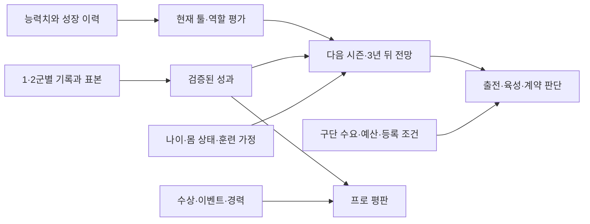

# 프로 선수 스카우팅·평가 체계 리서치와 적용안

2026-11-11 변경: 아래는 초기 설계·리서치 기록이다. 현행 프로 평판은 폐지했다. 현재 출전평가는 기량·시즌 중심 성적, 시즌평가는 당해 WAR, 누적 평가는 여러 시즌평가의 평균이다. 화면의 툴 20~80·보직 적합도·실험용 비교 숫자도 제거했다. [현행 평가 체계와 산식](pro-contract-assessment.md)을 우선한다.

작성·조사 기준일: 2026-11-06  
상태: **현재 데이터 기반 평가 엔진·리포트 1차 적용 완료 (`scouting-v1`). 역할 기량·보정 성과를 실제 평판에 연결했다. 등록·계약의 독립 모델 교체는 비교·검증 단계다.**  
연결 문서: [프로 라이프](pro-life.md), [훈련 규칙](training.md), [고교 평가 리서치](high-school-scouting-evaluation.md)


## 2026-11-06 구현 상태 · scouting-v1

문서의 단계적 적용 지침에 따라 **평가 자료층·계산·리포트·비교 경로**를 연결했고, 후속 사용자 합의로 실제 평판도 평가 기준으로 교체했다. [평판 계산과 영향 범위](reputation-evaluation.md)를 참고한다. 아래 리서치의 후속 단계 전체가 완료되었다는 뜻은 아니다.

| 항목 | 현재 적용 |
| --- | --- |
| 조회 | 고교·프로 대시보드의 선수 프로필 ‘선수 평가’, 고교 선수 카드·프로 개인 기록에서 열람 |
| 현재 능력 | 기본 능력과 1군 기준 툴 분리. 피로·부상 페널티는 기량 등급에 중복 적용하지 않음 |
| 실제 성적 | PA·BF·정수 아웃 기반 지표. 1/2군·포스트시즌 분리. 표본 0은 미측정 |
| 표본 보정 | 사건별 분모로 보정. 고교 사전 표본: 사건 60·안타 90·추가루타 150, 프로: 50·90·150 |
| 리그 기준 | 같은 시즌·레벨 합산 기록. 빈 시즌 초에는 전년도 동일 레벨 자료를 쓰고 기준 연도를 표시. 자료가 없으면 비교값을 만들지 않음 |
| 장기 성적 | 최근 3년의 사건 수·분모를 6:3:1로 합산. 빈 해는 제외하며 1군 100PA/30IP에서 2군 근거를 버리지 않음 |
| 현재/과거 | 월간·시즌 결산·소속/역할 변경·계약 검토·큰 능력 변화의 입력 자료를 보관. 구버전은 도입 시점부터 관찰 |
| 불변성 | 평가 조회는 난수·기록·평판·능력을 바꾸지 않음. 기준 계수·리그 환경·역할 가중치와 지명 당시 근거 보존 |
| 평판과 비교 모드 | 역할 기량·표본 신뢰도·레벨별 보정 성과는 실제 평판에 적용. 출전·계약의 새 독립 모델은 비교 단계 |

현재 관찰 입력은 선수마다 정기 평가 두 건과 입단·연간 결산·드래프트·소속/역할 변경·계약 검토의 보존 평가를 남긴다. 공통 기준표와 리그 환경은 공유하고 기록은 숫자 배열로 저장한다. 모든 선수에게 같은 기본 관찰을 적용하며 훈련 노출량을 스카우터 시찰 횟수로 표시하지 않는다.

**리포트 1차 검증(평판 연동 전):** 전체 258개 테스트, 이후 표시·전망·진로 경계 수정 영역 81개 재검증, 타입 검사·lint·빌드·실제 프로덕션 Worker 검증 통과. Worker에서 전 선수 월간 평가 생성, 지명 확장 평가와 프로 평가 상태가 순차 계산과 같음을 확인했다. 순수 계산 실험은 48개 능력 시드(개발 32/별도 16), 10/30/100/300PA, 다음 1,000PA를 비교했다. 선택한 프로 사전 표본은 별도 시드 OPS MSE 0.00549로 원시 성적 0.03904보다 작았다. 20만 타석의 조건부 BB·K·HR 분기도 확인했다. 이는 고정 상대 합성 실험이며 실제 승격·장기 계약·프로 성공을 검증한 결과가 아니다. [검증 자료](../validation/player-evaluation-v1.json), [실험 스크립트](../scripts/validate-player-evaluation.mjs).

**아직 전환하지 않은 부분:** 고교 지명식·신고선수 2점/TOP5·국가대표 TOP23, 프로의 등록·연봉 산식은 유지하되 평판 입력은 새 평가 기준으로 바뀌었다. 평판 80%의 현행 지명식과 평판 5%의 현행 계약식에도 간접 반영된다. 별도의 새 지명·승격·계약 모델 적용은 후속 단계다. 구종·타구 질·수비 기회·의학적 재발률처럼 엔진이 생성하지 않는 자료는 만들지 않는다.

공통 구현: [평가 계산](../lib/sim/player-evaluation.ts), [표본 보정](../lib/sim/evaluation-metrics.ts), [고정 기준·상대 전망](../lib/sim/evaluation-reference.ts), [성장 시나리오](../lib/sim/evaluation-projection.ts), [게임 연결·보관](../lib/sim/evaluation-lifecycle.ts), [화면](../app/components/player-evaluation.tsx).

프로 툴은 시즌 시작의 1군 등록 선수로 기준을 고정한다. 20명 미만 또는 표준편차가 작은 집단은 기본 분포로 보완하고 표시한다. 모델 전망은 고정된 투타 상대를 각 최대 64명씩 사용해 엔진의 조건부 확률을 평균한다. 정상 컨디션·현재 성향·기준 수비를 적용하며 OPS·BB/K/HR을 실전 기록과 구분한다.

다음 시즌/3년 전망은 공개된 재능 범위, 표준 회복 가능 훈련, 60/85/100% 참여, 연령과 노화 범위를 사용한다. 신고 성장 90%와 즉시 정식 전환 가정을 구분하고, 현재 무소속은 60% 성장·2시즌 제한 이후의 수치를 보장하지 않는다. 개인의 비공개 노화값이나 미래 이벤트·부상은 입력하지 않는다.

## 1. 결론과 권장 방향

프로에서는 **“지금 어느 수준의 상대에게 어떤 역할을 맡길 수 있고, 얼마나 꾸준히 기여하며, 앞으로 어떻게 달라질 것인가”**를 평가해야 한다. 고교 때의 전국 순위·드래프트 기대를 프로의 주전 경쟁·연봉·계약 평가에 그대로 이어 붙이면 평가 목적이 달라지는 문제를 해결하지 못한다.

권장하는 구조는 다음과 같다.

| 구분 | 답해야 하는 질문 | 게임에서의 용도 |
| --- | --- | --- |
| 실제 능력치·OVR | 어떤 능력을 얼마나 키웠나? | 기존 성장·훈련 피드백 유지 |
| 현재 스카우팅 평가 | 프로 1군 기준으로 어떤 장점과 약점이 있나? | 툴 평가, 역할 적합성, 육성 과제 |
| 성적 평가 | 어디에서, 얼마나 출전해, 무엇을 보여줬나? | 1·2군별 성과, 표본과 최근 추세 |
| 전망 | 다음 시즌과 3년 뒤 어느 역할을 기대하나? | 육성, 보직 전환, 장기 계약 |
| 신뢰도·가용성 | 평가 근거가 충분하며 실제로 출전할 수 있나? | 평가 출전, 부상 복귀, 계약 위험 |
| 구단의 결정 | 우리 팀에서 출전시키거나 영입할 이유가 있나? | 엔트리, 연봉, 계약, 트레이드 |

**첫 적용 대상은 현재 데이터만 사용하는 프로 리포트다.** 리포트를 만든 뒤 기존 출전·계약 판단과 나란히 검증하고, 확인된 부분부터 의사결정에 연결한다. WAR·Statcast를 흉내 낸 이름을 먼저 붙이거나 실제 리그의 비공개 가중치를 추정해 확정하지 않는다.

한국·일본·미국 자료에서 확인한 핵심은 관찰·기록·예측의 결합이다. 아래 국가별 비교는 공개된 구단 사례와 지표 작성자의 설명에 근거한다. 국가 전체에 통용되는 하나의 평가식이나 “한국은 정신력, 일본은 기본기, 미국은 데이터” 같은 구분을 확인한 것은 아니다.

## 2. 조사 범위와 근거의 성격

- **대상:** 이미 프로에 입단한 선수의 육성, 1군 활용, 영입·재계약 판단. 유망주 스카우팅 척도는 현재 능력과 미래 전망을 구분하는 방법으로 참고한다.
- **우선 자료:** 구단 공식 채용·업무 소개, 구단 영입 발표, MLB 공식 지표 설명, FanGraphs의 자사 평가·예측 방법 설명.
- **한계:** 영입 발표는 내부 리포트 원본이 아닌 공개 요약이다. 채용 공고는 업무 범위를 보여주지만 실제 모델 계수나 의사결정 비중을 공개하지 않는다. 공개 분석 사이트의 모델도 모든 구단의 내부 모델과 같지 않다.
- **시점:** 2025~2026년 공개 사례와 과거의 방법론 자료를 구분했다. 오래된 자료의 구속 기준이나 선수 예시는 현재 리그 기준으로 재사용하지 않는다. 조회일과 게시일도 구별한다.
- **표기:** 3절은 외부 자료에서 확인한 사실과 그 해석, 4~5절은 현재 저장소 확인 결과, 6절 이후는 우리 게임에 대한 제안이다. 제안 수치와 예시는 실제 구단의 공통 규정이 아니다.

## 3. 한국·일본·미국은 무엇을 평가하는가

### 3.1 한국: 기록과 함께 구질·역할·수비·적응 가능성을 설명한다

삼성의 2025년 12월 맷 매닝 영입 발표는 평균 구속과 구종 구성, MLB 선발 경험·이닝·ERA·WHIP, 메디컬 테스트를 함께 제시한다. 이는 영입 대상의 성적뿐 아니라 **어떤 공을 던지고 어떤 역할을 수행해 왔는지**를 함께 설명하는 사례다. 2026년 시즌 성과를 검증한 자료가 아니라 계약 당시의 평가 근거다. [삼성 공식 영입 발표](https://www.samsunglions.com/intro/intro02.asp?act=view&idx=1017152)

타자의 경우 삼성은 2024년 르윈 디아즈 영입 발표에서 MLB와 멕시코리그 기록을 구별하고, 장타력·1루 수비·홈구장 필요·리그 적응 기대를 언급했다. 이 사례에서 읽을 수 있는 것은 **기록을 남긴 환경과 구단이 원하는 역할을 함께 본다**는 점이다. 공개된 기록만으로 구단의 리그 간 환산 계수를 알 수는 없다. [삼성 공식 타자 영입 발표](https://www.samsunglions.com/intro/intro02.asp?act=view&idx=1016816)

NC의 2023년 와이드너 영입 자료도 평균·최고 구속, 구종, 제구 평가와 선발 경험을 연결한다. 따라서 투수 스카우팅을 승수나 ERA 한 항목으로 요약하는 방식은 이런 공개 설명의 정보량을 담지 못한다. [NC 공식 보도자료](https://about.ncsoft.com/news/article/news-nc-dinos-230131)

트래킹 데이터의 활용도 확인된다. 삼성은 2018년 트랙맨 도입 발표에서 회전·변화량·익스텐션, 타구 속도·발사각을 소개하며 외국인 선수 스카우트와 미래가치 평가 등에 활용할 계획을 밝혔다. **2018년의 도입 목적을 보여주는 자료이며, 2026년 전 구단의 장비·평가식을 입증하는 자료는 아니다.** [삼성 트랙맨 도입 발표](https://www.samsunglions.com/intro/intro02.asp?act=view&idx=774908)

게임에 가져올 요소는 구종을 꾸며내는 것이 아니라 **능력의 특징 → 검증된 역할·성적 → 우리 팀의 필요** 순서로 평가 이유를 설명하는 방식이다. 구속 능력치가 높더라도 선발을 버틸 체력, 제구, 회복이 부족하면 서로 다른 역할 전망을 제시할 수 있다.

### 3.2 일본: 스카우트 리포트와 분석을 결합해 1군에서의 통용 가능성을 판단한다

소프트뱅크의 2026년 4월 스카우트 부문 모집 공고는 국내외 선수 정보 분석, 중장기 편성 시뮬레이션, 스카우트 리포트와 외부 데이터의 통합, 세이버메트릭스를 이용한 성적 예측을 업무로 명시한다. 리포트와 데이터 분석이 같은 선수 획득 업무 안에 들어간다는 직접적인 근거다. [소프트뱅크 공식 공고](https://www.softbankhawks.co.jp/news/detail/202600990452.html)

DeNA의 공식 채용 인터뷰는 더 구체적이다. 2025년 12월 기준 게임전략 부문 설명에 따르면 자체 `Pitching+`는 공의 궤적·변화량에 카운트와 코스 등을 결합해 **평균적인 1군 타자에게 통할지** 예측한다. 다른 팀의 2군·전력외 선수를 분석하다 표면 성적은 두드러지지 않아도 모델상 1군 수준인 선수를 발견해 영입을 제안한 사례도 설명한다. [DeNA 공식 인터뷰](https://www.baystars.co.jp/recruit/)

이 자료는 NPB 전체의 표준 지표를 뜻하지 않는다. `Pitching+`의 이름만 빌려 우리 `velocity + control + movement`를 더하면 해당 모델을 재현하는 것도 아니다.

게임에 대한 시사점은 분명하다. **2군에서 몇 위인지와 1군에서 통할지는 별개 질문이다.** 2군에서 성적이 좋아도 상대 수준을 반영해야 하고, 성적이 평범해도 1군에서 쓸 수 있는 강점이 있는 선수는 평가 출전을 받을 수 있어야 한다. 반대로 등록 신분이나 최근 한 경기만으로 기량 자체를 낮게 판정하지 않는다.

### 3.3 미국: 툴 등급·성적 지표·미래 예측의 목적이 서로 다르다

MLB는 20–80 척도에서 50을 평균으로 설명한다. [MLB 공식 척도 설명](https://www.mlb.com/glossary/miscellaneous/scouting-grades)

스카우팅 실무 경험을 바탕으로 한 FanGraphs 설명에서는 타자의 타격·파워·주력·수비·송구, 투수의 구종별 평가와 커맨드 등을 구별한다. 각 툴의 현재/미래 평가를 병기하며, 파워의 원재료와 경기에서 실제로 꺼내 쓰는 파워도 구분할 수 있다. 이 설명은 2014년 자료이므로 표에 있는 당시 구속별 등급을 현행 기준으로 옮기지는 않는다. [FanGraphs 스카우팅 척도 해설](https://blogs.fangraphs.com/scouting-explained-the-20-80-scouting-scale/)

구단 공개 직무 설명에서도 분석 부문이 스카우팅과 선수 획득 평가를 지원한다. [샌프란시스코 구단 업무 소개](https://www.mlb.com/giants/team/front-office/baseball-operations)

공개 평가 체계는 다음처럼 목적을 나눠 읽는 것이 적절하다.

| 자료·지표 | 설명하는 것 | 읽을 때의 한계 |
| --- | --- | --- |
| 스카우팅 툴 등급 | 능력의 구성과 현재/미래의 역할 가능성 | 전체 등급은 툴의 단순 평균이라고 보장되지 않음 |
| wRC+ | 리그·구장 환경을 조정한 타격 생산성 | 수비·주루를 포함한 전체 선수 가치가 아님 |
| FIP | 홈런·볼넷/사구·삼진 중심의 투구 평가 | 투구의 모든 요소나 미래 성적을 단독으로 설명하지 않음 |
| WAR | 대체 수준 대비 종합 기여를 승수 단위로 추정 | 제공처별 계산 차이가 있고, 과거 WAR와 미래 전망은 구분해야 함 |
| Statcast 기대 성적 | 타구 질 등을 이용해 결과와 과정의 차이를 설명 | 타구 단위 관측이 필요하며, 기대 성적 자체가 장기 예측 모델 전부는 아님 |
| 프로젝션 | 과거 기록·나이·환경 등을 바탕으로 미래 성적 추정 | 예측 시점·기간·출장량 가정에 따라 의미가 달라짐 |

지표 정의 근거: [wRC+](https://library.fangraphs.com/offense/wrc/), [FIP](https://library.fangraphs.com/pitching/fip/), [FanGraphs WAR](https://library.fangraphs.com/misc/war/), [Statcast 기대 성적](https://baseballsavant.mlb.com/leaderboard/expected_statistics), [프로젝션의 목적](https://library.fangraphs.com/principles/projections/).

최근의 구체적 예로 OOPSY 작성자는 2026년 설명에서 나이 곡선, 리그 수준 환산, 구장·득점 환경, 평균 회귀, 최근성 가중치를 사용한다고 밝힌다. 해당 peak 모델은 출전량을 통일하고 부상을 반영하지 않는다는 한계도 명시한다. 따라서 **기량 전망과 실제 출장량 전망을 따로 읽어야 한다.** 이는 공개 모델 한 가지의 방법론이며 MLB 구단들의 공통 공식이 아니다. [OOPSY 작성자 설명, 2026-03-09](https://blogs.fangraphs.com/oopsy-peak-projections-are-now-live-on-fangraphs/)

### 3.4 세 나라를 비교해 얻은 설계 원칙

| 항목 | 한국에서 확인한 사례 | 일본에서 확인한 사례 | 미국에서 확인한 사례 | 우리 게임의 선택 |
| --- | --- | --- | --- | --- |
| 능력 관찰 | 구속·구종·제구·장타·수비 | 스카우트 리포트와 외부 정보 통합 | 툴의 현재/미래 등급 | 기존 능력치를 프로 기준으로 해석 |
| 성적의 환경 | 이전 리그·역할·이닝을 명시 | 2군 성적과 1군 통용 가능성 구별 | 리그·구장 보정 및 수준 환산 | 1·2군 분리, 1군 전망 별도 |
| 미래 평가 | 적응·미래가치·육성 방향 | 중장기 편성과 성적 예측 | 나이·회귀·최근성 기반 예측 | 다음 시즌/3년 뒤 전망 |
| 구단 활용 | 필요한 장타·선발 등 역할 | 편성·육성·획득에 연결 | 획득 평가와 분석 지원 | 출전·계약·육성 판단 분리 |
| 공개 자료의 범위 | 영입 이유 요약 중심 | 업무와 자체 모델 사례 | 척도·공개 지표 방법론이 상대적으로 자세함 | 자료 공개량 차이를 국가 성향으로 해석하지 않음 |

위 표는 앞 절의 자료를 종합한 해석이다. **우리 리그 하나에 세 나라의 장점을 적용하는 제안이며, KBO·NPB·MLB 세 리그를 새로 구현한다는 뜻은 아니다.** 향후 해외 진출을 넣는다면 대상 리그별 기준과 환산 근거를 추가해야 한다.

## 4. 현재 게임은 이미 무엇을 갖고 있는가

분석 기준은 2026-11-06 작업 트리다. 당시 HEAD는 `086f7da`였으나 미커밋 변경이 있어 해당 커밋만으로 이 상태를 재현할 수는 없다. 과거 기획의 수치보다 실제 함수와 현재 타입을 우선 확인했다.

### 4.1 데이터 자산

| 데이터 | 실제 위치·필드 | 활용 가능성 | 주의점 |
| --- | --- | --- | --- |
| 11개 능력 | `Player.stats` | 현재 툴과 역할 능력 | 실제 km/h·회전수·타구속도가 아닌 게임 점수 |
| 재능·공개 진행 | `talent`, `talentExposure` | 성장 전망과 정보 공개 범위 | 재능은 경기 기량과 별개. 숨겨진 값 노출 주의 |
| 나이·노화 | `age`, `agingOffset`, `ageChanges`, `pro-growth.ts` | 연령별 성장·쇠퇴 시나리오 | 현재 노화 규칙은 게임 규칙 |
| 시즌별 기록 | `seasonStats`, `career[].records` | 장기 추세와 통산 기록 | 합산 기록만으로 1군 실력 판정 금지 |
| 1·2군 기록 | `seasonByLevel`, `career[].byLevel` | 리그별 성과·검증량 | 이미 있으므로 새로 원시 데이터 수집할 필요 없음 |
| 구단별 기록 | `seasonByClub`, `career[].byClub` | 이적 전후 기록 추적 | 총계와 구단별 기록을 중복 합산하지 않음 |
| 포스트시즌 | `seasonPostseason`, 경력의 `postseason` | 큰 경기 경력·성과 | 정규 성적과 기본적으로 분리 |
| 최근 기록 | `recentAppearances`, `recentZ` | 단기 컨디션·최근 성과 | 원시 최근 기록 배열에 리그·날짜가 직접 붙어 있지 않음 |
| 경기 박스스코어 | `calendar.events[].boxScore`·경기 날짜/대회 | 현재 보유 경기의 출전량과 기간별 성적 | 장기 경력에 모든 경기 상세가 남는다고 가정하지 않음 |
| 몸 상태 | `fatigue`, `forcedRest`, `injury`, `lastPitched` | 당일 출전·복귀 상태 | 완전한 장기 부상 이력은 없음 |
| 역할·포지션 | `primaryRole`, `position`, `eligiblePositions`, `twoWay` | 선발/불펜·수비 역할별 평가 | 실제 포지션별 수비 이닝 기록은 없음 |
| 계약·등록·이적 | `professional`, `proContract`, `ProWorld.clubs` | 예산·수요·가용성·구단 전략 | 선수 기량과 별도의 결정 조건 |
| 드래프트 리포트 | `DraftPick.scoutingReport` | 지명 당시 판단 보관 | 현재 프로 평가와 목적·시점이 다름 |

근거: [선수·기록 타입](../lib/sim/types.ts), [프로 타입](../lib/sim/pro-types.ts), [성장·노화](../lib/sim/pro-growth.ts), [경기 집계](../lib/sim/match-engine.ts).

### 4.2 실제 평가 로직

| 항목 | 현재 구현 | 프로 평가 관점에서 보완할 점 |
| --- | --- | --- |
| 대표 OVR | 일반 선수는 주력 분야, 겸업은 투타 OVR 평균. 최대 100 | 성장 요약으로 유지하되 포지션 가치·출장량과 구별 |
| 평판 | OVR 60% + 성적평판 40% + 이벤트·프로·겸업 보너스 | 기량·성과·인지도가 한 점수에 섞임 |
| 성적평판 | OPS 또는 투구 지표를 사전 표본 60으로 보정 후 표준화·순위화 | 타자는 PA, 투수는 outs가 보정 표본 단위. 프로 1·2군을 분리하지 않음 |
| 드래프트 평가 | 평판 80% + 1~10 재능을 0~100으로 환산한 값 10% + 적합도 10% | 고교 선발 목적의 평가로 보존 |
| 당일 출전 | 역할 점수 + 최근 성적 - 피로 - 신고선수 6점 - 관리 상태 감점 | 즉시 출전 판단과 장기 선수 가치를 구별할 기반은 이미 있음 |
| 프로 등록 | 전 구단 같은 포지션 경쟁, `selectionScore`, 등록 간격·인원 제한 | 1군 대상 평가·성적의 수준 보정이 필요 |
| 계약 | 최근 성과 45% + 역할 30% + 나이 기반 항목 10% + 가용성 10% + 평판 5% | 미래 전망, 검증량, 누적 기여, 겸업을 더 정확히 표현할 여지 |
| 구단 관심 | 계약 평가에 우승 도전/리빌딩 방향을 반영 | 공통 선수 평가와 구단 선호를 분리할 출발점 |
| 스카우팅 리포트 | 지명 당시 강점 2개, 평판·적합도·일부 기록·개발 과제 | 독립적인 프로 평가 모델은 아직 아님 |

근거: [engine.ts의 overall·reputationScore·updateReputation·selectionScore](../lib/sim/engine.ts), [밸런스 파라미터](../baseball_balance_v0_4.json), [draftAssessment](../lib/sim/draft.ts), [프로 평가](../lib/sim/pro-evaluation.ts), [시장 평가](../lib/sim/pro-market.ts), [등록 평가](../lib/sim/pro-world.ts), [드래프트 리포트](../lib/sim/scouting-report.ts).

계약 성과 계산은 다음과 같다. 이 수식은 현실 구단 방식이 아니라 **현행 코드 설명**이다.

```text
타자 성과 = 50 + (OPS - .720) × 65
투수 성과 = 50 + ((SO - 1.5×BB - 2×HR) / BF - .13) × 120
1군 성과는 0~100, 2군 성과는 0~70으로 제한

해당 연도 성과 = a × 1군 성과 + (1-a) × 2군 성과
a = min(1, 1군 PA / 100)       # 주 역할이 타자인 경우
a = min(1, 1군 IP / 30)        # 주 역할이 투수인 경우

최근 3개년 성과 = 올해·전년·전전년을 .6/.3/.1로 합산
                 존재하는 연도 행의 가중치 합으로 다시 나눔
```

데이터가 없는 리그의 `performanceValue`는 50을 반환한다. 현재 연도 행은 기록이 없어도 만들어질 수 있다. 따라서 시즌 초의 빈 50점이 직전 시즌의 검증된 성적을 희석하는 문제와, 1군 100PA/30IP에 도달하면 해당 연도의 2군 정보가 완전히 빠지는 문제를 별도로 다뤄야 한다.

### 4.3 먼저 해결해야 할 평가상의 불일치

1. **리그 혼합:** `updateReputation`은 `seasonStats`를 합산한다. 프로에서 2군 성적도 1군과 같은 모집단에서 평판·최근 성적 산정에 들어간다.
2. **고정 기준:** 계약 성과의 `.720`, `.13`은 해당 시즌의 득점 환경과 무관하다. 리그 전체 타고투저가 바뀌어도 기준은 그대로다.
3. **작은 표본:** 1군 비중 조정은 있으나 2군 자체의 작은 표본까지 충분히 보정하는 구조는 아니다. 단기 성적이 과장될 수 있다.
4. **주 역할 편중:** 계약 성과는 `primaryRole`로 타격/투구 중 하나를 선택한다. 겸업의 다른 분야 기여를 직접 합산하지 않는다.
5. **나이와 잠재력 혼용:** 계약의 `potential`은 23세 이하 80, 24~29세 65 등 나이표다. 개인의 성장 이력·현재 능력·훈련 전망을 평가한 값이 아니다.
6. **당일 상태와 장기 가용성 혼용:** 현재 피로와 잔여 부상 페널티가 계약 점수에 들어간다. 시즌 내내 꾸준했어도 계약 직전 피로로 연간 가용성이 달리 평가될 수 있다.
7. **경기 기량과 보직 점수의 차이:** 선발 `roleScore`는 스태미나·제구·회복 비중이 높고 구속 비중은 5%다. 반면 타석 결과는 별도의 구속·제구·변화구·BQ 조합으로 계산한다. 기존 역할 가중치를 현실 스카우팅 표준으로 설명하면 안 된다.
8. **리포트 문구와 관측 범위:** `arm`은 포수 평가에 쓰이지만 경기에서는 외야진의 어깨 평균으로 추가 진루 등에 영향을 준다. 현재 엔진으로 포수 도루저지·프레이밍 실적을 주장할 수 없다.

이는 현재 모델이 의도한 단순화를 분석한 것이며, 모든 항목이 개별 버그라는 뜻은 아니다. 개선 우선순위는 **리그 분리 → 표본·기준 보정 → 역할·겸업 → 전망·계약**이다.

## 5. 현실의 평가 항목을 현재 데이터에 연결하기

### 5.1 툴 매핑

| 현실에서 살피는 항목 | 현재 연결할 데이터 | 리포트에 쓸 수 있는 표현 | 아직 쓸 수 없는 표현 |
| --- | --- | --- | --- |
| 타격·컨택 | `contact`, AVG, K% | 컨택 기반이 좋음, 삼진 억제 성과 | 특정 코스 공략·배트 스피드·컨택률 실측 |
| 선구·타석 판단 | `bq`, BB%, K% | 볼넷 생산과 삼진 관리, 타격 판단의 간접 근거 | 존 밖 스윙률·초구 선택·카운트별 판단 |
| 파워 | `power`, ISO, HR/PA | 파워 능력과 경기 장타 생산을 따로 제시 | 평균 타구속도·배럴률·연습 타구 비거리 |
| 주력·주루 | `speed`, 3B | 주력 툴, 주루 활용 가능성 | 도루 성공률·주루 득점 기여 실측 |
| 수비 | `defense`, 포지션·자격 | 해당 역할의 수비 능력 평가 | 수비 이닝 기반 실적·OAA·DRS·실책률 |
| 송구 | `arm` | 송구 능력의 게임 내 평가 | 송구 km/h·팝타임·도루저지율 |
| 빠른 공 기반 | `velocity`, K/BF | 구속 툴과 탈삼진 생산 | 실제 평균 구속·회전 효율·구종별 구위 |
| 제구 | `control`, BB/BF | 제구 능력과 볼넷 억제 | 목표 지점 대비 오차인 커맨드 실측 |
| 변화구 | `movement`, HR/BF 등 | 변화구 능력과 장타 억제 성과를 병기 | 슬라이더·커브 개별 등급, 수직/수평 무브먼트 |
| 이닝 소화 | `stamina`, IP·BF, 회복·피로 | 선발 수행 조건, 실제 투구량 | 투구수·3순환 상대 성적·구속 유지력 실측 |
| 회복·건강 | `recovery`, 현재 부상·피로 | 현재 몸 상태와 회복 능력 | 누적 부상 이력 기반 재발 확률 |
| 야구 판단 | `bq` | 경기 엔진에 반영되는 판단 능력 | 성격·리더십·성실성·클러치 능력 판정 |

`bq`를 인성 점수로 바꾸지 않는다. `control` 하나를 스트라이크 투입 능력과 정밀 커맨드 두 개의 독립 관측값처럼 표시하지 않는다. 화면의 고정 “우투우타” 문구도 실제 좌우 상대 기록이 있다는 의미는 아니다.

### 5.2 지금 바로 계산할 수 있는 성적

아래는 분모가 0이면 `미측정`으로 표시한다. 미측정을 0점·리그 최하위로 처리하지 않는다.

| 분야 | 지표 | 현재 데이터에서의 계산 |
| --- | --- | --- |
| 타격 | AVG | H / AB |
| 타격 | OBP | (H + BB) / PA |
| 타격 | SLG | (H + 2B + 2×3B + 3×HR) / AB |
| 타격 | OPS | OBP + SLG |
| 타격 | ISO | SLG - AVG |
| 타격 | BB%, K%, HR% | 각각 BB, SO, HR을 PA로 나눔 |
| 투구 | IP | outs / 3. 기록 표기의 20.1이닝은 20 + 1/3이지 20.1이 아님 |
| 투구 | ERA | ER × 27 / outs |
| 투구 | WHIP | (H + BB) × 3 / outs |
| 투구 | K%, BB%, K-BB%, HR% | SO/BF, BB/BF, (SO-BB)/BF, HR/BF |
| 양쪽 | 출장량 | PA·BF·outs를 별도 유지. 경기 수는 보유 박스스코어로 집계 |

현재 경기 엔진에는 사구·희생플라이·희생번트가 없어 OBP의 위 계산이 게임 기록과 일치한다. 이런 사건을 추가하면 분모·분자도 함께 바꿔야 한다. 또한 현재 득점 처리에서는 R과 ER이 함께 증가하므로 ERA와 비자책점까지 구분하는 현실 투구 평가는 같지 않다.

**특히 `GB`, `FB`를 일반적인 전체 타구 유형으로 해석하면 안 된다.** 현재는 안타가 아닌 아웃 중 삼진이 아닐 때만 둘 중 하나가 증가한다. 따라서 `GB/(GB+FB)`는 전체 땅볼률이 아닌 **삼진을 제외한 아웃의 땅볼 비중**이다. 이를 GB%·발사각 성향·xFIP 입력으로 재사용하지 않는다. [집계 분기 확인](../lib/sim/match-engine.ts)

### 5.3 계산 가능성과 정당한 이름은 다르다

| 항목 | 현시점 판단 | 권장 처리 |
| --- | --- | --- |
| 리그 대비 OPS·K-BB% | 가능 | 시즌·레벨별 평균과 차이 표시 |
| 간이 FIP | 수학적으로 가능 | `게임 간이 FIP`로 제한. 실제 구단 평가 모델이라 부르지 않음 |
| wOBA·wRC+ | 결과 종류는 상당 부분 있음 | 게임 득점 가중치·기준 환경을 검증하기 전 공식 이름 사용 보류 |
| xwOBA·배럴·구종별 구위 | 입력이 없음 | 생성하지 않음 |
| WAR | 새 경기부터 수비 기회·처리 결과·포지션 아웃 기록을 추가함 | [출전평가의 게임용 WAR](pro-war-assessment.md)로 적용. OVR을 WAR로 변환하거나 과거 수비·주루 기록을 만들지 않음 |
| OAA·포수 프레이밍 | 기회·위치·판정 데이터가 없음 | 능력치 기반 평가임을 표시 |
| 좌우 상대 성적 | 손잡이·상대별 분할 기록이 없음 | 추정해서 쓰지 않음 |
| 부상 재발률 | 부상 이력과 검증 모델이 없음 | 현재 부상 상태와 전망의 불확실성만 표시 |

간이 FIP를 보조 지표로 넣는다면 현재 사건 집합에 맞춰 다음처럼 정의할 수 있다.

```text
게임 간이 FIP = (13×HR + 3×BB - 2×SO) / IP + C
C = 같은 레벨 리그 ERA - (13×리그 HR + 3×리그 BB - 2×리그 SO) / 리그 IP
```

원래 FIP는 사구를 포함하고 상수로 득점 환경을 맞춘다. 위 식은 사구 사건이 없는 게임용 단순화이며, 13/3/-2 계수의 게임 내 적합성도 별도 검증해야 한다. 소수 이닝에서는 과도하게 변동할 수 있어 평가 핵심보다 설명 보조로 쓴다. [FIP의 원식과 상수](https://library.fangraphs.com/pitching/fip/)

Statcast 기대 성적에는 타구 단위 질 정보가 필요하고, 외야 OAA는 수비 기회의 난도와 처리 결과가 필요하다. 우리 데이터가 없는 부분을 `power`, `defense`로 대입하면 동일한 지표가 아니다. [Statcast 기대 성적](https://baseballsavant.mlb.com/leaderboard/expected_statistics), [외야 수비 기회·OAA 설명](https://baseballsavant.mlb.com/leaderboard/catch_probability)

## 6. 제안하는 프로 리포트 구조

### 6.1 화면에서 구별할 여섯 가지



리포트 상단에는 **기준일, 대상 리그, 현재 역할, 현재 평가, 전망, 검증 정도**를 둔다. 아래에는 강점 두 가지, 우려 두 가지, 실제 성적, 다음 개선 과제를 둔다. 모든 수치를 한꺼번에 보여주기보다 결론을 먼저 보여주고 근거를 펼쳐 볼 수 있게 한다.

주 화면의 OVR은 그대로 성장 요약으로 사용한다. 프로 리포트의 상대 평가가 달라져도 실제 능력치가 줄었다고 오해하지 않도록 `능력 68 / 1군 대비 툴 55`처럼 다른 척도임을 명시한다.

### 6.2 현재 기량과 오늘의 컨디션

- **현재 기량:** 피로·일시적 부상 페널티·일시 이벤트를 제거한 `stats` 기준. 정상적인 몸 상태에서의 능력이다.
- **당일 경기력:** `effective`의 자세·피로·부상 효과를 반영한 당일 상태. 선발·교체 판단에 쓴다.
- **가용성:** 경기 출전 가능 여부와 관리 필요성. 출전 불가능은 평가 점수로 억지 보상하지 않고 후보 제외 조건으로 처리한다.
- **장기 가용성 전망:** 과거 출전량과 향후 운용 시나리오. 부상 이력이 없으면 정밀 재발 확률을 표시하지 않는다.

예를 들어 부상 중인 주전은 “현재 기량 60, 복귀 전 출전 불가”다. 기량 등급을 35로 내린 뒤 계약에서도 다시 부상 감점을 반복하는 방식은 피한다.

## 7. 20–80 척도를 도입하는 방법

이 절은 미국 척도에서 착안한 **게임용 표기 제안**이다. 한국·일본 구단도 같은 환산식을 쓴다는 뜻이 아니다.

### 7.1 기준 모집단부터 고정한다

1. 기본 대상은 **게임 세계의 프로 1군**이다. 2군 선수도 현재 소속과 무관하게 같은 1군 기준으로 툴을 표시한다.
2. 시즌 시작에 1군 등록 선수로 기준 스냅샷을 만든다. 다음 시즌에는 새 기준을 만들고 이전 리포트의 기준은 보존한다.
3. 타격 툴은 야수·겸업 타자, 투구 툴은 투수·겸업 투수끼리 비교한다. 툴과 역할 평가의 모집단 ID를 저장한다.
4. 수비·역할은 포지션 맥락도 병기한다. 유격수 수비 60과 1루수 수비 60을 같은 수비 기여량으로 단정하지 않는다.
5. 작은 역할 집단은 상위 집단으로 묶는다. 제안 기준은 20명 미만이면 확대, 그것도 불가능하면 게임 기본 기준표 사용이다.
6. 시즌 중 이적·승격만으로 같은 능력의 툴 등급이 바뀌지 않도록 기준을 매 조회마다 다시 만들지 않는다.

미래 툴 전망도 해당 리포트의 기준표에 대입해 현재와 비교한다. 이 경우 “현재 1군 기준의 3년 뒤 기량 전망”이라고 표시한다. 미래 리그 전체의 성장·신인 유입까지 예측하지 않았다면 3년 뒤 실제 리그 순위라고 표현하지 않는다.

### 7.2 초기 환산안

```text
z = (선수 능력 - 기준 집단 평균) / 기준 집단 표준편차
툴 표시 등급 = clamp(5 × round((50 + 10×z) / 5), 20, 80)
```

표준편차가 거의 0이거나 모집단이 너무 작으면 저장된 기본 분포를 쓴다. 10점당 표준편차 하나로 만드는 것은 이번 게임의 초기 정규화 방식이다. 스카우터가 실제로 이 산식을 계산해서 등급을 준다는 의미가 아니다.

| 게임 툴 등급 | 상대적 의미 |
| --- | --- |
| 20~30 | 1군 기준으로 큰 보완 필요 |
| 35~40 | 평균 이하 |
| 45 | 평균에 조금 못 미침 |
| 50 | 기준 집단 평균 수준 |
| 55 | 평균 이상 |
| 60 | 뚜렷한 강점 |
| 65~70 | 리그 상위 강점 |
| 75~80 | 매우 드문 강점 |

가상의 평균 65·표준편차 8인 툴에서 능력 73은 60, 능력 57은 40이다. **능력치 50을 툴 50으로 그대로 옮기지 않는다.** 80도 만점 확률이나 성공 보장을 뜻하지 않는다.

내부 의사결정에는 반올림 전 값을 사용한다. 5점 단위 화면 표시가 승격·연봉의 갑작스러운 경계가 되어서는 안 된다. 20–80 등급, 백분위, 0~100 OVR을 그대로 더하거나 평균 내지도 않는다.

### 7.3 종합등급은 툴 평균과 다르다

- 타자: 타격 전망에 주루·수비의 역할 적합성을 더해 읽는다. DH와 포수에게 같은 구성으로 종합등급을 주지 않는다.
- 투수: 구속·제구·변화구의 타자 상대 능력과 선발/불펜을 버틸 체력·회복을 함께 본다.
- 겸업: **타자 평가 / 투수 평가**를 각각 표시한다. 대표 OVR의 평균 표시는 유지하되 계약 기여를 평균으로 처리하지 않는다.
- `roleScore`는 첫 버전의 **기존 보직 적합도**로 병기할 수 있다. 이를 바로 새 프로 종합등급으로 이름만 바꾸지 않는다.

다음 시즌 전망과 3년 뒤 전망을 기본으로 한다. 베테랑에게 과거 최고점이나 평생 최고 잠재력을 현재 계약 전망처럼 보여주지 않는다. 3년 뒤 예상 기량은 현재보다 낮을 수 있다.

## 8. 성적·표본·리그 수준을 처리하는 방법

### 8.1 성적표와 판단용 성적을 분리한다

실제 성적표는 원래 기록을 그대로 보여준다. 판단용으로만 작은 표본을 평균 쪽으로 보정한다. 사용자에게 “OPS .900인데 평가에는 왜 .800이 쓰이는가”를 표본 설명으로 납득시켜야 한다.

같은 시즌·레벨의 합산 기록으로 리그 평균을 만든다. 개인 타율의 단순 평균 대신 전체 H/전체 AB, 전체 BB/전체 PA처럼 해당 분모를 반영한다. 시즌 초에는 직전 시즌 동일 레벨 평균 또는 검증된 초기 시뮬레이션 기준을 사용한다.

```text
보정 비율 = (실제 사건 수 + 사전 표본 × 기준 비율) / (실제 표본 + 사전 표본)
```

예시로 기준 BB%가 10%, 사전 표본이 100PA라면 20PA에서 볼넷 4개를 얻은 선수의 관측 BB%는 20%지만 판단용 값은 `(4+10)/(20+100) = 11.67%`다. 실제 기록 20%는 바꾸지 않는다.

사전 표본 100은 이 설명의 예시다. 실제 적용에서는 BB·K·장타 등 지표별로 다음 기간의 예측 오차를 비교해 결정한다. 현행의 모든 지표에 같은 60을 쓰는 방식은 비교 기준으로 남긴다.

OPS에 적용할 때는 OBP와 SLG의 분모가 다른 점을 반영한다. 가능하면 볼넷·안타 종류 등 구성 사건을 보정해 재조합한다. 단순화해 OPS 자체를 보정한다면 근사임을 기록한다. 투수의 K·BB·HR 비율은 BF를 사용하고, 이닝은 출장량·ERA 표시 등에 따로 쓴다.

### 8.2 최근 3년을 합칠 때

- 최근성 가중치 `.6/.3/.1`은 현행 비교 기준으로 활용하되 확정 최적값으로 보지 않는다.
- **연도별 사건 수와 분모에 가중치를 곱해 합친 뒤 비율을 계산한다.** 10PA 시즌과 500PA 시즌의 비율을 같은 신뢰도로 다루지 않는다.
- 기록이 없는 올해를 “50점짜리 한 시즌”으로 추가하지 않는다. 미출전 정보는 가용성 항목에 반영할 수 있지만 타격·투구 능력 표본으로 만들지 않는다.
- 레벨별 환산을 마치기 전에는 1군과 2군 사건을 합치지 않는다.
- 포스트시즌은 별도 표시한다. 정규 평가를 대체하는 대규모 가산점은 주지 않는다.

최근성·나이·평균 회귀를 결합한다는 발상은 공개 예측 모델에서 참고한 것이며, 위 산식과 우선순위는 우리 게임의 설계다. [프로젝션 설명](https://library.fangraphs.com/principles/projections/), [OOPSY 방법론](https://blogs.fangraphs.com/oopsy-peak-projections-are-now-live-on-fangraphs/)

### 8.3 2군 성적을 1군 전망으로 연결하기

**첫 리포트에서는 1군·2군 성과를 따로 표시한다.** 검증되지 않은 “2군 OPS × 0.8” 같은 환산식을 넣지 않는다. 1군 실전이 없으면 “1군 검증 전”으로 쓰되 능력치 기반 전망은 별도로 제공할 수 있다.

게임에는 현실과 다른 장점이 있다. 타석 결과를 만드는 `probabilities`가 있으므로 동일한 선수를 **고정된 1군 상대·수비 환경**에 놓은 모델 전망을 계산할 수 있다.

```text
현재 엔진의 분기를 그대로 따른 타석 확률 예시
볼넷 확률 = bb
안타 확률 = (1-bb) × hit
삼진 확률 = (1-bb) × (1-hit) × k
홈런 확률 = (1-bb) × hit × hr
```

`hit`, `k`, `hr`는 모두 독립적인 타석 결과 확률이 아니다. 실제 엔진의 조건부 분기를 그대로 사용해야 한다. [확률 계산](../lib/sim/engine.ts), [타석 진행](../lib/sim/match-engine.ts)

권장 계산 조건은 다음과 같다.

| 항목 | 제안 |
| --- | --- |
| 상대 | 시즌 기준 1군의 투수/타자들을 동일 조건으로 평가. 비선형 확률이므로 가능하면 평균 선수 한 명보다 상대별 결과를 평균 |
| 컨디션 | 정상 상태·부상 페널티 없음. 자세는 현행 선택값을 명시하고 다른 자세는 별도 비교 |
| 수비 | 고정된 1군 기준 수비·송구 환경 |
| 결과 | 모델 예상 BB%·K%·장타/OPS 등. `실전 성적`과 명확히 구분 |
| 제한 | 선수의 실제 기량을 아는 게임 모델의 전망. 현실 스카우트의 완벽한 관측을 재현한 것은 아님 |
| 실행 | 순수 계산 또는 별도 상태 복사·전용 난수 사용. 본 게임 RNG·피로·기록을 변경하지 않음 |

그 다음에는 여러 시드에서 **평가 당시의 능력·2군 성적 → 이후 1군 성적** 자료를 모아 전망을 보정한다. 승격자만으로 학습하면 선발 편향이 생기므로 표준 상대 실험이나 폭넓은 평가 출전 자료를 함께 사용한다. 평가일 이후 능력 상승을 과거 평가의 입력으로 넣지 않는다.

최종 모델은 2군 성적을 일괄 70점에서 잘라내는 대신, 수준 환산된 증거와 표본 신뢰도를 결합하는 방향이다. 이 변경은 검증 후 계약·등록 평가에 반영한다.

### 8.4 평가 신뢰도

신뢰도는 기량의 높낮이가 아니라 **무엇이 얼마나 검증되었는지**다. 아래 기준은 UI용 초기안이며 통계적 95% 신뢰구간이 아니다.

| 증거 | 표시 제안 |
| --- | --- |
| 1군 기록 없음 | 1군 검증 전 |
| 1군 1~99PA / 1~119BF | 제한된 표본 |
| 1군 100~299PA / 120~359BF | 검증 진행 |
| 1군 300PA 이상 / 360BF 이상 | 시즌 내 근거 축적 |
| 여러 시즌 기록과 일관된 전망 | 장기 근거 축적 |

타격·투구·수비에 서로 다른 신뢰도를 둔다. 타격 500PA가 있다고 수비 실측 신뢰도까지 높이지 않는다. 부상·보직 변경·급격한 성장 후에는 과거 표본이 새 상태를 얼마나 설명하는지 다시 살핀다.

## 9. 전망과 역할을 어떻게 판단할 것인가

### 9.1 미래 전망

다음 시즌과 3년 뒤를 각각 **보수적 / 기준 / 낙관적 시나리오**로 제시한다. 검증 전에는 이 범위를 확률구간으로 표기하지 않는다.

| 입력 | 사용 방법 |
| --- | --- |
| 현재 능력·최근 성장 | 출발점과 변화 방향 |
| 나이·게임 성장/노화 규칙 | 기간별 성장·하락 반영 |
| 재능 공개 정도 | 공개된 범위 안에서 성장 시나리오 폭 조절 |
| 훈련·피로 관리 | 지속 가능한 표준 훈련을 기준으로 가정 명시 |
| 부상 | 현재 복귀 예정·출전 제한 반영. 미보유 재발 이력은 생성하지 않음 |
| 역할 | 선발·불펜·수비 위치에 따라 필요한 능력과 출장 계획을 구별 |
| 실전 성적 | 단순 최근 성적 복사 대신 표본·리그 보정을 거친 증거 사용 |

숨겨진 `talent`나 `agingOffset`을 전망 문구로 역산할 수 있게 노출하지 않는다. 초기 리포트는 선수에게 공개된 재능 단계·성장 이력으로 전망하고, 알 수 없는 부분은 범위로 둔다. 매주 기준 없는 무작위 오차를 다시 뽑아 평가가 흔들리게 하지 않는다.

신고선수의 훈련 전망에는 정식 전환 전 성장 90%가 반영된다. 전환 시점을 확정해 미래 성장을 보장하지 말고 “현 신분 유지 / 전환 시” 조건을 분리한다. 이를 현재 툴의 10% 감점으로 다시 적용하지 않는다.

### 9.2 역할별로 읽어야 할 근거

| 역할 | 우선 확인할 근거 | 반드시 함께 볼 한계·조건 |
| --- | --- | --- |
| 코너·DH | 컨택·파워, 출루·장타 생산 | DH의 수비 가치 과대평가 금지, 코너 수비 자격 확인 |
| 센터라인 | 수비·스피드, 타격 유지 수준 | 수비 실적 미측정. SS/CF 등 실제 역할은 자격으로 제한 |
| 포수 | 수비·송구 툴, 타격, 체력·회복 | 프레이밍·도루저지 성과를 꾸며내지 않음 |
| 선발 | 타자 상대 능력, 볼넷·장타 억제, 이닝 소화 | 평균 성적과 투구량 분리, 체력만 높은 선수를 에이스로 부르지 않음 |
| 중간계투 | 짧은 구간의 투구 기량, 제구, 회복 | 작은 이닝 표본과 연속 활용 가능성 |
| 마무리 | 구위·제구·장타 억제 | 세이브·레버리지 기록 없이 “클러치 검증” 표현 금지 |
| 겸업 | 타격과 투구 각각의 기량·성적·표본 | 양쪽의 현실적인 출장 계획과 공유 피로 |

현행 역할 가중치는 첫 비교 기준으로 보존한다. 새 가중치는 표준 상대·실제 경기 결과에 대한 설명력을 확인해 정한다. 현재 역할과 대안 역할을 각각 평가할 수 있지만, 대안 평가는 즉시 포지션 자격을 부여하는 이벤트가 아니다.

## 10. 출전·계약·평판에 연결하는 원칙

### 10.1 결정마다 평가 질문을 바꾼다

| 결정 | 핵심 질문 | 사용할 요소 | 직접 쓰지 않을 요소 |
| --- | --- | --- | --- |
| 오늘 출전 | 오늘 이 역할을 수행할 수 있나? | 현재 기량, 컨디션, 역할 자격, 휴식·등록 조건 | 3년 뒤 잠재력이 높다는 이유만으로 자동 주전 |
| 1군 승격 | 현재 1군 경쟁자를 대체할 근거가 있나? | 1군 대상 전망, 레벨별 성과·표본, 구단 자리 | 2군 원시 OPS와 1군 OPS의 무보정 비교 |
| 평가 출전 | 더 관찰할 가치와 기회가 있나? | 강점, 성장, 적은 표본, 기존 평가 출전 절차 | 미출전자의 무조건 최저 평가 |
| 재계약·연봉 | 앞으로 기대할 기여와 이미 증명한 기여는? | 다년 성과, 다음 시즌 전망, 출장량, 예산 | 계약 직전 하루 피로를 연간 건강의 대용으로 사용 |
| FA·장기 계약 | 기간 전체에서 기대할 기여·위험은? | 연도별 전망, 역할, 가용성, 계약기간·총부담 | 나이 하나를 개인 잠재력으로 대체 |
| 트레이드 | 양 구단의 필요와 부담이 맞나? | 공통 기량·전망 + 각 구단 수요·계약 | 평가 점수 차이만으로 이동 확정 |
| 수상 | 이번 시즌 실제로 얼마나 기여했나? | 실제 1군 성과·출장량 | 미래 잠재력·모델 예상 성적 |

첫 전환 단계에서는 기존 점수와 새 평가를 함께 계산하는 비교 모드를 둔다. 리포트 추가만으로 연봉·승격이 달라지지 않게 한 뒤, 1군 등록부터 연결하고 계약은 뒤에 연결하는 것이 적절하다.

### 10.2 계약은 기량의 비율과 출장량을 구분한다

같은 타격 능력의 50PA 선수와 500PA 선수는 **기량 추정치가 같을 수 있어도 이미 달성한 기여는 다르다.** 부상 복귀 선수와 건강한 선수는 동일한 기량 등급이어도 다음 시즌 출장 전망이 다를 수 있다.

최종 목표는 기간별 `예상 역할 수행 수준 × 예상 출장량`을 기여의 근거로 삼고, 계약기간·구단 수요·예산을 별도 반영하는 것이다. 이 곱을 바로 WAR나 금액으로 부르지는 않는다. 게임 내 기여→연봉 환산은 시뮬레이션 후 별도로 보정한다.

초기에는 기존 계약식을 유지하며 새 리포트에서 **왜 현행 점수가 나왔는지** 설명하고, 데이터가 쌓인 뒤 기여 기반 계약안과 비교한다. 선수 품질, 구단 적합도, 계약 가격을 모두 “스카우팅 점수” 하나에 넣지 않는다.

### 10.3 평판은 별도 축으로 남긴다

평판은 프로에서의 성과·경력·수상·야구 이벤트가 만든 인지도와 신뢰의 요약으로 발전시키는 것이 적절하다. 스카우팅 현재 기량과 같을 필요가 없다.

- 이벤트 평판 상승은 평판에 적용한다. 기록이 없는데 1군 검증 신뢰도까지 올리지 않는다.
- 이벤트 능력 상승은 실제 능력 변화이므로 현재 툴과 모델 전망에 반영한다. 관측 성적은 변하지 않는다.
- 평판이 높다는 이유로 투구 확률·툴 등급·계약 근거를 다시 반복 가산하지 않는다.
- 고교 평판과 지명 이유는 경력으로 남긴다. 프로 입단 첫날부터 이를 프로 1군 성과로 해석하지 않는다.

평판 산식 변경은 분리된 리포트와 성적 평가를 검증한 뒤 진행한다. 그래야 기량·성과·이벤트를 이중 가산하지 않고 기존 평판의 역할을 조정할 수 있다.

### 10.4 신고선수 기조 유지

다음은 사용자 확정 규칙이며 새로운 프로 평가를 넣어도 유지한다.

| 항목 | 유지할 내용 |
| --- | --- |
| 제안 | 미지명 + 지명권과 평가 2점 이내 또는 개별 능력 전국 TOP5 |
| 입단 상태 | 성장 90%, 출전 평가 6점 불이익, 정식 전환 전 1군 등록 제한 |
| 타자 전환 | 2군 80PA 이상·OPS .750 이상 |
| 투수 전환 | 2군 20IP 이상·ERA 4.00 이하·SO/BF 18% 이상 |
| 겸업 전환 | 타자 또는 투수 조건 중 하나 충족 |
| 전환 효과 | 성장·출전 제한 해제, 현재 구현의 정식 계약 처리. 추가 능력·평판 보너스 없음 |

전환 판정은 **실제 2군 성적**으로 한다. 보정 OPS·1군 예상 성적·툴 50 같은 새 평가로 조건을 몰래 바꾸지 않는다. 신고선수 신분은 행정·육성 조건이지 낮은 재능의 증거가 아니다. 현재 툴, 실전 검증, 출전 불이익을 별도 표시한다. [신고선수 제안](../lib/sim/draft-outcome.ts), [전환 조건](../lib/sim/pro-career.ts)

## 11. 사용자에게 보이는 리포트 예시

아래는 문구·구성 확인용 **가상 사례**다. 실제 플레이 결과나 확정된 새 모델의 계산 결과가 아니다.

### 사례 A: 2군에서 잘 치는 20세 신고선수

> **1군 검증 전 · 2군에서 장타 가능성을 보여준 코너 야수**  
> 기준: 2027년 5월, 게임 1군 / 현재 소속: 2군  
> 툴: 컨택 45 · 파워 60 · 주력 40 · 수비 40  
> 역할 전망: 대타·코너 경쟁, 수비 보완 필요  
> 실제 기록: 2군 70PA, OPS .900 / 1군 출전 없음  
> 파워는 강점이다. 다만 1군 상대 타격과 수비는 추가 확인이 필요하다.  
> 정식 전환: 아직 80PA에 도달하지 않았다. 현재 성적을 유지하며 출전량을 쌓아야 한다.

좋은 2군 성적과 강한 파워를 인정하되 1군 주전 확정으로 표현하지 않는다. 70PA에서 보정 성적이 낮아졌다는 이유로 실제 OPS를 바꾸지 않는다.

### 사례 B: ERA는 좋지만 볼넷이 많은 불펜

> **실점 억제 성과는 우수, 제구 지속성은 추가 확인 필요**  
> 실제 기록: 1군 18IP·80BF·ERA 2.50·SO 18·BB 10  
> K% 22.5% · BB% 12.5% · K-BB% 10.0%  
> 툴: 구속 60 · 제구 40 · 변화구 55  
> 현재 실점 결과는 좋다. 볼넷 부담과 적은 표본 때문에 같은 실점률이 이어질지는 더 지켜봐야 한다.

18이닝·5자책점이면 ERA 2.50이다. 이 예시는 ERA와 제구 근거가 다른 방향을 가리킬 수 있음을 보여준다. “운이 좋았으니 다음 경기에서 실점한다”는 확정 문구를 사용하지 않는다.

### 사례 C: 기량은 충분하지만 출장 전망이 불확실한 베테랑

> **현재 타격은 1군 주전 수준, 계약기간은 신중히 검토**  
> 현재 기량과 최근 시즌 생산성은 충분한 근거가 있다.  
> 현재 부상 회복 상태와 나이를 반영하면 다음 시즌 출장 계획에는 폭이 있다.  
> 장기 부상 이력은 보관되어 있지 않아 재발 확률은 제시하지 않는다.

기량 하락과 출전 불확실성을 구별한다. 아직 확보하지 않은 과거 부상 이력을 문구로 만들지 않는다.

### 사례 D: 투타 기여가 다른 겸업 선수

> **타격은 1군 경쟁 가능, 투구는 추가 육성 단계**  
> 타자 현재 평가 55 / 투수 현재 평가 40  
> 타격은 1군 300PA, 투구는 1군 30BF로 검증량도 다르다.  
> 타자 중심 운용과 제한적인 투구 평가가 적절하다. 겸업 자격은 별도 현행 규칙에 따른다.

계약 기여는 실제로 가능한 타석과 이닝을 각각 계산한다. 두 분야 점수의 평균이나 두 분야 풀타임 출장량의 무조건 합산으로 처리하지 않는다.

## 12. 기록·리포트 저장과 갱신

기존 `ScoutingReport`는 드래프트 당시의 이유를 보존하는 타입이다. 이를 현재 능력으로 덮어쓰지 않고 **별도의 프로 평가 스냅샷**을 제안한다.

| 새 리포트에 필요한 항목 | 목적 |
| --- | --- |
| 선수 ID, 평가일, 대상 시즌, 생성 사유 | 무엇을 언제 평가했는지 추적 |
| 모델·기준표 버전, 대상 리그·역할 | 같은 55점의 의미와 재현 조건 명시 |
| 당시 능력·레벨별 기록·나이·몸 상태 | 나중의 성장이나 이적으로 과거 평가가 바뀌는 것 방지 |
| 현재 툴과 역할 평가 | 기량 설명 |
| 원시/보정 성적과 표본 | 성적과 해석 구분 |
| 다음 시즌/3년 뒤 시나리오와 가정 | 전망의 범위와 전제 공개 |
| 항목별 신뢰도·누락 데이터 | 미측정을 낮은 능력으로 오해하지 않도록 함 |
| 강점·우려·추천 역할·다음 과제 | 행동 가능한 요약 |
| 근거 종류 | 실전 관측 / 게임 능력 기반 / 모델 전망 구분 |

갱신은 월간 정기 평가, 시즌 마감·계약 평가, 역할 전환, 큰 능력 변화 후 필요 시로 제한한다. 실시간 성적표와 몸 상태 표시는 별도로 최신화한다. 오래된 스카우팅 평가에는 평가일을 명확히 표시한다.

리포트 조회·재조회·화면 이동은 평가를 재추첨하지 않는다. 저장을 다시 불러와도 같은 평가 근거와 문구를 유지한다. 기존 세이브에 당시 자료가 없으면 “과거 평가 자료 없음”으로 남기고 오늘의 능력으로 과거 리포트를 만들어내지 않는다.

## 13. 적용 순서와 검증 기준

### 13.1 권장 구현 순서

| 순서 | 범위 | 완료 기준 |
| --- | --- | --- |
| 1 | 프로 리포트 자료층 | 1·2군·연도별 기록, 출처·평가일, 누락값 처리. 기존 드래프트 리포트 보존 |
| 2 | 능력 기반 현재 툴·역할 표시 | 1군 기준표, 표본 설명, 강점·약점. 실제 경기·계약 결과는 아직 변경하지 않음 |
| 3 | 프로 성적 평가 분리 | 리그 환경·작은 표본·최근 기록의 레벨 처리. 고교 평가와 별도 경로 |
| 4 | 표준 1군 상대 전망 | 엔진과 동일한 조건부 확률, 별도 기준 환경, 본 게임 상태 불변 |
| 5 | 등록·평가 출전 연동 | 기존 경쟁·신분·부상 규칙 보존, 승격 전후 결과 비교 |
| 6 | 전망·계약 연동 | 미래 기간·가용성·겸업 기여를 반영하고 현행 계약식과 검증 |
| 7 | 정밀 관측 확장 | 실제로 필요한 사건·구종·수비 기록부터 추가. 데이터가 생긴 항목만 평가 확장 |

관련 구현 지점은 [types.ts](../lib/sim/types.ts), [pro-types.ts](../lib/sim/pro-types.ts), [pro-evaluation.ts](../lib/sim/pro-evaluation.ts), [pro-world.ts](../lib/sim/pro-world.ts), [pro-market.ts](../lib/sim/pro-market.ts), [engine.ts](../lib/sim/engine.ts)다. 이 문서 작성에서는 파일을 수정하지 않았다.

### 13.2 추가 데이터의 우선순위

| 우선순위 | 추가할 데이터 | 얻는 것 |
| --- | --- | --- |
| 높음 | 날짜·레벨·역할이 붙은 최근 출전 요약 | 승격 전후 단기 성적을 제대로 분리 |
| 높음 | 시즌별 등록일·출전일·부상 기간·보직별 투구량 | 가용성과 역할 지속성 평가 |
| 중간 | 실제 포지션별 출장 이닝·수비 기회·처리 결과 | 수비 실적과 툴을 구분할 기반 |
| 중간 | 주루 기회·시도·성공/실패와 상황 | 주루 기여 평가 |
| 후속 | 투타 손잡이·상대 손잡이·구종별 투구수·코스·구속 | 플래툰·구종·커맨드 평가 |
| 후속 | 타구속도·발사각·수비 위치·이동 정보 | 타구 질·고급 수비 평가 |

정교한 데이터를 추가하려면 엔진이 그 사건을 실제로 생성해야 한다. 현재 총점에서 역산한 가짜 회전수·타구속도를 붙이는 것은 관측 확장이 아니다. 야구 밖 인간관계·성격·학교생활 데이터는 이번 설계에 필요하지 않다.

### 13.3 후속 구현 때 검증할 시나리오

1. 능력·기록이 같으면 지명 순위·등록 신분만으로 현재 툴이 달라지지 않는다. 신고 출전 제한은 별도 유지된다.
2. 같은 툴의 선수는 2군에서 1군으로 이동하는 순간 등급이 바뀌지 않는다. 실전 검증량은 실제 1군 출전으로만 증가한다.
3. 10PA의 OPS 1.200이 충분한 1군 표본을 가진 주전의 기량 판단을 자동으로 뒤집지 않는다.
4. 무기록 선수는 `미측정`과 전망을 받는다. 성적 0점이나 성적 50점의 가상 시즌을 받지 않는다.
5. 1군 99→100PA, 29⅔→30IP처럼 기존 경계 부근에서 작은 기록 변화가 평가 근거를 갑자기 삭제하지 않는다.
6. 투수 20⅓이닝을 20.1로 나눠 ERA를 계산하지 않는다. 삼진률은 BF를 분모로 쓴다.
7. `GB/FB`를 전체 타구 통계로 사용하지 않는다. 포수·수비 실측이 없는 경우 과장 문구가 생성되지 않는다.
8. 부상·피로로 현재 능력 원본을 변경하지 않는다. 당일 출전 가능성과 장기 기량을 별도 처리한다.
9. 겸업의 타격·투구 표본과 기여를 각각 계산하고 공유 피로·출장 제약을 반영한다.
10. 신고선수 전환은 원래 실제 2군 조건으로 발생하며 새 보정 점수 때문에 지연되거나 앞당겨지지 않는다.
11. 리포트 생성 전후 난수·피로·능력·경기 결과·드래프트 원본이 동일하다. 저장 복원 후에도 같은 평가다.
12. 시즌 시작에 기록이 비었다고 직전 평가가 갑자기 50으로 내려가지 않는다. 미래 자료를 과거 평가에 사용하지 않는다.

모델 평가는 여러 시드의 동일 조건 선수군으로 한다. 평가 시점 이후의 성적을 예측하는 오차, 역할별 순위, 1군 정착, 과도한 승강격, 연봉 분포를 현행 모델과 비교한다. 단순히 새 점수의 분포가 예쁘거나 설명 문구가 풍부하다는 이유로 더 정확하다고 결론 내리지 않는다.

## 14. 참고 자료와 사용 범위

모든 자료의 조회일은 2026-11-06이다. 본문에서 근거와 연결했고, 아래는 재검토를 위한 목록이다. 공식 구단 자료도 내부 리포트 전체가 공개된 것은 아니다.

| 자료 | 발표·기준 시점 | 이번 문서에서 사용한 범위 |
| --- | --- | --- |
| [삼성: 맷 매닝 영입](https://www.samsunglions.com/intro/intro02.asp?act=view&idx=1017152) | 2025-12-01 | 투수 영입 설명의 항목 |
| [삼성: 르윈 디아즈 영입](https://www.samsunglions.com/intro/intro02.asp?act=view&idx=1016816) | 2024-08-14 | 타자 평가·리그 기록·역할 맥락 |
| [NC: 와이드너 영입](https://about.ncsoft.com/news/article/news-nc-dinos-230131) | 2023-01-31 | 구종·제구·선발 경험의 연결 |
| [삼성: 트랙맨 도입](https://www.samsunglions.com/intro/intro02.asp?act=view&idx=774908) | 2018-02-01 | 과거 도입 목적. 현재 보급률 판단에는 사용하지 않음 |
| [소프트뱅크: 스카우트 업무 공고](https://www.softbankhawks.co.jp/news/detail/202600990452.html) | 2026-04-13 | 리포트·외부 데이터 통합과 예측 업무 |
| [DeNA: 게임전략 부문 인터뷰](https://www.baystars.co.jp/recruit/) | 인터뷰 내용 2025-12 기준 | 자체 Pitching+와 프로 선수 획득 사례 |
| [MLB: Scouting Grades](https://www.mlb.com/glossary/miscellaneous/scouting-grades) | 게시일 미표기 | 척도 정의 확인 |
| [FanGraphs: 스카우팅 척도 해설](https://blogs.fangraphs.com/scouting-explained-the-20-80-scouting-scale/) | 2014-09-04 | 툴·현재/미래 평가 개념. 당시 구속표 미사용 |
| [Giants: 야구 운영 부문 설명](https://www.mlb.com/giants/team/front-office/baseball-operations) | 게시일 미표기·과거 인사 정보 포함 | 업무만 참고 |
| [FanGraphs: wRC/wRC+](https://library.fangraphs.com/offense/wrc/) | 방법론 설명 | 타격 지표의 환경 보정·범위 |
| [FanGraphs: FIP](https://library.fangraphs.com/pitching/fip/) | 방법론 설명 | 입력·상수·간이식의 차이 |
| [FanGraphs: WAR](https://library.fangraphs.com/misc/war/) | 방법론 설명 | 기여 구성요소와 제공처 차이 |
| [Baseball Savant: 기대 성적](https://baseballsavant.mlb.com/leaderboard/expected_statistics) | 상시 갱신 | 필요한 관측 데이터와 지표 의미 |
| [Baseball Savant: 외야 Catch Probability](https://baseballsavant.mlb.com/leaderboard/catch_probability) | 상시 갱신 | 외야 수비 기회·난도·OAA |
| [FanGraphs: Projection Systems](https://library.fangraphs.com/principles/projections/) | 최초 표기 2010-02-25 | 과거 성과와 미래 예측의 구별 |
| [OOPSY 작성자: Peak Projections](https://blogs.fangraphs.com/oopsy-peak-projections-are-now-live-on-fangraphs/) | 2026-03-09 | 최근 예측 모델의 구성과 출전량·부상 가정 |

이 문서의 도입 순서·표본 구간·등급 환산·저장 구조는 위 자료와 현재 게임 코드를 바탕으로 작성한 독자적인 게임 설계안이다. 실제 구단의 비공개 평가식이나 실제 KBO·NPB·MLB 등록·계약 규정을 재현했다고 주장하지 않는다.
